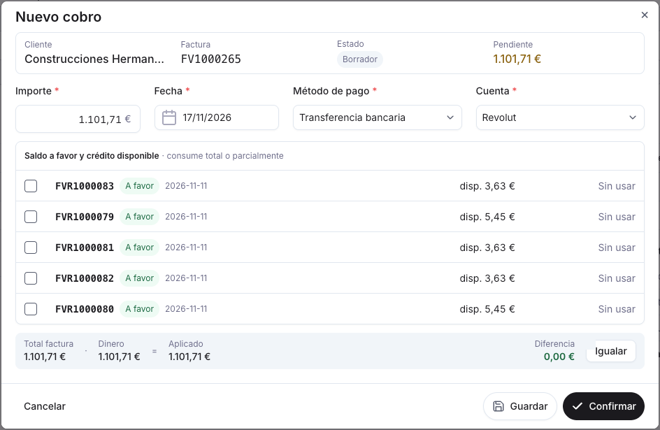
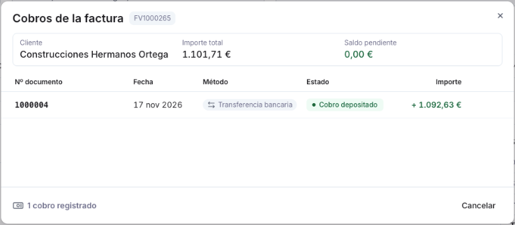
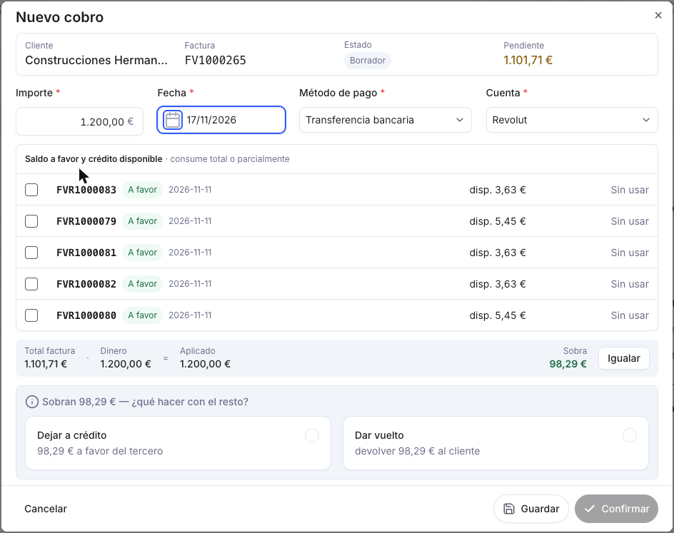
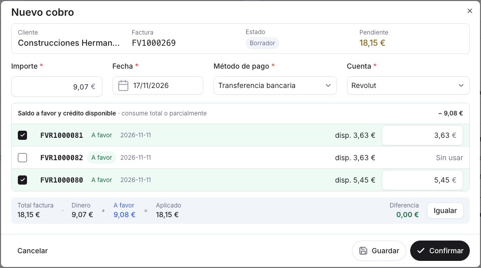

# Añadir cobros a tu factura de venta

Cuando un cliente te paga una factura, registras ese dinero como un cobro. Puedes registrar el total de una vez o ir anotando cobros parciales hasta cubrirla. Para poder cobrarla, la factura tiene que estar en estado **Completado** (ver [Crear una factura de venta](../crear-una-factura-de-venta/crear-una-factura-de-venta.md)).

## Registrar un cobro

1. Abre la factura desde **[Ventas > Factura](https://app.etendo.ai/sales-invoice){target="_blank"}**. Tienes dos formas de llegar al cobro:

    - Desde la **vista detalle**, con el botón **Añadir cobro** del panel derecho o con el enlace **Añadir cobro** de la sección **COBROS**.
    - Desde el **formulario**, con el enlace **Ver →** del indicador de cobro de la barra superior. Se abre la ventana **Cobros de la factura**, con el historial y el botón **+ Añadir cobro**.

2. Se abre la ventana **Nuevo cobro**:

    <figure markdown="span">
      
      <figcaption>La ventana Nuevo cobro, con el importe pendiente ya propuesto y el resumen del cobro al pie.</figcaption>
    </figure>

    Arriba tienes de referencia el **Cliente**, el número de **Factura** y el importe **Pendiente**. El **Estado** que aparece ahí es el del cobro que estás creando, no el de la factura.

3. Completa los datos del cobro:

    - **Importe** — lo que has recibido. Viene propuesto con el total pendiente de la factura.
    - **Fecha** — cuándo lo has recibido. Viene con la fecha de hoy.
    - **Método de pago** — cómo te ha pagado el cliente. Viene con el método del contacto y puedes cambiarlo.
    - **Cuenta** — dónde entra el dinero: una cuenta bancaria, la caja o una tarjeta. También viene del contacto y puedes cambiarla.

4. Revisa el resumen del pie, que acompaña al cobro en todo momento. Compara el **Total factura** con lo que vas a aplicar: el **Dinero** que estás registrando, el saldo **A favor** si aplicas alguno, y la suma de ambos como **Aplicado**. A la derecha, la **Diferencia** entre el total y lo aplicado:

    - **Falta X €** — lo aplicado no cubre el total. La factura queda con ese importe pendiente.
    - **Diferencia 0,00 €** — coinciden y la factura queda cobrada.
    - **Sobra X €** — lo aplicado supera el total (ver [Si el cliente paga de más](#si-el-cliente-paga-de-mas)).

    El botón **Igualar** ajusta el **Importe** para que la diferencia quede en cero, incluso si ya estás combinando dinero con saldo a favor.

    Si cobras de menos, aparece además la opción **Ajustar diferencia**, desactivada por defecto. Déjala así y la factura queda con ese importe pendiente, que podrás cobrar más adelante. Actívala solo para diferencias de céntimos por redondeo: la factura se da por cobrada y la diferencia se lleva a tu contabilidad. No la uses para perdonar un saldo real.

5. Haz clic en **Confirmar** para registrar el cobro, o en **Guardar** si prefieres dejarlo preparado y confirmarlo más tarde. La factura descuenta el importe y la ventana **Cobros de la factura** muestra el movimiento:

    <figure markdown="span">
      
      <figcaption>Con el cobro registrado, el saldo pendiente queda en cero y el movimiento aparece en el historial.</figcaption>
    </figure>

    Cada cobro aparece con su **Nº documento**, **Fecha**, **Método**, **Estado** e **Importe**. En la vista detalle lo ves igual, en la sección **COBROS**.

!!! info "Cobros parciales"
    Puedes registrar tantos cobros como necesites hasta cubrir la factura. El indicador de la barra superior se actualiza con cada uno: aparece como **Pendiente** mientras quede saldo, como **Vencido** si pasa la fecha de vencimiento sin cobrarse del todo, y como **Pagado** cuando ya no queda nada por cobrar.

## Si el cliente paga de más

Cuando lo aplicado supera el total de la factura, la ventana avisa **Sobran X € — ¿qué hacer con el resto?** y te pide que elijas qué hacer con la diferencia. Hasta que elijas una opción no puedes confirmar el cobro:

<figure markdown="span">
  
  <figcaption>Con un cobro de más, hay que elegir entre dejar el sobrante a crédito o devolverlo antes de confirmar.</figcaption>
</figure>

- **Dejar a crédito** — el sobrante queda a favor del cliente y lo podrás aplicar a una factura suya más adelante.
- **Dar vuelto** — le devuelves el sobrante. El cobro se registra por el total exacto de la factura y no genera crédito.

En los dos casos la factura queda cobrada por completo.

## Aplicar saldo a favor o crédito disponible

Un cliente puede tener dinero a su favor por dos motivos: una **factura rectificativa** a su favor, por una devolución o un ajuste, o un **crédito** de una vez que pagó de más y elegiste **Dejar a crédito**. Cuando lo tiene, la ventana **Nuevo cobro** muestra la sección **Saldo a favor y crédito disponible**, y puedes consumirlo entero o en parte:

<figure markdown="span">
  
  <figcaption>Al marcar dos saldos a favor, el importe en dinero baja y la suma sigue cubriendo el total.</figcaption>
</figure>

- Al marcar una línea, su importe se aplica a la factura y el **Importe** en dinero baja en esa misma cantidad. Si el saldo cubre la factura entera, el importe queda en cero.
- El importe de cada línea pasa a ser un campo que puedes cambiar, por si solo quieres consumir una parte. La cabecera de la sección muestra el total que estás aplicando.
- Puedes combinar varias líneas con un cobro en dinero y usar **Igualar** para cuadrar la diferencia.

Una rectificativa que consumes del todo deja de aparecer como disponible y pasa a mostrarse como **Aplicada** en la lista de facturas.

!!! info "En el historial solo aparece el dinero"
    El saldo a favor y el crédito que apliques no se registran como un cobro aparte: descuentan del pendiente, pero en el historial de la factura solo verás el movimiento de dinero real. Por eso el importe del cobro puede ser menor que el total de la factura aunque quede saldada.

## Artículos Relacionados

- [Crear una factura de venta](../crear-una-factura-de-venta/crear-una-factura-de-venta.md)
- [Gestionar tus facturas de venta](../gestionar-tus-facturas-de-venta/gestionar-tus-facturas-de-venta.md)
- [Crear una factura rectificativa](../crear-una-factura-rectificativa/crear-una-factura-rectificativa.md)

---
Esta obra está bajo la licencia :material-creative-commons: :fontawesome-brands-creative-commons-by: :fontawesome-brands-creative-commons-sa: [CC BY-SA 2.5 ES](https://creativecommons.org/licenses/by-sa/2.5/es/){target="_blank"} de [Futit Services S.L](https://etendo.software){target="_blank"}.
