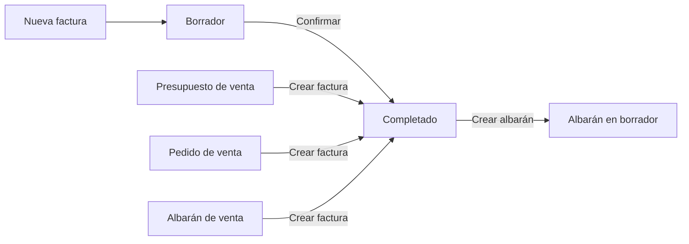
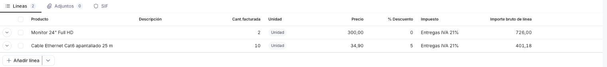
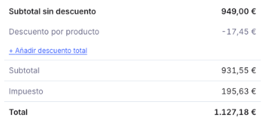
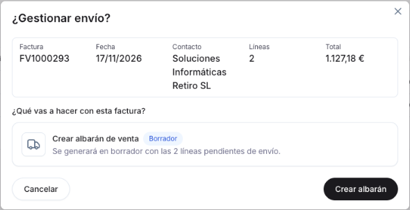

# Crear una factura de venta

La **factura de venta** es el documento fiscal que formaliza el cobro al cliente. Puedes crearla directamente, o generarla desde un [presupuesto de venta](../crear-y-gestionar-presupuestos/crear-y-gestionar-presupuestos.md) aceptado, un [pedido de venta](../crear-y-gestionar-pedidos/crear-y-gestionar-pedidos.md) confirmado o un [albarán](../crear-y-gestionar-albaranes/crear-y-gestionar-albaranes.md) completado, sin volver a escribir los datos. En estos tres casos, Etendo crea la factura ya confirmada, con el cliente, las condiciones y las cantidades del presupuesto, del pedido o del albarán del que sale. Este artículo repasa los **Pasos** para crearla directamente desde cero; para las otras vías, consulta el artículo del presupuesto, del pedido o del albarán.

## Pasos

1. Accede a la ventana **[Ventas > Factura](https://app.etendo.ai/sales-invoice){target="_blank"}** y haz clic en **+ Nueva factura**. Se abre el formulario en blanco.

2. Completa la **cabecera** con el cliente y las condiciones de la venta:

    <figure markdown="span">
      
      <figcaption>Formulario de la Factura de Venta en Borrador, con la cabecera, las líneas y los totales.</figcaption>
    </figure>

    - **Contacto** *(obligatorio)* — el cliente al que le facturas. Al elegirlo, la **Dirección**, la **Tarifa**, el **Método de pago** y las **Condiciones de pago** se completan solos con los datos de su ficha. Puedes cambiarlos solo para esta factura.
    - **Tipo de documento** *(obligatorio)* — por defecto, **Factura**. Elige **Factura rectificativa** solo para corregir una factura ya emitida (ver [Crear una factura rectificativa](../crear-una-factura-rectificativa/crear-una-factura-rectificativa.md)). Una vez guardada, no se puede cambiar.
    - **Fecha de la factura** *(obligatorio)* — el día en que la emites. Por defecto, la fecha de hoy.
    - **Fecha contable** *(obligatorio)* — el día con el que la factura entra en tu contabilidad. Puede ser distinta de la fecha de la factura.
    - **Moneda** *(obligatorio)* — la moneda en la que facturas. Por defecto, la de tu empresa.
    - **Tarifa** *(obligatorio)* — la lista de precios con la que se calculan los precios. Está en **Mostrar más datos**, con el **Nº documento**, que Etendo asigna al guardar, y el **Proyecto** y el **Centro de costos**, opcionales.

    !!! info "Para tu asesor"
        La **Fecha contable** decide en qué periodo contable queda registrada la factura. Si no te indican otra cosa, déjala igual que la **Fecha de la factura**. **Proyecto** y **Centro de costos** son dimensiones analíticas, y puedes indicarlas también en cada línea, con **Editar dimensiones**.

3. Añade las **líneas** con los productos o servicios que facturas:

    <figure markdown="span">
      
      <figcaption>Pestaña Líneas con los productos facturados y sus importes.</figcaption>
    </figure>

    Con la factura vacía tienes tres opciones: **+ Añadir líneas**, para escribirlas tú, e **Importar desde albarán** o **Importar desde pedido**, para traer las de un albarán o un pedido del mismo cliente. Cuando ya hay líneas, el botón pasa a **+ Añadir línea** y las dos opciones de importar quedan en su desplegable.

    - **Producto** — al elegirlo, la **Descripción** y el **Precio** se completan solos según la tarifa de la cabecera.
    - **Cant. facturada** y **Unidad** — cuántas unidades facturas y en qué unidad de medida.
    - **Precio**, **% Descuento** e **Impuesto** — los ajustas en cada línea.
    - **Importe bruto de línea** — se calcula solo: precio por cantidad, con el descuento aplicado y el impuesto incluido.

    Para guardar una línea, usa la tecla ++enter++; para descartarla, ++esc++. Al pasar el cursor sobre ella aparecen **Editar dimensiones**, **Editar línea** y **Eliminar**.

    !!! info "La factura se guarda al añadir la primera línea"
        Al hacer clic en **+ Añadir líneas**, Etendo guarda la factura como borrador y le asigna su número. Si después decides no seguir, puedes eliminarla con el icono de papelera.

    Junto a **Líneas** están **Adjuntos**, para guardar archivos con la factura, y **SIF**, con la configuración del envío de la factura a la administración tributaria (ver [Impuestos](../../../impuestos/que-puedes-hacer-en-impuestos/que-puedes-hacer-en-impuestos.md)).

4. Revisa los **totales** antes de confirmar:

    <figure markdown="span">
      
      <figcaption>Panel de totales con el desglose de descuentos, impuesto e importe final.</figcaption>
    </figure>

    - **Subtotal sin descuento** — precio por cantidad de todas las líneas, sin descuentos ni impuestos.
    - **Descuento por producto** — la suma de los descuentos de las líneas.
    - **Descuento total** — un descuento adicional sobre toda la factura. Se añade con el enlace **+ Añadir descuento total**.
    - **Subtotal** — el importe sin impuestos, con los descuentos ya aplicados.
    - **Impuesto** — el impuesto de todas las líneas.
    - **Total** — el importe final que paga el cliente.

    En **Notas** puedes añadir observaciones. Ese texto se imprime en el PDF, en el bloque **Observaciones**, así que el cliente también lo ve.

5. Haz clic en **Confirmar**. La factura pasa a **Completado** y se abre la ventana **¿Gestionar envío?**:

    <figure markdown="span">
      { width=420 }
      <figcaption>Ventana ¿Gestionar envío?, con la opción de crear el albarán de las líneas pendientes de envío.</figcaption>
    </figure>

    La ventana resume la factura — número, fecha, contacto, líneas y total — y te pregunta **¿Qué vas a hacer con esta factura?**. **Crear albarán de venta** genera el [albarán](../crear-y-gestionar-albaranes/crear-y-gestionar-albaranes.md) en **Borrador** con las líneas pendientes de envío:

    - Si vas a entregar la mercancía ahora, haz clic en **Crear albarán**.
    - Si prefieres entregarla más tarde, haz clic en **Cancelar**. La factura queda confirmada igual y creas el albarán cuando quieras con el botón **Gestionar envío** de la barra superior.

    !!! warning "La factura no se puede editar tras confirmar"
        Verifica los importes y el contacto antes de confirmar. Si necesitas corregirla igualmente, puedes reactivarla si todavía cumple las condiciones; si no, corrígela con una [factura rectificativa](../crear-una-factura-rectificativa/crear-una-factura-rectificativa.md). Ver [Gestionar tus facturas de venta](../gestionar-tus-facturas-de-venta/gestionar-tus-facturas-de-venta.md#acciones-disponibles).

Ya en **Completado**, la barra superior muestra el avance de la entrega, con la etiqueta **Entregado 0%**, y el cobro **Pendiente**, con el importe y el enlace **Ver →**. Para registrar el cobro, consulta [Añadir pagos a tu factura de venta](../anadir-pagos-a-tu-factura-de-venta/anadir-pagos-a-tu-factura-de-venta.md); para enviársela al cliente, [Enviar tus facturas por email](../enviar-tus-facturas-por-email/enviar-tus-facturas-por-email.md).

## Artículos Relacionados

- [Gestionar tus facturas de venta](../gestionar-tus-facturas-de-venta/gestionar-tus-facturas-de-venta.md)
- [Añadir pagos a tu factura de venta](../anadir-pagos-a-tu-factura-de-venta/anadir-pagos-a-tu-factura-de-venta.md)
- [Crear y gestionar albaranes](../crear-y-gestionar-albaranes/crear-y-gestionar-albaranes.md)

---
Esta obra está bajo la licencia :material-creative-commons: :fontawesome-brands-creative-commons-by: :fontawesome-brands-creative-commons-sa: [CC BY-SA 2.5 ES](https://creativecommons.org/licenses/by-sa/2.5/es/){target="_blank"} de [Futit Services S.L](https://etendo.software){target="_blank"}.
