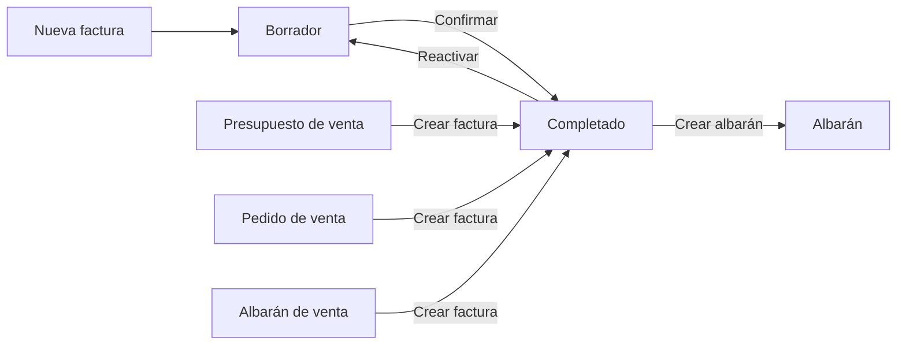
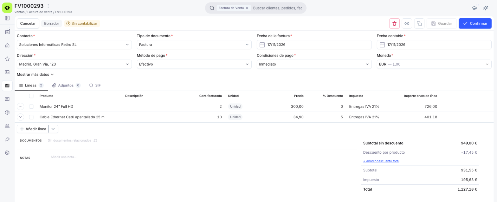
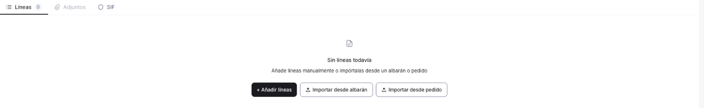

# Crear una factura de venta

La **factura de venta** es el documento fiscal con el que formalizas la venta y dejas constancia de lo que el cliente te debe. Puedes crearla directamente, o generarla desde un [presupuesto de venta](../crear-y-gestionar-presupuestos/crear-y-gestionar-presupuestos.md) aceptado, un [pedido de venta](../crear-y-gestionar-pedidos/crear-y-gestionar-pedidos.md) confirmado o un [albarán](../crear-y-gestionar-albaranes/crear-y-gestionar-albaranes.md) completado, sin volver a escribir los datos. Este artículo repasa los pasos para crearla desde cero. Para las otras vías, consulta el artículo del presupuesto, del pedido o del albarán.

**Antes de empezar**, necesitas tener registrados:

- El [contacto](../../contactos/como-crear-un-contacto/como-crear-un-contacto.md) del cliente, con su dirección.
- Los [productos o servicios](../../../operaciones/inventario/productos/crear-un-producto/crear-un-producto.md) que vas a facturar.
- La [tarifa](../../../operaciones/inventario/productos/gestionar-tarifas-de-producto/gestionar-tarifas-de-producto.md) con la que se calculan sus precios.

---

## Crear la factura

<figure markdown="span">
  
  <figcaption>Formulario de la Factura de Venta en Borrador, con la cabecera, las líneas y los totales.</figcaption>
</figure>

1. Accede a la ventana **[Ventas > Factura](https://app.etendo.ai/sales-invoice){target="_blank"}** y haz clic en **+ Nueva factura**, en la esquina superior derecha.

2. Completa la cabecera con el cliente y las condiciones de la venta:

    - **Contacto** *(obligatorio)* — el cliente al que le facturas. Al elegirlo, la **Dirección**, la **Tarifa**, el **Método de pago** y las **Condiciones de pago** se completan con los datos de su ficha, y puedes cambiarlos solo para esta factura.
    - **Tipo de documento** *(obligatorio)* — por defecto, **Factura**. Para corregir una factura ya emitida, elige **Factura rectificativa** (ver [Crear una factura rectificativa](../crear-una-factura-rectificativa/crear-una-factura-rectificativa.md)). Una vez guardada, no se puede cambiar.
    - **Fecha de la factura** *(obligatorio)* — el día en que la emites. Por defecto, hoy.
    - **Fecha contable** *(obligatorio)* — el día con el que la factura entra en tu contabilidad. Puede ser distinta de la fecha de la factura.
    - **Moneda** *(obligatorio)* — por defecto, la de tu empresa.
    - **Tarifa** *(obligatorio)* — la lista de precios con la que se calculan los precios. La ves al hacer clic en **Mostrar más datos**, debajo de la cabecera.
    - **Nº documento**, **Proyecto** y **Centro de costos** — también en **Mostrar más datos**. Etendo asigna el **Nº documento** al guardar. **Proyecto** y **Centro de costos** son opcionales y te sirven para analizar tus ventas.

!!! info "Para tu asesor"
    La **Fecha contable** decide en qué periodo contable queda registrada la factura. Si no te indican otra cosa, déjala igual que la **Fecha de la factura**. **Proyecto** y **Centro de costos** son dimensiones analíticas y puedes indicarlas también en cada línea, con **Editar dimensiones**.

## Añadir las líneas

<figure markdown="span">
  
  <figcaption>Pestaña Líneas de una factura nueva, con las tres formas de añadir líneas.</figcaption>
</figure>

Con la factura vacía tienes tres formas de añadir los productos o servicios que facturas: **+ Añadir líneas**, para escribirlos tú, e **Importar desde albarán** o **Importar desde pedido**, para traer las líneas de un albarán o un pedido del mismo cliente. Cuando ya hay líneas, el botón pasa a **+ Añadir línea**, con las dos opciones de importar en su desplegable.

<figure markdown="span">
  
  <figcaption>Pestaña Líneas con los productos facturados y sus importes.</figcaption>
</figure>

- **Producto** — al elegirlo, la **Descripción** y el **Precio** se completan solos según la tarifa de la cabecera.
- **Cant. facturada** y **Unidad** — cuántas unidades facturas y en qué unidad de medida.
- **Precio** — lo que le cobras por unidad. Viene de la tarifa y puedes cambiarlo para esta venta.
- **% Descuento** e **Impuesto** — la rebaja que le haces en esa línea y el impuesto que se le aplica.
- **Importe bruto de línea** — se calcula solo: precio por cantidad, con el descuento aplicado y el impuesto incluido.

Para guardar una fila, usa ++enter++ o haz clic fuera de ella. Para descartarla, ++esc++. Con el cursor sobre una línea tienes **Editar dimensiones**, **Editar línea** y **Eliminar**.

!!! info "La factura se guarda al añadir la primera línea"
    Al hacer clic en **+ Añadir líneas**, Etendo guarda la factura como borrador y le asigna su número. Si no quieres seguir, elimínala con el icono de papelera.

Junto a **Líneas** están **Adjuntos**, para guardar archivos, y **SIF**, con la configuración del envío de la factura a la administración tributaria (ver [SIF](../../../impuestos/glosario-de-impuestos/glosario-de-impuestos.md#sif)).

### Totales y notas

<figure markdown="span">
  
  <figcaption>Panel de totales con el desglose de descuentos, impuesto e importe final.</figcaption>
</figure>

- **Subtotal sin descuento** — precio por cantidad de todas las líneas, sin descuentos ni impuestos.
- **Descuento por producto** — la suma de los descuentos de las líneas.
- **Descuento total** — un descuento adicional sobre toda la factura. El enlace **+ Añadir descuento total** activa la fila donde indicas el porcentaje.
- **Subtotal**, **Impuesto** y **Total** — el importe sin impuestos con los descuentos ya aplicados, el impuesto de todas las líneas y el importe final que paga el cliente.

En **Notas** puedes añadir observaciones. Ese texto se imprime en el PDF, en el bloque **Observaciones**, así que el cliente lo ve.

## Confirmar la factura

<figure markdown="span">
  { width=420 }
  <figcaption>Ventana ¿Gestionar envío?, con el resumen de la factura y la opción de crear el albarán de las líneas pendientes de envío.</figcaption>
</figure>

Cuando los importes y el contacto sean correctos, haz clic en **Confirmar**. La factura pasa a **Completado** y se abre la ventana **¿Gestionar envío?**. Su opción **Crear albarán de venta** genera el [albarán](../crear-y-gestionar-albaranes/crear-y-gestionar-albaranes.md) en **Borrador** con las líneas pendientes de envío.

- Si entregas la mercancía ahora, haz clic en **Crear albarán**.
- Si la entregas más tarde, haz clic en **Cancelar**. La factura queda confirmada igual y creas el albarán cuando quieras con **Gestionar envío**, en la barra superior.

--8<-- "overrides/snippets/factura-de-venta-no-editable.md"

    Tienes el detalle de **Reactivar** en [Gestionar tus facturas de venta](../gestionar-tus-facturas-de-venta/gestionar-tus-facturas-de-venta.md#acciones-disponibles) y las formas de corregirla en [Crear una factura rectificativa](../crear-una-factura-rectificativa/crear-una-factura-rectificativa.md).

Con la factura confirmada, ya puedes [registrar el cobro](../anadir-cobros-a-tu-factura-de-venta/anadir-cobros-a-tu-factura-de-venta.md) y [enviársela al cliente](../enviar-documentos-por-email/enviar-documentos-por-email.md).

## Artículos Relacionados

- [Gestionar tus facturas de venta](../gestionar-tus-facturas-de-venta/gestionar-tus-facturas-de-venta.md)
- [Añadir cobros a tu factura de venta](../anadir-cobros-a-tu-factura-de-venta/anadir-cobros-a-tu-factura-de-venta.md)
- [Crear y gestionar albaranes](../crear-y-gestionar-albaranes/crear-y-gestionar-albaranes.md)

---
Esta obra está bajo la licencia :material-creative-commons: :fontawesome-brands-creative-commons-by: :fontawesome-brands-creative-commons-sa: [CC BY-SA 2.5 ES](https://creativecommons.org/licenses/by-sa/2.5/es/){target="_blank"} de [Futit Services S.L](https://etendo.software){target="_blank"}.
