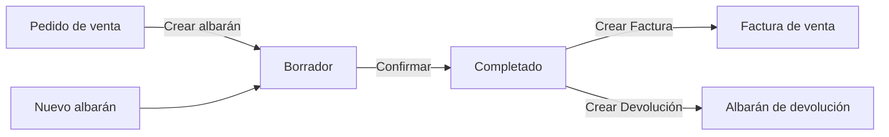
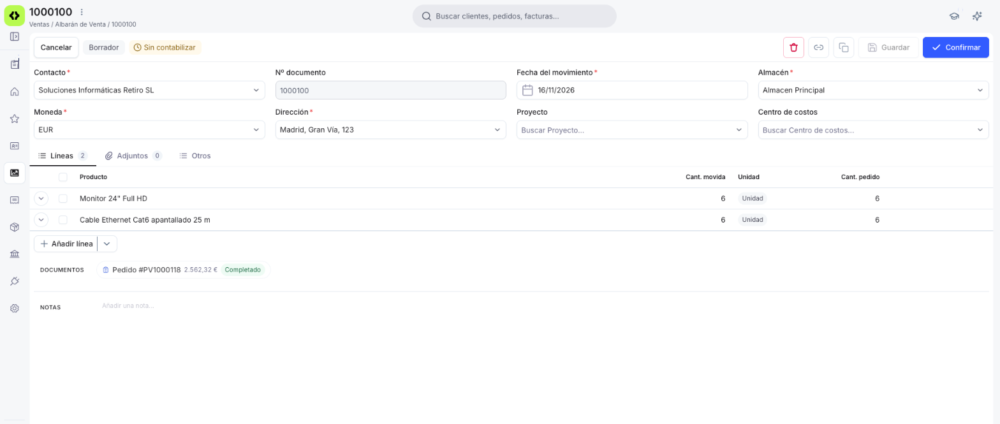
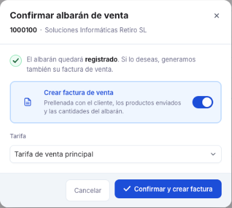
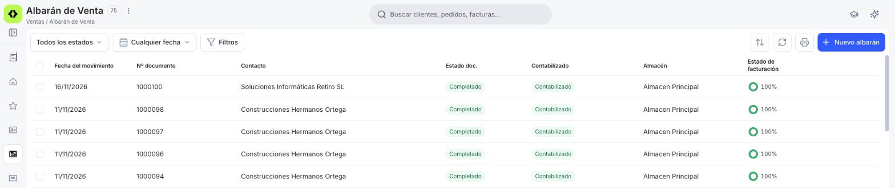
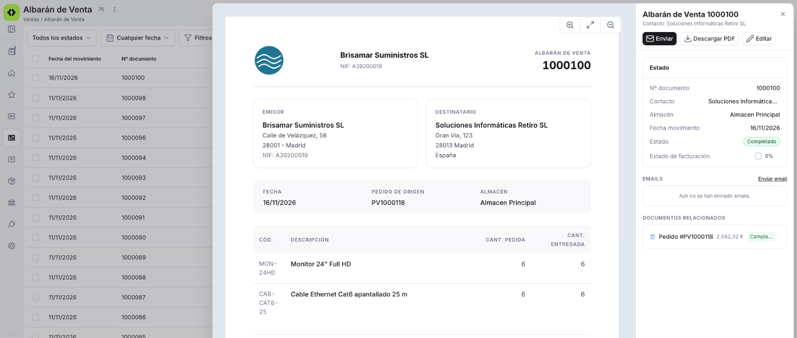
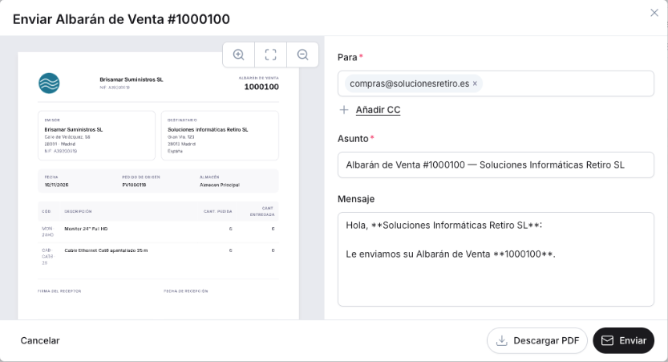
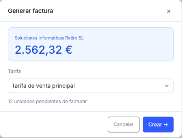

# Crear y gestionar albaranes

## Descripción general

El **albarán de venta** es el documento que acompaña la entrega de la mercancía a tu cliente. Te sirve para dejar constancia de qué le entregaste, en qué cantidad y desde qué almacén, y para que el cliente firme al recibirla. Al confirmarlo, la mercancía sale de tu almacén.

Lo normal es crearlo desde un [pedido de venta](../crear-y-gestionar-pedidos/crear-y-gestionar-pedidos.md), sin volver a escribir los datos, aunque también puedes crearlo desde cero. Una vez confirmado, el albarán da lugar a la [factura de venta](../crear-una-factura-de-venta/crear-una-factura-de-venta.md) y, si el cliente te devuelve algo, al albarán de devolución.

El siguiente diagrama muestra las dos formas de crear un albarán, sus estados y los documentos que puedes generar desde él:

Este artículo explica primero cómo **crear un albarán** y después cómo **gestionarlo**.

---

## Crear un albarán

### 1. Empieza un albarán nuevo

Si la entrega corresponde a un pedido de venta, crea el albarán desde ese pedido. Tienes dos momentos para hacerlo:

- **Al confirmar el pedido** — en la ventana **Confirmar pedido**, marca **Crear albarán**.
- **Más tarde** — en el pedido **Completado**, haz clic en **Gestionar envío y factura**, marca **Crear albarán** y haz clic en **Crear →** (ver [Crear y gestionar pedidos](../crear-y-gestionar-pedidos/crear-y-gestionar-pedidos.md)).

Se abre la ventana **Albarán creado**, con el aviso «Se ha generado un documento». Haz clic en **Ver albarán** para revisarlo o en **Cerrar** para seguir en el pedido. El albarán se crea en **Borrador**.

Para crear un albarán sin pedido, accede a **[Ventas > Albarán](https://app.etendo.ai/goods-shipment){target="_blank"}** y haz clic en **+ Nuevo albarán**, en la esquina superior derecha. Se abre el formulario en blanco.

!!! info "Qué datos pasan del pedido al albarán"
    El cliente, la dirección, el almacén y las líneas con sus cantidades. La nota del pedido no pasa al albarán. Si el pedido ya tiene parte de la mercancía entregada, el albarán solo propone las unidades que quedan pendientes.

### 2. Completa el formulario

<figure markdown="span">
  
  <figcaption>Formulario del Albarán de Venta en Borrador, creado a partir de un pedido de venta.</figcaption>
</figure>

**Cabecera**

- **Contacto** *(obligatorio)* — el cliente que recibe la mercancía. Si el albarán sale de un pedido, ya viene completado.
- **Nº documento** — Etendo le asigna el número al guardar el albarán.
- **Fecha del movimiento** *(obligatorio)* — el día en que entregas la mercancía. Por defecto, la fecha de hoy.
- **Almacén** *(obligatorio)* — el almacén del que sale la mercancía.
- **Moneda** *(obligatorio)* — por defecto, la moneda de tu empresa.
- **Dirección** *(obligatorio)* — la dirección de entrega. Viene de la ficha del cliente o del pedido. Puedes cambiarla solo para este albarán, por ejemplo si el cliente tiene varias direcciones de entrega.
- **Proyecto** y **Centro de costos** — opcionales. Te sirven para analizar tus ventas y tus costes por proyecto o por área de tu negocio.

**Pestaña Líneas**

Las líneas son los productos que entregas. Cada línea muestra:

- **Producto** — el producto que entregas.
- **Cant. movida** — cuántas unidades entregas con este albarán.
- **Unidad** — la unidad de medida del producto.
- **Cant. pedido** — cuántas unidades tenía el pedido, como referencia. Si el albarán no sale de un pedido, queda vacía.

Para añadir líneas, haz clic en **+ Añadir línea**. Con la flecha de ese botón puedes elegir **Añadir desde pedido** o **Añadir desde Factura**, para traer las líneas de un pedido o de una factura del mismo cliente.

Al pasar el cursor sobre una línea aparecen tres iconos: **Editar dimensiones**, **Editar línea** y **Eliminar**. Con la flecha **Expandir**, a la izquierda de la línea, ves el **Proyecto** y el **Centro de costos** de esa línea.

!!! tip "Si solo entregas una parte"
    Antes de confirmar, quita las líneas que no entregas con el icono **Eliminar** de la línea. Etendo te pide confirmación, porque no se puede deshacer. Lo que quites queda pendiente de entrega en el pedido.

Los servicios del pedido también pueden ir en el albarán. Así dejas constancia de que el servicio se hizo, aunque no salga mercancía del almacén.

**Documentos, notas, adjuntos y otros datos**

- **Documentos** — muestra el pedido del que sale el albarán, con su importe y su estado. Haz clic en él para abrirlo.
- **Notas** — para añadir observaciones sobre la entrega.
- Pestaña **Adjuntos** — para guardar archivos junto al albarán.
- Pestaña **Otros** — te dice si el albarán ya está registrado en tu contabilidad.

!!! info "Para tu asesor"
    - **Proyecto** y **Centro de costos** son dimensiones analíticas. Se pueden indicar en la cabecera o en cada línea, con **Editar dimensiones**.
    - La pestaña **Otros** muestra el **Estado contable** del albarán, con el mismo valor que la columna **Contabilizado** de la lista: **Sin contabilizar** mientras no se haya registrado en la contabilidad y **Contabilizado** una vez registrado.

### 3. Confirma el albarán

<figure markdown="span">
  { width=420 }
  <figcaption>Ventana de confirmación del Albarán de venta con la opción de crear la factura de venta.</figcaption>
</figure>

Cuando hayas revisado las líneas, haz clic en **Confirmar**. Se abre la ventana **Confirmar albarán de venta**, con el número del albarán y el cliente.

El interruptor **Crear factura de venta** viene activado. Así, en el mismo paso creas la factura con el cliente, los productos enviados y las cantidades del albarán:

- **Si quieres la factura ahora** — deja el interruptor activado, elige la **Tarifa** con la que se calculan los precios y haz clic en **Confirmar y crear factura**.
- **Si prefieres facturar más tarde** — desactiva el interruptor y haz clic en **Confirmar albarán**. Puedes crear la factura después (ver [Genera la factura pendiente](#4-genera-la-factura-pendiente)).

El albarán pasa a **Completado** y la mercancía sale del almacén.

!!! warning "Si no tienes stock suficiente"
    Si falta stock de algún producto, la ventana muestra el aviso «No hay suficiente en stock», con la línea y el producto, y el albarán no se confirma. Registra primero la entrada de esa mercancía, por ejemplo con un [albarán de compra](../../../operaciones/compras/crear-y-gestionar-albaranes-de-compra/crear-y-gestionar-albaranes-de-compra.md), y vuelve a confirmar.

---

## Gestionar albaranes

Cuando el albarán ya está confirmado, esta parte te muestra cómo encontrarlo, enviarlo y facturarlo.

### 1. Busca el albarán

<figure markdown="span">
  
  <figcaption>Vista lista del Albarán de Venta con las columnas de estado, contabilidad y facturación.</figcaption>
</figure>

La vista lista muestra todos tus albaranes con las columnas **Fecha del movimiento**, **Nº documento**, **Contacto**, **Estado doc.** (ver [Estados del Documento](#estados-del-documento)), **Contabilizado**, **Almacén** y **Estado de facturación**.

**Estado de facturación** te dice qué parte del albarán ya facturaste. Muestra un indicador circular con el porcentaje: verde y completo al 100 %, gris y vacío al 0 %.

Para encontrar un albarán, tienes estas opciones:

- **Filtrar por estado** — el selector **Todos los estados** de la barra superior.
- **Filtrar por fecha** — el selector **Cualquier fecha**.
- **Filtros** — para añadir más criterios de búsqueda.

Junto a **+ Nuevo albarán** tienes botones para ordenar, actualizar e imprimir la lista.

Al pasar el cursor sobre una fila aparecen accesos rápidos para trabajar con ese albarán sin abrirlo: **Editar**, **Clonar**, **Enviar / Descargar**, **Más acciones** y **Eliminar**.

!!! info "Para tu asesor"
    La columna **Contabilizado** muestra si el albarán ya está registrado en tu contabilidad: **Contabilizado** cuando lo está y **Sin contabilizar** mientras no lo esté. Para registrarlo, usa la acción **Contabilizar** (ver [Acciones Disponibles](#acciones-disponibles)).

### 2. Abre el albarán

<figure markdown="span">
  
  <figcaption>Vista detalle con la previsualización del PDF y el panel lateral de información clave.</figcaption>
</figure>

Haz clic en un albarán de la lista para abrir la vista detalle. En el centro ves el PDF del albarán, con botones para acercarlo, alejarlo o verlo a pantalla completa.

El PDF muestra tus datos y los del cliente, la fecha, el pedido del que sale, el almacén y cada producto en dos columnas: **Cant. pedida**, lo que el cliente pidió, y **Cant. entregada**, lo que le entregas con este albarán. Al pie tiene espacio para la **Firma del receptor** y la **Fecha de recepción**, para que el cliente firme al recibir la mercancía. No lleva precios.

En el panel derecho, la sección **Estado** muestra el **Nº documento**, el **Contacto**, el **Almacén**, la **Fecha movimiento**, el **Estado** y el **Estado de facturación**. Desde este panel puedes:

- **Enviar** — abre el panel de envío por email al cliente.
- **Descargar PDF** — descarga el albarán en PDF.
- **Editar** — abre el formulario completo.

Debajo, el panel tiene dos secciones:

- **Emails** — los correos que le enviaste al cliente. Desde el enlace **Enviar email** puedes mandar uno nuevo.
- **Documentos relacionados** — el pedido del que sale el albarán, con su importe y su estado.

### 3. Envía o imprime el albarán

<figure markdown="span">
  
  <figcaption>Panel de envío por email del Albarán de venta.</figcaption>
</figure>

Con el albarán **Completado**, tienes tres formas de hacérselo llegar al cliente:

- **Envíalo por email** — haz clic en el icono **Enviar / Descargar** (con forma de sobre) de la barra superior, o en **Enviar** desde la vista detalle. Se abre el panel **Enviar Albarán de Venta**, con una vista previa del PDF a la izquierda.
    - **Para** ya viene con el correo del cliente, si su ficha lo tiene. Con **Añadir CC** puedes sumar destinatarios en copia.
    - **Asunto** ya viene completado con el número del albarán y el nombre del cliente.
    - **Mensaje** trae un saludo que puedes cambiar.

    Haz clic en **Enviar** para mandar el correo.
- **Descarga el PDF y envíalo por otro medio** — con el botón **Descargar PDF**.
- **Imprímelo y entrégalo con la mercancía** — usa el icono **Imprimir** de la barra superior.

En **Borrador** no están disponibles **Enviar / Descargar** ni **Imprimir**.

### 4. Genera la factura pendiente

<figure markdown="span">
  { width=420 }
  <figcaption>Ventana Generar factura, con la tarifa y las unidades pendientes de facturar.</figcaption>
</figure>

Si confirmaste el albarán sin crear la factura, créala desde el albarán **Completado**:

1. Haz clic en **Crear Factura**, en la barra superior. Se abre la ventana **Generar factura**, con el cliente y las unidades pendientes de facturar.
2. Elige la **Tarifa**. El albarán no tiene precios propios, así que la factura toma los precios de la tarifa que elijas.
3. Haz clic en **Crear →**.

Etendo crea la factura de venta ya confirmada, con las cantidades entregadas y los precios de esa tarifa. Cuando el albarán queda facturado al 100 %, la etiqueta pasa a **Facturado 100%** y **Crear Factura** deja de aparecer en la barra superior.

Si el cliente te devuelve mercancía, haz clic en **Crear Devolución**, en la barra superior. Ver [Crear y gestionar devoluciones](../crear-y-gestionar-devoluciones/crear-y-gestionar-devoluciones.md).

---

## Estados del Documento

El estado se muestra como una etiqueta junto al botón **Cancelar**, en la barra superior.

| Estado | Descripción |
|---|---|
| Borrador | En preparación. Puedes cambiar todos sus datos. Todavía no sale mercancía del almacén. |
| Completado | Confirmado. La mercancía ya salió del almacén. Puedes enviarlo, facturarlo y crear una devolución. |

!!! warning "Si necesitas corregir un albarán confirmado"
    En **Completado**, la mayoría de los datos ya no se pueden cambiar: cliente, fechas, almacén y líneas. Solo puedes elegir el **Proyecto** y el **Centro de costos**. Si necesitas deshacer la entrega, total o parcialmente, haz clic en **Crear Devolución**.

---

## Acciones Disponibles

<figure markdown="span">
  
  <figcaption>Barra de acciones del Albarán de venta en estado Completado.</figcaption>
</figure>

La barra superior del formulario muestra estas acciones:

| Acción | Descripción | Estado |
| :--- | :--- | :--- |
| **Cancelar** | Descarta los cambios sin guardar y vuelve a la lista. | Todos los estados |
| **Guardar** | Guarda el albarán sin cambiar su estado. | Solo en Borrador |
| **Confirmar** | Abre la ventana **Confirmar albarán de venta** y pasa el albarán a Completado (ver [Confirma el albarán](#3-confirma-el-albaran)). | Solo en Borrador |
| **Copiar enlace** | Copia el enlace directo a este albarán, para compartirlo con otra persona de tu equipo. | Todos los estados |
| **Clonar** | Crea un borrador nuevo con los mismos datos del albarán. | Todos los estados |
| **Enviar / Descargar** | Icono con forma de sobre. Abre el panel de envío por email, desde donde también puedes descargar el PDF. | Solo en Completado |
| **Imprimir** | Crea una copia para imprimir y entregar con la mercancía. | Solo en Completado |
| **Crear Factura** | Abre la ventana **Generar factura** y crea la factura de venta ya confirmada con lo entregado (ver [Genera la factura pendiente](#4-genera-la-factura-pendiente)). | Completado, mientras quede algo por facturar |
| **Crear Devolución** | Inicia la devolución de la mercancía entregada. Ver [Crear y gestionar devoluciones](../crear-y-gestionar-devoluciones/crear-y-gestionar-devoluciones.md). | Solo en Completado |
| **Contabilizar** | En el menú de tres puntos. Registra el albarán en tu contabilidad. Si tienes dudas, consúltalo con tu asesor. | Completado, sin contabilizar |
| **Papelera** | Elimina el albarán. Antes te pide confirmación. | Solo en Borrador |

## Artículos Relacionados

- [Crear y gestionar pedidos](../crear-y-gestionar-pedidos/crear-y-gestionar-pedidos.md)
- [Crear una factura de venta](../crear-una-factura-de-venta/crear-una-factura-de-venta.md)
- [Crear y gestionar devoluciones](../crear-y-gestionar-devoluciones/crear-y-gestionar-devoluciones.md)

---
Esta obra está bajo la licencia :material-creative-commons: :fontawesome-brands-creative-commons-by: :fontawesome-brands-creative-commons-sa: [CC BY-SA 2.5 ES](https://creativecommons.org/licenses/by-sa/2.5/es/){target="_blank"} de [Futit Services S.L](https://etendo.software){target="_blank"}.
