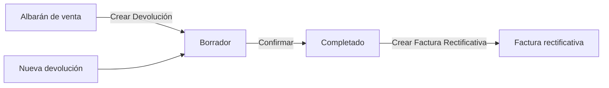
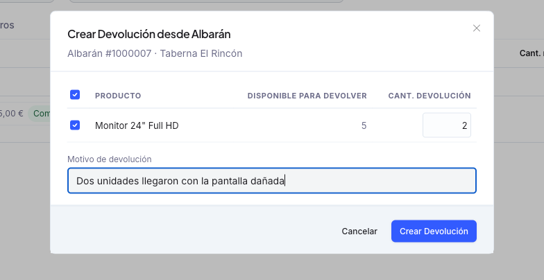
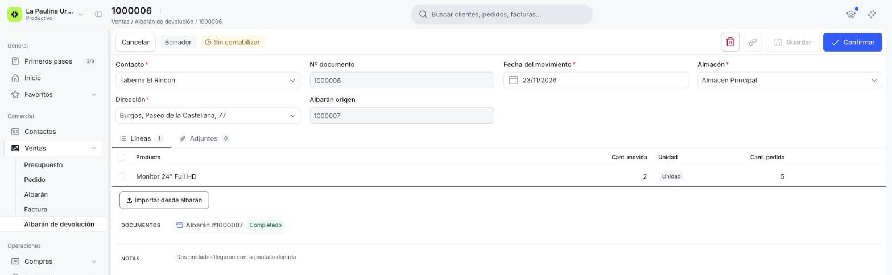
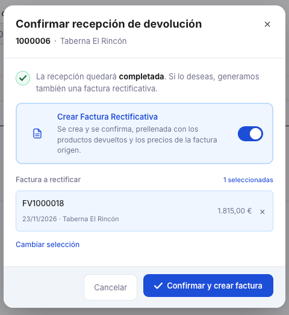
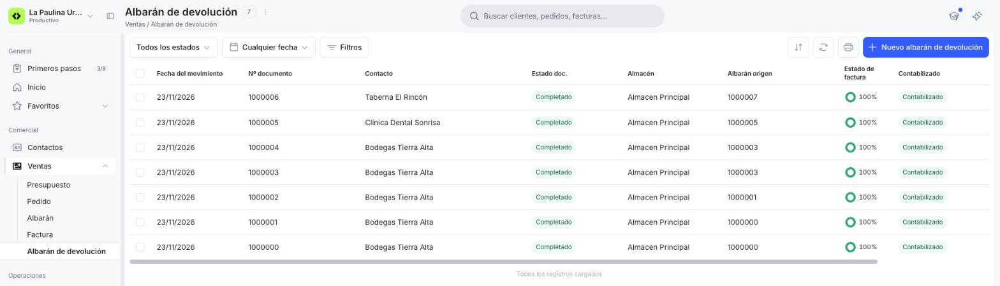
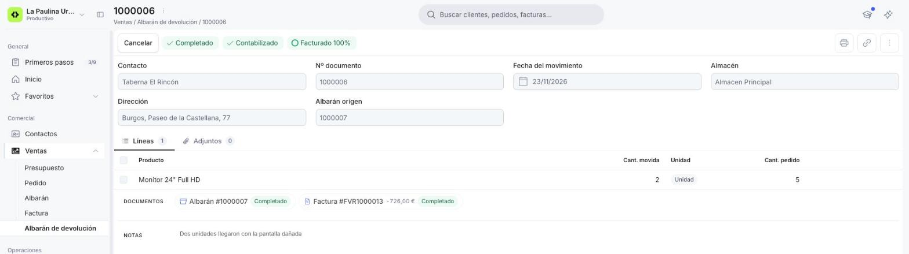
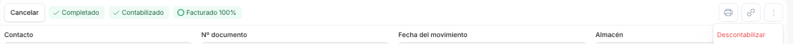

# Crear y gestionar devoluciones

## Descripción general

Cuando un cliente te devuelve mercancía, tienes que resolver dos cosas: que los productos vuelvan a tu almacén y que el cliente deje de deberte ese dinero. En Etendo cada una es un documento: el **albarán de devolución** registra la entrada de la mercancía, y la **factura rectificativa** corrige el importe.

Puedes generar los dos de una vez. Al confirmar el albarán de devolución, Etendo te ofrece crear también la rectificativa, y viene activado por defecto.

Abajo tienes primero cómo crear la devolución y después cómo gestionarla.

---

## Crear una devolución

### 1. Abre el albarán de la entrega

Parte del [albarán de venta](../crear-y-gestionar-albaranes/crear-y-gestionar-albaranes.md) con el que entregaste la mercancía. Ábrelo desde **[Ventas > Albarán](https://app.etendo.ai/goods-shipment){target="_blank"}**: tiene que estar en **Completado**.

!!! note "Si la entrega no está en Etendo"
    También puedes crear la devolución desde cero en **[Ventas > Albarán de devolución](https://app.etendo.ai/return-material-receipt){target="_blank"}** con **+ Nuevo albarán de devolución**. En ese caso eliges tú el cliente, la dirección, el almacén y las líneas, en vez de que vengan del albarán de venta. A partir de ahí el recorrido es el mismo: revisa el documento y confirma.

### 2. Indica qué te devuelven

<figure markdown="span">
  
  <figcaption>La ventana propone devolver todo lo entregado; aquí se han dejado 2 de las 5 unidades.</figcaption>
</figure>

Haz clic en **Crear Devolución**. Se abre la ventana **Crear Devolución desde Albarán** con los productos de ese albarán:

- **Casilla de cada línea** — desmarca los productos que el cliente no te devuelve.
- **Disponible para devolver** — cuánto queda sin devolver de esa entrega.
- **Cant. devolución** — viene con todo lo disponible. Cámbialo si solo te devuelven una parte.
- **Motivo de devolución** — opcional. Lo que escribas aquí queda guardado en las notas del documento.

Haz clic en **Crear Devolución**. Etendo crea el albarán de devolución en **Borrador** y te ofrece abrirlo.

### 3. Revisa el albarán de devolución

<figure markdown="span">
  
  <figcaption>El albarán de devolución en Borrador, con el albarán de origen y el motivo ya recogido en Notas.</figcaption>
</figure>

- **Contacto**, **Dirección** y **Almacén** — vienen del albarán de venta. El almacén es donde entra la mercancía devuelta.
- **Fecha del movimiento** — cuándo recibes la devolución.
- **Albarán origen** — la entrega de la que procede.
- **Líneas** — cada producto con la **Cant. movida**, que es lo que te devuelven, y la **Cant. pedido** de la entrega original.

Si el cliente te devuelve cosas de varios envíos a la vez, con **Importar desde albarán** traes las líneas de otra entrega suya al mismo documento.

En **Borrador** todavía no ha entrado nada en el almacén y puedes cambiar lo que necesites.

### 4. Confirma y genera la factura rectificativa

<figure markdown="span">
  { width=420 }
  <figcaption>Al confirmar, Etendo propone crear también la factura rectificativa y te muestra a qué factura se va a aplicar.</figcaption>
</figure>

Haz clic en **Confirmar**. Se abre la ventana **Confirmar recepción de devolución**, donde eliges entre dos caminos:

- **Con rectificativa** — deja activado el interruptor **Crear Factura Rectificativa**. En **Factura a rectificar**, Etendo ya ha elegido la factura de esa entrega; con **Cambiar selección** puedes usar otra. El botón es **Confirmar y crear factura**.
- **Solo la entrada de mercancía** — desactiva el interruptor. Desaparece la selección de factura y el botón pasa a ser **Confirmar**. La rectificativa la harás más tarde, por tu cuenta.

En los dos casos la mercancía entra en tu almacén y el albarán de devolución pasa a **Completado**. Si has elegido el primero, además se crea la factura rectificativa con los productos devueltos y los precios de la factura origen.

!!! warning "La rectificativa no pasa por borrador"
    Se crea ya confirmada. Repasa las cantidades y los precios **antes** de confirmar la devolución.

---

## Gestionar devoluciones

Cuando la devolución ya está confirmada, esta parte te muestra cómo encontrarla, imprimirla y comprobar que el importe quedó corregido.

### 1. Busca la devolución

<figure markdown="span">
  
  <figcaption>La lista de devoluciones, con el albarán de origen y el porcentaje ya rectificado de cada una.</figcaption>
</figure>

En **[Ventas > Albarán de devolución](https://app.etendo.ai/return-material-receipt){target="_blank"}** las tienes todas. Cada fila trae:

- **Nº documento**, **Contacto** y **Estado doc.**
- **Almacén** donde entró la mercancía y **Albarán origen** del que procede.
- **Estado de factura**, el porcentaje que ya está rectificado, y **Contabilizado**.

Arriba tienes los selectores de estado y fecha, y el botón **Filtros**.

!!! info "Para tu asesor"
    La columna **Contabilizado** muestra si la devolución ya está registrada en tu contabilidad: **Contabilizado** cuando lo está y **Sin contabilizar** mientras no lo esté. Al confirmarla se registra sola en unos segundos, así que no tienes que hacer nada. Si tu asesor necesita deshacer ese registro, lo hace con **Descontabilizar** (ver [Acciones Disponibles](#acciones-disponibles)).

### 2. Abre la devolución

<figure markdown="span">
  
  <figcaption>La devolución ya completada, con el albarán de origen y la factura rectificativa en Documentos.</figcaption>
</figure>

Haz clic en una fila para abrirla. Arriba verás el estado del documento, si está contabilizado y el indicador **Facturado**. Debajo, los datos del cliente y el **Albarán origen**, y en **Líneas** cada producto con la **Cant. movida**.

En **Documentos** tienes el albarán de origen y la factura rectificativa, con su importe en negativo. En **Notas**, el motivo que escribiste al crearla.

### 3. Imprime o comparte la devolución

Con **Imprimir** sacas el PDF del albarán de devolución. El PDF incluye un espacio para la **Firma del receptor** y la **Fecha de recepción**, por si quieres que el cliente te lo firme. Con el icono de enlace copias la dirección de esta devolución para pasársela a alguien de tu equipo.

Esta ventana no envía emails al cliente. Si necesitas mandarle algo, hazlo desde la factura rectificativa: ver [Enviar documentos por email](../enviar-documentos-por-email/enviar-documentos-por-email.md).

### 4. Comprueba que el importe está corregido

El indicador **Facturado** te dice qué parte de la devolución tiene ya su rectificativa. Si confirmaste sin generarla, créala desde [Crear una factura rectificativa](../crear-una-factura-rectificativa/crear-una-factura-rectificativa.md).

!!! info "El importe queda a favor del cliente"
    La rectificativa no descuenta sola de la factura original: deja un importe disponible para ese cliente, que aplicas tú al cobrar cualquier factura suya. Ver [Añadir cobros a tu factura de venta](../anadir-cobros-a-tu-factura-de-venta/anadir-cobros-a-tu-factura-de-venta.md#aplicar-saldo-a-favor-o-credito-disponible).

---

## Estados del Documento

El estado se muestra como una etiqueta junto al botón **Cancelar**, en la barra superior.

| Estado | Descripción |
|---|---|
| Borrador | En preparación. Todavía no ha entrado nada en el almacén y puedes cambiar las líneas. |
| Completado | La mercancía ha entrado en el almacén. |

!!! warning "Confirmar no se deshace"
    En **Completado** ya no puedes cambiar el cliente, el almacén ni las líneas. Repasa las cantidades mientras la devolución está en **Borrador**.

---

## Acciones Disponibles

Las acciones están en la barra superior del documento, y cambian según el estado.

<figure markdown="span">
  
  <figcaption>La barra de una devolución ya completada y contabilizada.</figcaption>
</figure>

| Acción | Descripción | Estado |
| :--- | :--- | :--- |
| **Cancelar** | Descarta los cambios sin guardar y vuelve a la lista. | Todos los estados |
| **Guardar** | Guarda los cambios sin confirmar. | Solo en Borrador |
| **Confirmar** | Registra la entrada en el almacén y, si lo dejas activado, crea la factura rectificativa (ver [Confirma y genera la factura rectificativa](#4-confirma-y-genera-la-factura-rectificativa)). | Solo en Borrador |
| **Importar desde albarán** | Trae líneas de otra entrega del mismo cliente (ver [Revisa el albarán de devolución](#3-revisa-el-albaran-de-devolucion)). | Solo en Borrador |
| **Copiar enlace** | Copia el enlace directo a esta devolución, para compartirlo con otra persona de tu equipo. | Todos los estados |
| **Imprimir** | Saca el PDF para imprimirlo o archivarlo (ver [Imprime o comparte la devolución](#3-imprime-o-comparte-la-devolucion)). | Solo en Completado |
| **Descontabilizar** | En el menú de tres puntos. Deshace el registro en tu contabilidad y devuelve la devolución a Sin contabilizar. Si tienes dudas, consúltalo con tu asesor. | Completado, contabilizado |
| **Papelera** | Elimina la devolución. Antes te pide confirmación. | Solo en Borrador |

## Artículos Relacionados

- [Crear y gestionar albaranes](../crear-y-gestionar-albaranes/crear-y-gestionar-albaranes.md)
- [Crear una factura rectificativa](../crear-una-factura-rectificativa/crear-una-factura-rectificativa.md)
- [Documentos de venta: preguntas frecuentes](../documentos-de-venta-preguntas-frecuentes/documentos-de-venta-preguntas-frecuentes.md)

---
Esta obra está bajo la licencia :material-creative-commons: :fontawesome-brands-creative-commons-by: :fontawesome-brands-creative-commons-sa: [CC BY-SA 2.5 ES](https://creativecommons.org/licenses/by-sa/2.5/es/){target="_blank"} de [Futit Services S.L](https://etendo.software){target="_blank"}.
