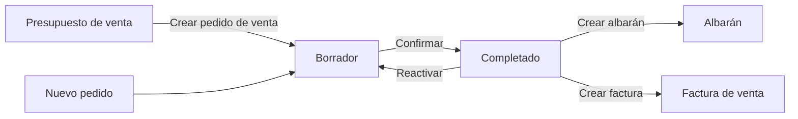
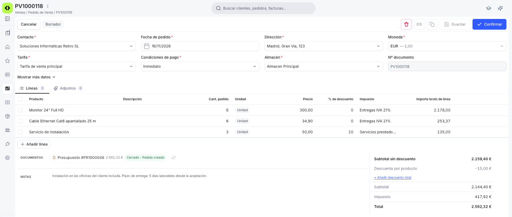
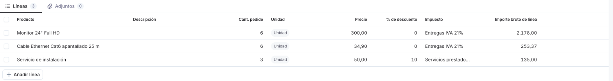
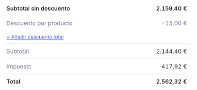
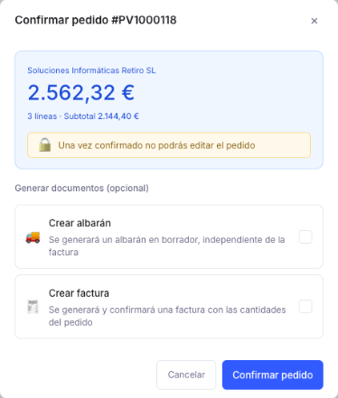
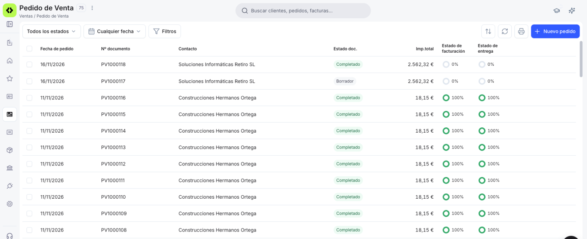
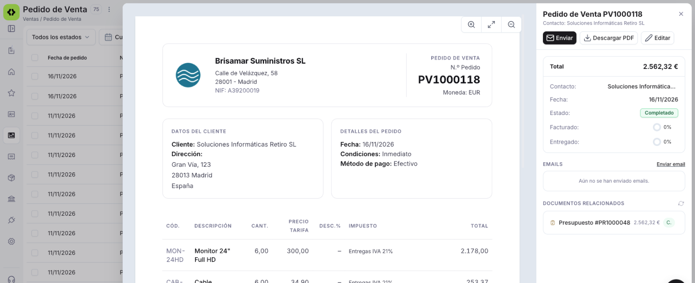
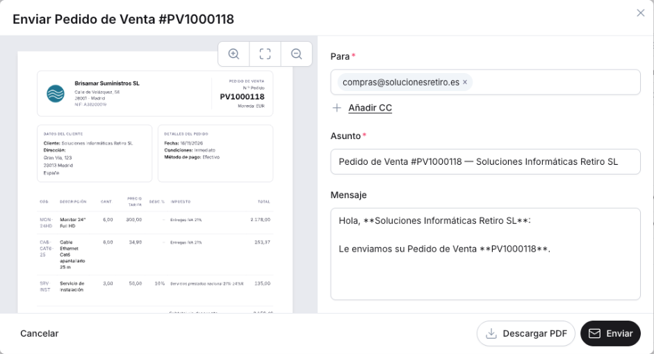
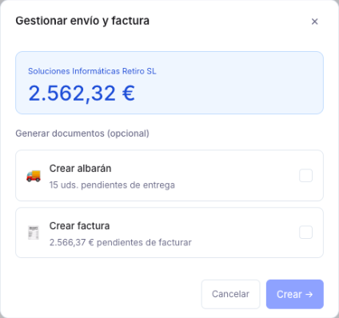

# Crear y gestionar pedidos

## Descripción general

El **pedido de venta** es el compromiso que asumes con tu cliente: qué productos le entregas, a qué precio y en qué condiciones de pago. Te sirve para saber qué te queda por entregar y por facturar en cada venta.

Puedes crearlo desde cero o a partir de un [presupuesto de venta](../crear-y-gestionar-presupuestos/crear-y-gestionar-presupuestos.md) que el cliente aceptó, sin volver a escribir los datos. Cuando lo confirmas, el pedido da lugar al [albarán](../crear-y-gestionar-albaranes/crear-y-gestionar-albaranes.md), que acompaña la entrega de la mercancía, y a la [factura de venta](../crear-una-factura-de-venta/crear-una-factura-de-venta.md).

El siguiente diagrama muestra las dos formas de crear un pedido, sus estados y los documentos que puedes generar desde él:

Este artículo explica primero cómo **crear un pedido** y después cómo **gestionarlo**.

---

## Crear un pedido

### 1. Empieza un pedido nuevo

Accede a **[Ventas > Pedido](https://app.etendo.ai/sales-order){target="_blank"}** y haz clic en **+ Nuevo pedido**, en la esquina superior derecha. Se abre el formulario en blanco.

Si el cliente aceptó un presupuesto, crea el pedido desde ese presupuesto. En el presupuesto, haz clic en **Confirmar**, elige **Crear pedido de venta** y haz clic en **Continuar** (ver [Crear y gestionar presupuestos](../crear-y-gestionar-presupuestos/crear-y-gestionar-presupuestos.md)). El pedido se crea en **Borrador** para que lo revises.

!!! info "Qué datos pasan del presupuesto al pedido"
    El cliente, la dirección, la tarifa, las condiciones y el método de pago, las líneas con sus precios y descuentos, y la nota.

### 2. Completa el formulario

<figure markdown="span">
  
  <figcaption>Formulario del Pedido de venta en Borrador, creado a partir de un presupuesto.</figcaption>
</figure>

**Cabecera**

- **Contacto** *(obligatorio)* — el cliente que te hace el pedido. Al elegirlo, la Dirección, la Tarifa, el Método de pago y las Condiciones de pago se completan solos con los datos de su ficha.
- **Fecha de pedido** *(obligatorio)* — por defecto, la fecha de hoy. Puedes cambiarla.
- **Dirección** *(obligatorio)* — viene de la ficha del cliente. Puedes cambiarla solo para este pedido.
- **Moneda** *(obligatorio)* — la moneda en la que haces la venta. Por defecto, la moneda de tu empresa.
- **Tarifa** *(obligatorio)* — la lista de precios con la que se calculan los precios de los productos. Normalmente es la que tiene asignada el cliente.
- **Condiciones de pago** *(obligatorio)* — vienen de la ficha del cliente. Puedes cambiarlas solo para este pedido, elegir otras condiciones de tu cuenta o crear unas nuevas con **+ Crear condición de pago**. Ver [Cómo configurar las condiciones de pago](../../../sistema/configuracion/como-configurar-las-condiciones-de-pago/como-configurar-las-condiciones-de-pago.md).
- **Almacén** *(obligatorio)* — el almacén del que sale la mercancía de este pedido.
- **Nº documento** — Etendo le asigna el número al guardar el pedido.
- **Método de pago** — viene de la ficha del cliente. Puedes cambiarlo solo para este pedido. Lo ves al hacer clic en **Mostrar más datos**, debajo de la cabecera.

!!! tip "Datos que vienen de la ficha del cliente"
    Puedes cambiarlos solo para este pedido. La ficha del cliente no cambia.

**Pestaña Líneas**

<figure markdown="span">
  
  <figcaption>Pestaña Líneas con los productos y servicios incluidos en el pedido.</figcaption>
</figure>

Las líneas son los productos o servicios que vendes en este pedido. Haz clic en **+ Añadir línea** para añadir cada una.

- **Producto** — al elegirlo, la descripción y el precio se completan solos según la tarifa de la cabecera.
- **Descripción** — viene de la ficha del producto. Puedes cambiarla en cada línea.
- **Cant. pedido** — cuántas unidades vendes. Por defecto, 1.
- **Precio** — el precio del producto en la tarifa elegida. Puedes cambiarlo si necesitas ajustarlo para este cliente.
- **% de descuento** — el descuento que aplicas sobre el precio de esa línea.
- **Impuesto** — el impuesto que corresponde a la línea.
- **Importe bruto de línea** — se calcula solo: precio por cantidad, con el descuento aplicado y el impuesto incluido.

Para guardar una línea, usa la tecla ++enter++ o haz clic fuera de la fila. Para descartarla, usa la tecla ++esc++.

**Totales**

<figure markdown="span">
  
  <figcaption>Panel de totales con desglose de subtotal, descuentos, impuesto e importe final.</figcaption>
</figure>

Puedes descontar en cada línea, con **% de descuento**, o sobre el total del pedido. El panel de totales, abajo a la derecha, muestra:

- **Subtotal sin descuento** — precio por cantidad de todas las líneas, sin descuentos ni impuestos.
- **Descuento por producto** — la suma de los descuentos de las líneas.
- **Descuento total** — un descuento adicional sobre todo el pedido. Se añade con el enlace **+ Añadir descuento total**.
- **Subtotal** — el importe sin impuestos, con los descuentos ya aplicados.
- **Impuesto** — el impuesto de todas las líneas.
- **Total** — el importe final que paga el cliente.

**Documentos, notas y adjuntos**

Si el pedido sale de un presupuesto, la sección **Documentos** lo muestra con su importe y su estado. Haz clic en él para abrirlo.

Usa el campo **Notas** para añadir observaciones, como el plazo de entrega. Este texto se imprime en el PDF del pedido, en el bloque **Observaciones**, así que el cliente también lo ve.

La pestaña **Adjuntos**, junto a **Líneas**, sirve para guardar archivos junto al pedido.

### 3. Confirma el pedido

<figure markdown="span">
  { width=420 }
  <figcaption>Ventana de confirmación del Pedido de venta con la opción de generar el albarán y la factura.</figcaption>
</figure>

Cuando el pedido esté completo, haz clic en **Confirmar**. Se abre la ventana **Confirmar pedido** con el cliente, el total, el número de líneas y el subtotal.

!!! warning "Revisa el pedido antes de confirmarlo"
    La ventana te avisa: «Una vez confirmado no podrás editar el pedido». Comprueba líneas, cantidades y precios. Si después necesitas cambiarlo, mira cuándo puedes usar **Reactivar** en [Estados del Documento](#estados-del-documento).

En la sección **Generar documentos (opcional)** eliges qué documentos crear en el mismo momento:

- **Crear albarán** — crea el albarán en **Borrador**, independiente de la factura. Úsalo cuando entregas mercancía o cuando quieres dejar constancia de un servicio realizado. Por eso las líneas de servicio también se incluyen, aunque no salga mercancía del almacén.
- **Crear factura** — crea la factura con las cantidades del pedido, ya confirmada.

Puedes marcar uno, los dos o ninguno. Después haz clic en **Confirmar pedido**. Ves el aviso «Pedido confirmado» y el pedido pasa a **Completado**. Si no marcaste ninguna opción, puedes crear el albarán y la factura más adelante (ver [Genera los documentos pendientes](#4-genera-los-documentos-pendientes)).

!!! info "Qué datos pasan al albarán y a la factura"
    El albarán y la factura llevan el cliente, la dirección, las condiciones de pago y las líneas del pedido.

---

## Gestionar pedidos

Cuando el pedido ya está confirmado, esta parte te muestra cómo encontrarlo, enviarlo y completar la entrega y la factura.

### 1. Busca el pedido

<figure markdown="span">
  
  <figcaption>Vista lista del Pedido de venta con columnas de estado, facturación y entrega.</figcaption>
</figure>

La vista lista muestra todos tus pedidos con las columnas **Fecha de pedido**, **Nº documento**, **Contacto**, **Estado doc.** (ver [Estados del Documento](#estados-del-documento)), **Imp. total**, **Estado de facturación** y **Estado de entrega**.

Las dos últimas columnas te dicen qué parte del pedido ya facturaste y qué parte ya entregaste. Cada una muestra un indicador circular con el porcentaje: verde y completo al 100 %, gris y vacío al 0 %. Las líneas de servicio también cuentan en **Estado de entrega**, porque también pueden llevar albarán.

Para encontrar un pedido, tienes estas opciones:

- **Filtrar por estado** — el selector **Todos los estados** de la barra superior.
- **Filtrar por fecha** — el selector **Cualquier fecha**. Opciones: Hoy, Ayer, Últimos 7 días, Últimos 30 días, Últimos 12 meses, Todo el tiempo y Personalizado.
- **Filtros** — para añadir más criterios de búsqueda.
- **Ordenar** — haz clic en el encabezado de una columna.

Junto a **+ Nuevo pedido** tienes botones para ordenar, actualizar e imprimir la lista.

Al pasar el cursor sobre una fila aparecen accesos rápidos para trabajar con ese pedido sin abrirlo: **Editar**, **Clonar**, **Enviar / Descargar** (solo en pedidos **Completados**), **Más acciones** y **Eliminar**. En un pedido **Completado** con algo pendiente, **Más acciones** ofrece **Gestionar envío y factura** y, si todavía no tiene albarán ni factura, **Reactivar**. Cuando el pedido ya está entregado y facturado al 100 %, **Más acciones** no aparece.

### 2. Abre el pedido

<figure markdown="span">
  
  <figcaption>Vista detalle con la previsualización del PDF y el panel lateral de información clave.</figcaption>
</figure>

Haz clic en un pedido de la lista para abrir la vista detalle. En el centro ves el PDF del pedido, con botones para acercarlo, alejarlo o verlo a pantalla completa. En el panel derecho ves el **Total**, el **Contacto**, la **Fecha**, el **Estado** y los indicadores **Facturado** y **Entregado** con su porcentaje.

Desde este panel puedes:

- **Enviar** — abre el panel de envío por email al cliente.
- **Descargar PDF** — descarga el pedido en PDF.
- **Editar** — abre el formulario completo. En **Completado** ya no puedes cambiar los datos.

Debajo, el panel tiene dos secciones:

- **Emails** — los correos que le enviaste al cliente. Desde el enlace **Enviar email** puedes mandar uno nuevo.
- **Documentos relacionados** — el presupuesto del que sale el pedido y los albaranes o facturas que creaste desde él, con su importe y su estado.

### 3. Envía el pedido al cliente

<figure markdown="span">
  
  <figcaption>Panel de envío por email del Pedido de venta.</figcaption>
</figure>

Con el pedido **Completado**, tienes tres formas de hacérselo llegar al cliente:

- **Envíalo por email** — haz clic en el icono **Enviar / Descargar** (con forma de sobre) de la barra superior, o en **Enviar** desde la vista detalle. Se abre el panel **Enviar Pedido de Venta**, con una vista previa del PDF a la izquierda.
    - **Para** ya viene con el correo del cliente, si su ficha lo tiene. Con **Añadir CC** puedes sumar destinatarios en copia.
    - **Asunto** ya viene completado con el número del pedido y el nombre del cliente.
    - **Mensaje** trae un saludo que puedes cambiar.

    Haz clic en **Enviar** para mandar el correo.

- **Descarga el PDF y envíalo por otro medio** — con el botón **Descargar PDF**.
- **Imprímelo y entrégalo en persona** — usa el icono **Imprimir** de la barra superior.

En **Borrador** no están disponibles **Enviar / Descargar** ni **Imprimir**.

### 4. Genera los documentos pendientes

<figure markdown="span">
  { width=420 }
  <figcaption>Ventana Gestionar envío y factura, con las opciones para crear el albarán y la factura pendientes.</figcaption>
</figure>

Si queda algo por entregar o facturar, créalo desde el pedido **Completado**:

1. Haz clic en **Gestionar envío y factura**, en la barra superior. Se abre la ventana del mismo nombre.
2. En **Generar documentos (opcional)**, marca lo que necesites:
    - **Crear albarán** — debajo ves cuántas unidades quedan pendientes de entrega.
    - **Crear factura** — debajo ves el importe pendiente de facturar.
3. Haz clic en **Crear →**.

!!! info "Solo se ofrece lo que queda pendiente"
    Cuando el pedido ya está entregado o facturado al 100 %, la opción correspondiente deja de aparecer.

---

## Estados del Documento

El estado se muestra como una etiqueta junto al botón **Cancelar**, en la barra superior.

| Estado | Descripción |
|---|---|
| Borrador | En preparación. Puedes cambiar todos sus datos. |
| Completado | Confirmado. Ya no puedes cambiar sus datos. Puedes enviarlo y crear el albarán y la factura. |

!!! warning "Si necesitas cambiar un pedido confirmado"
    Si todavía no creaste el albarán ni la factura, haz clic en **Reactivar**, en el menú de tres puntos, para devolver el pedido a **Borrador**. Si el pedido ya tiene algún albarán o factura, **Reactivar** deja de estar disponible: haz clic en **Clonar** para crear un pedido nuevo con los mismos datos y trabaja sobre él.

---

## Acciones Disponibles

<figure markdown="span">
  
  <figcaption>Barra de acciones del Pedido de venta en estado Completado.</figcaption>
</figure>

La barra superior del formulario muestra estas acciones:

| Acción | Descripción | Estado |
| :--- | :--- | :--- |
| **Cancelar** | Descarta los cambios sin guardar y vuelve a la lista. | Todos los estados |
| **Guardar** | Guarda el pedido sin cambiar su estado. | Solo en Borrador |
| **Confirmar** | Abre la ventana **Confirmar pedido** y pasa el pedido a Completado (ver [Confirma el pedido](#3-confirma-el-pedido)). | Solo en Borrador |
| **Copiar enlace** | Copia el enlace directo a este pedido, para compartirlo con otra persona de tu equipo. | Todos los estados |
| **Clonar** | Crea un borrador nuevo con los mismos datos del pedido. | Todos los estados |
| **Enviar / Descargar** | Icono con forma de sobre. Abre el panel de envío por email, desde donde también puedes descargar el PDF. | Solo en Completado |
| **Imprimir** | Crea una copia para imprimir y entregar en persona. | Solo en Completado |
| **Gestionar envío y factura** | Abre la ventana para crear el albarán o la factura de lo que queda pendiente (ver [Genera los documentos pendientes](#4-genera-los-documentos-pendientes)). | Completado, mientras quede algo por entregar o facturar |
| **Reactivar** | En el menú de tres puntos. Devuelve el pedido a Borrador para que puedas cambiarlo. | Completado, sin albarán ni factura |
| **Papelera** | Elimina el pedido. Antes te pide confirmación. | Solo en Borrador |

## Artículos Relacionados

- [Crear y gestionar presupuestos](../crear-y-gestionar-presupuestos/crear-y-gestionar-presupuestos.md)
- [Crear y gestionar albaranes](../crear-y-gestionar-albaranes/crear-y-gestionar-albaranes.md)
- [Crear una factura de venta](../crear-una-factura-de-venta/crear-una-factura-de-venta.md)

---
Esta obra está bajo la licencia :material-creative-commons: :fontawesome-brands-creative-commons-by: :fontawesome-brands-creative-commons-sa: [CC BY-SA 2.5 ES](https://creativecommons.org/licenses/by-sa/2.5/es/){target="_blank"} de [Futit Services S.L](https://etendo.software){target="_blank"}.
