# Crear y gestionar presupuestos

## Descripción general

El **presupuesto de venta** es la oferta que le envías a un cliente antes de que se comprometa a comprar. Incluye los productos, los precios, los descuentos y las condiciones de pago.

Es un documento opcional. Cuando el cliente lo acepta, lo conviertes en un [pedido de venta](../crear-y-gestionar-pedidos/crear-y-gestionar-pedidos.md) o directamente en una [factura de venta](../crear-una-factura-de-venta/crear-una-factura-de-venta.md), sin volver a escribir los datos. El pedido es la opción habitual cuando vendes productos que tienes que entregar. La factura directa es para servicios o ventas sin entrega.

El siguiente diagrama muestra los estados por los que pasa un presupuesto, incluidos los tres estados de cierre posibles. Las flechas discontinuas son las respuestas que el cliente da desde el [portal del cliente](../que-es-el-portal-del-cliente/que-es-el-portal-del-cliente.md) (en beta):

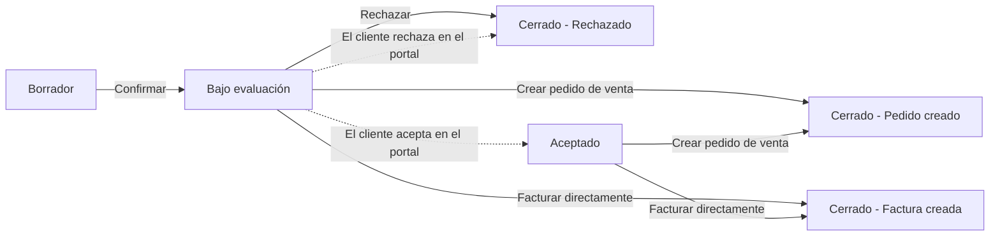

Este artículo se organiza en dos partes: primero cómo **crear un presupuesto** y enviarlo al cliente, y luego cómo **gestionarlo** cuando el cliente responde.

---

## Crear un presupuesto

### 1. Empieza un presupuesto nuevo

Accede a **[Ventas > Presupuesto](https://app.etendo.ai/sales-quotation){target="_blank"}** y haz clic en **+ Nuevo presupuesto**, en la esquina superior derecha. Se abre el formulario en blanco.

### 2. Completa el formulario

<figure markdown="span">
  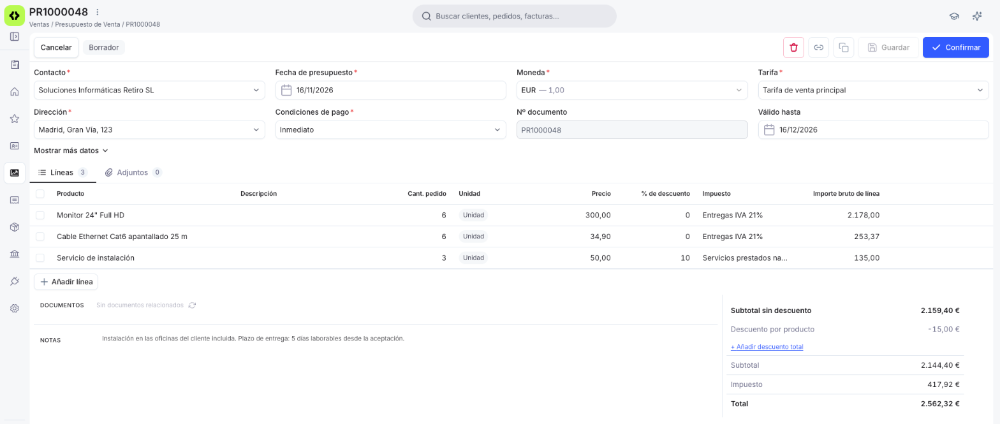
  <figcaption>Formulario de creación y edición del Presupuesto de venta.</figcaption>
</figure>

**Cabecera**

- **Contacto** — el cliente al que le haces la oferta. Al elegirlo, la Dirección, la Tarifa, el Método de pago y las Condiciones de pago se completan solos con los datos de su ficha. Si el cliente todavía no existe, créalo sin salir del formulario con **+ Crear contacto**.
- **Fecha de presupuesto** — por defecto, la fecha de hoy. Puedes cambiarla.
- **Moneda** — la moneda en la que haces la oferta. Por defecto, la moneda de tu empresa.
- **Tarifa** — la lista de precios con la que se calculan los precios de los productos. Normalmente es la que tiene asignada el cliente.
- **Dirección** — viene de la ficha del cliente. Puedes cambiarla solo para este presupuesto.
- **Condiciones de pago** — vienen de la ficha del cliente. Puedes cambiarlas solo para este presupuesto, elegir otras condiciones de tu cuenta o crear unas nuevas con **+ Crear condición de pago**. Ver [Cómo configurar las condiciones de pago](../../../sistema/configuracion/como-configurar-las-condiciones-de-pago/como-configurar-las-condiciones-de-pago.md).
- **Nº documento** — Etendo le asigna el número al guardar el presupuesto. En un presupuesto nuevo ves entre `< >` el número previsto.
- **Válido hasta** — hasta qué fecha mantienes la oferta. No es obligatorio.
- **Método de pago** — viene de la ficha del cliente. Puedes cambiarlo solo para este presupuesto. Lo ves al hacer clic en **Mostrar más datos**, debajo de la cabecera.

!!! tip "Datos que vienen de la ficha del cliente"
    Puedes cambiarlos solo para este presupuesto. La ficha del cliente no cambia. Si el cliente no tiene una dirección registrada, escríbela tú.

!!! info "Aviso de límite de crédito"
    Si el cliente ya superó el límite de crédito de su ficha, al elegirlo ves un aviso en la parte superior del formulario con el importe superado. El aviso es informativo: puedes guardar y confirmar el presupuesto de todos modos.

**Pestaña Líneas**

<figure markdown="span">
  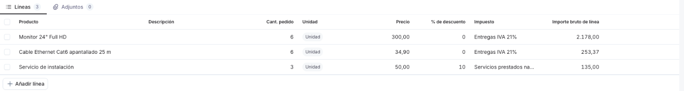
  <figcaption>Pestaña Líneas con los productos y servicios incluidos en el presupuesto.</figcaption>
</figure>

Las líneas son los productos o servicios que incluyes en la oferta. Después de elegir el contacto, haz clic en **+ Añadir líneas** para añadir la primera. Para las siguientes, haz clic en **+ Añadir línea**.

- **Producto** — al elegirlo, la descripción y el precio se completan solos según la tarifa de la cabecera.
- **Descripción** — viene de la ficha del producto. Puedes cambiarla en cada línea.
- **Cant. pedido** — cuántas unidades ofreces. Por defecto, 1.
- **Precio** — el precio del producto en la tarifa elegida. Puedes cambiarlo si necesitas ajustarlo para este cliente.
- **% de descuento** — el descuento que aplicas sobre el precio de esa línea.
- **Impuesto** — el impuesto que corresponde a la línea.
- **Importe bruto de línea** — se calcula solo: precio por cantidad, con el descuento aplicado y el impuesto incluido.

Para guardar una línea, usa la tecla ++enter++ o haz clic fuera de la fila. Para descartarla, usa la tecla ++esc++.

!!! info "El presupuesto se guarda al añadir la primera línea"
    Al hacer clic en **+ Añadir líneas**, Etendo guarda el presupuesto como borrador. Si después decides no seguir, puedes eliminarlo con el icono de papelera.

**Totales**

<figure markdown="span">
  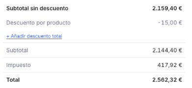
  <figcaption>Panel de totales con desglose de subtotal, descuentos, impuesto e importe final.</figcaption>
</figure>

Puedes aplicar dos tipos de descuento. El primero va en cada línea, en la columna **% de descuento**. El segundo se aplica sobre el total del presupuesto. El panel de totales, abajo a la derecha, muestra:

- **Subtotal sin descuento** — precio por cantidad de todas las líneas, sin descuentos ni impuestos.
- **Descuento por producto** — la suma de los descuentos de las líneas.
- **Descuento total** — un descuento adicional sobre todo el presupuesto. Se añade con el enlace **+ Añadir descuento total**.
- **Subtotal** — el importe sin impuestos, con los descuentos ya aplicados.
- **Impuesto** — el impuesto de todas las líneas.
- **Total** — el importe final que paga el cliente.

**Notas y adjuntos**

Usa el campo **Notas** para añadir observaciones sobre la oferta, como el plazo de entrega o una condición particular. Este texto se imprime en el PDF del presupuesto, en el bloque **Observaciones**, así que el cliente también lo ve.

La pestaña **Adjuntos**, junto a **Líneas**, sirve para guardar archivos junto al presupuesto. Se activa cuando el presupuesto ya está guardado.

### 3. Confirma el presupuesto y envíalo al cliente

<figure markdown="span">
  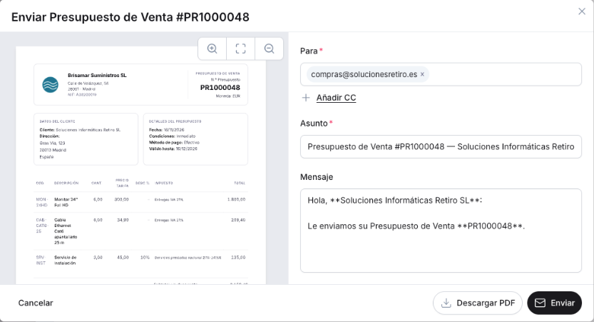
  <figcaption>Panel de envío por email del Presupuesto de venta.</figcaption>
</figure>

Cuando el presupuesto esté completo, haz clic en **Confirmar** en la barra superior. Se abre la ventana **Enviar a evaluación** con un resumen del presupuesto. Haz clic en **Enviar a evaluación**. El presupuesto pasa a **Bajo evaluación**: queda pendiente de la respuesta del cliente.

!!! warning "El presupuesto ya no puede volver a Borrador"
    En **Bajo evaluación** ya no puedes cambiar los datos del presupuesto. Si necesitas modificarlo:

    1. Haz clic en **Rechazar**, en el menú de tres puntos. El presupuesto queda **Cerrado - Rechazado**.
    2. Haz clic en **Copia** para crear un borrador nuevo con los mismos datos.
    3. Cambia lo que necesites en el borrador nuevo.
    4. Confírmalo y envíaselo al cliente.

Con el presupuesto ya confirmado, tienes tres formas de hacérselo llegar al cliente:

- **Envíalo por email** — haz clic en el icono **Enviar / Descargar** (con forma de sobre). Se abre el panel **Enviar Presupuesto de Venta**, con una vista previa del PDF a la izquierda.
    - **Para** ya viene con el correo del cliente, si su ficha lo tiene. Con **Añadir CC** puedes sumar destinatarios en copia.
    - **Asunto** ya viene completado con el número del presupuesto y el nombre del cliente.
    - **Mensaje** trae un saludo que puedes cambiar.

    Haz clic en **Enviar** para mandar el correo. Si tu cuenta tiene activado el [portal del cliente](../que-es-el-portal-del-cliente/que-es-el-portal-del-cliente.md) (en beta), el email incluye además el botón **Ver documento en el portal**, desde el que tu cliente puede aceptar o rechazar el presupuesto sin escribirte.
- **Descarga el PDF y envíalo por otro medio** — por ejemplo, por WhatsApp. Usa el botón **Descargar PDF**, que está en la vista detalle y en el panel de envío por email.
- **Imprímelo y entrégalo en persona** — usa el icono **Imprimir** de la barra superior.

!!! info "Cuándo aparecen Enviar / Descargar e Imprimir"
    Estos dos iconos aparecen cuando el presupuesto está **Bajo evaluación**, **Aceptado** o en alguno de los estados **Cerrado**. No están disponibles mientras el presupuesto está en **Borrador**.

---

## Gestionar presupuestos

Cuando el cliente ya recibió el presupuesto, esta parte te muestra cómo encontrarlo y qué hacer según su respuesta.

### 1. Busca el presupuesto pendiente

<figure markdown="span">
  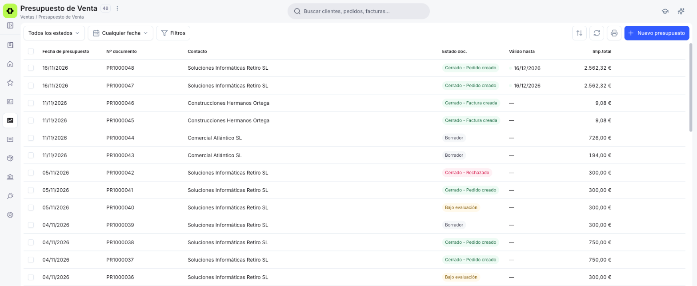
  <figcaption>Vista lista del Presupuesto de venta con columnas de estado, vigencia e importe total.</figcaption>
</figure>

La vista lista muestra todos tus presupuestos con las columnas **Fecha de presupuesto**, **Nº documento**, **Contacto**, **Estado doc.** (ver [Estados del Documento](#estados-del-documento)), **Válido hasta** e **Imp. total**. Para encontrar uno, tienes estas opciones:

- **Filtrar por estado** — el primer selector de la barra superior. Elige **Bajo evaluación** para ver de un vistazo los presupuestos que esperan respuesta, o **Aceptado** para ver los que el cliente ya aceptó desde el portal y tienes que convertir en pedido o factura.
- **Filtrar por fecha** — el segundo selector. Opciones: Hoy, Ayer, Últimos 7 días, Últimos 30 días, Últimos 12 meses, Todo el tiempo y Personalizado.
- **Filtros** — para añadir más criterios de búsqueda.
- **Ordenar** — haz clic en el encabezado de una columna.

Junto a **+ Nuevo presupuesto** tienes también los botones para ordenar, actualizar e imprimir la lista.

Al pasar el cursor sobre una fila aparecen accesos rápidos para trabajar con ese presupuesto sin abrirlo: **Editar**, **Clonar**, **Enviar / Descargar** y **Eliminar**.

### 2. Abre el presupuesto

<figure markdown="span">
  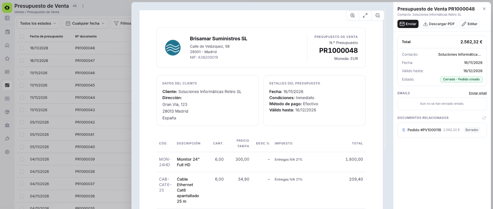
  <figcaption>Vista detalle con la previsualización del PDF y el panel lateral de información clave.</figcaption>
</figure>

Haz clic en un presupuesto de la lista para abrir la vista detalle. En el centro ves el PDF del presupuesto, con botones para acercarlo, alejarlo o verlo a pantalla completa. En el panel derecho ves el total, el cliente, la fecha, la validez y el estado.

Desde este panel puedes hacer lo siguiente sin abrir el formulario:

- **Enviar** — abre el panel de envío por email al cliente.
- **Descargar PDF** — descarga el presupuesto en PDF.
- **Editar** — abre el formulario completo. En **Bajo evaluación** solo puedes cambiar el campo **Notas**. Para cambiar el resto, rechaza el presupuesto y trabaja sobre una copia (ver el aviso en [Confirma el presupuesto y envíalo al cliente](#3-confirma-el-presupuesto-y-envialo-al-cliente)).

Debajo, el panel tiene dos secciones:

- **Emails** — los correos que le enviaste al cliente. Desde el enlace **Enviar email** puedes mandar uno nuevo.
- **Documentos relacionados** — el pedido o la factura que creaste a partir de este presupuesto, con su importe y su estado. En el formulario completo aparece la misma información en la sección **Documentos**, y cada documento es un enlace que puedes abrir.

### 3. Cierra el presupuesto según la respuesta del cliente

El cliente puede darte su respuesta de dos formas: desde el portal del cliente, si tu cuenta lo tiene, o por cualquier otro medio. Según cuál use, el paso que te toca es distinto.

#### Si responde desde el portal del cliente (beta)

!!! experimental "Funcionalidad en beta"
    El portal del cliente está en beta y todavía no está activado en todas las cuentas. Si en tu cuenta no está activo, sigue en [Si te responde por otro medio](#si-te-responde-por-otro-medio).

<figure markdown="span">
  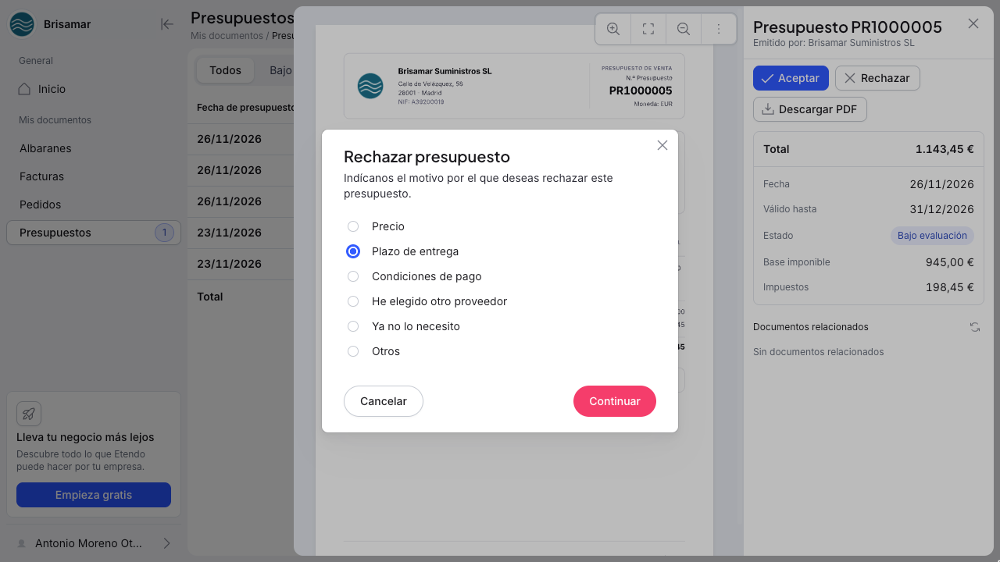
  <figcaption>Desde el portal, tu cliente acepta o rechaza el presupuesto sin escribirte.</figcaption>
</figure>

Con el [portal del cliente](../que-es-el-portal-del-cliente/que-es-el-portal-del-cliente.md), tu cliente responde al presupuesto desde el enlace que le llega en el email. Puede hacerlo si se cumplen estas condiciones:

- El presupuesto está **Bajo evaluación**.
- No ha pasado su fecha **Válido hasta**. Si no tiene, siempre está vigente. Si ya pasó, el portal muestra **Este presupuesto ha caducado**.
- Tu cliente entra con el enlace del email en el que le enviaste ese presupuesto. Con el enlace de otro documento lo ve, pero no puede responderlo.

Así responde tu cliente:

1. **Elige su respuesta en el portal.** Con **Aceptar**, se abre la ventana **¿Deseas aceptar este presupuesto?**. Con **Rechazar**, tiene que elegir un motivo: **Precio**, **Plazo de entrega**, **Condiciones de pago**, **He elegido otro proveedor**, **Ya no lo necesito** u **Otros**. Con **Otros**, también escribe una descripción.
2. **Confirma su decisión desde un email.** Le llega **Confirma la aceptación del presupuesto …** o **Confirma el rechazo del presupuesto …**, en el mismo hilo que el presupuesto. Va a las direcciones que pusiste en **Para** al enviarlo, no a las de copia.

    <figure markdown="span">
      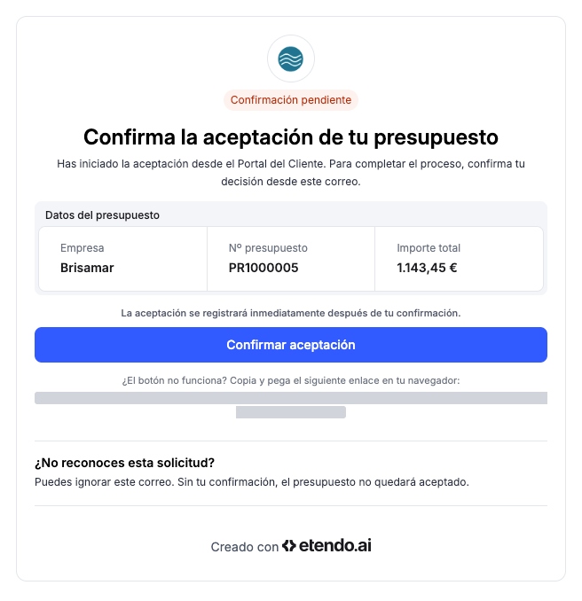{ width=420 }
      <figcaption>La respuesta solo se aplica cuando tu cliente hace clic en el botón del email.</figcaption>
    </figure>

3. **Ve el resultado.** Al hacer clic en **Confirmar aceptación** o **Confirmar rechazo**, el portal le muestra **¡Presupuesto aceptado!** o **¡Presupuesto rechazado!**. El botón sirve una sola vez.

!!! warning "Hasta que tu cliente no confirma, el presupuesto sigue pendiente"
    Responder en el portal no cambia nada todavía. El presupuesto sigue **Bajo evaluación** hasta que tu cliente hace clic en el botón del email.

Cuando confirma, el usuario de tu empresa que envió el presupuesto recibe un email con la respuesta, y el presupuesto cambia de estado solo. No tienes que registrarla tú:

- **Si lo acepta**, pasa a **Aceptado**. Etendo no crea ningún pedido ni factura por su cuenta: conviértelo tú, como se explica en [Convertir el presupuesto aceptado en pedido o factura](#convertir-el-presupuesto-aceptado-en-pedido-o-factura).
- **Si lo rechaza**, pasa a **Cerrado - Rechazado**. El motivo del cliente queda en las **Notas**, con el texto **Rechazado por el cliente desde el portal. Motivo: …**. Para guardar un motivo interno, elígelo en el campo **Razón de rechazo**, dentro de **Mostrar más datos**. Tu cliente no lo ve.

<figure markdown="span">
  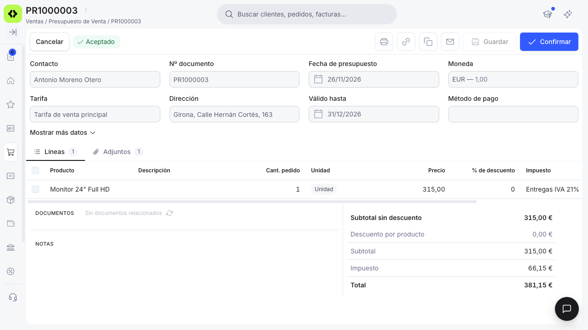
  <figcaption>Presupuesto aceptado por el cliente desde el portal, listo para convertir en pedido o factura.</figcaption>
</figure>

#### Si te responde por otro medio

Si el cliente te contesta por teléfono, por correo o en persona, o tu cuenta no tiene el portal activado, registra tú la respuesta en el presupuesto, que sigue **Bajo evaluación**:

- **Si acepta**, conviértelo en pedido o en factura, como se explica a continuación.
- **Si rechaza**, haz clic en **Rechazar**, en el menú de tres puntos. El presupuesto queda **Cerrado - Rechazado** y no se crea ningún pedido ni factura.

#### Convertir el presupuesto aceptado en pedido o factura

<figure markdown="span">
  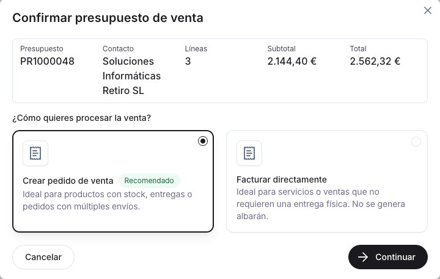{ width=420 }
  <figcaption>Ventana de confirmación del Presupuesto de venta con las dos formas de procesar la venta.</figcaption>
</figure>

Cuando el cliente acepta, ya sea desde el portal (el presupuesto está en **Aceptado**) o por otro medio (sigue en **Bajo evaluación**), haz clic en **Confirmar**. Se abre la ventana **Confirmar presupuesto de venta**, con el resumen del presupuesto y la pregunta **¿Cómo quieres procesar la venta?**. Elige una opción y haz clic en **Continuar**:

- **Crear pedido de venta** — recomendada si vendes productos con stock, con entrega o con varias entregas. El presupuesto queda **Cerrado - Pedido creado**.
- **Facturar directamente** — para servicios o ventas sin entrega. No se crea albarán (el documento que acompaña la entrega de la mercancía). El presupuesto queda **Cerrado - Factura creada**.

Al terminar, una ventana te confirma el documento creado. Puedes abrirlo directamente o cerrar el aviso y seguir en el presupuesto.

!!! info "Qué datos pasan al pedido o a la factura"
    El pedido o la factura llevan el mismo cliente, la misma dirección, la misma tarifa, las mismas condiciones de pago y todas las líneas del presupuesto. No tienes que volver a escribir nada. El documento se crea en **Borrador**, así que puedes revisarlo antes de confirmarlo.

---

## Estados del Documento

El estado se muestra como una etiqueta junto al botón **Cancelar**, en la barra superior.

| Estado | Descripción |
|---|---|
| Borrador | En preparación. Puedes cambiar todos sus datos. |
| Bajo evaluación | Enviado al cliente, pendiente de respuesta. Solo puedes cambiar las notas. |
| Aceptado | El cliente lo aceptó desde el portal del cliente (beta). Falta que lo conviertas en pedido o factura. |
| Cerrado - Rechazado | El cliente rechazó la oferta, desde el portal o por otro medio. Si lo rechazó desde el portal, su motivo queda en las notas. |
| Cerrado - Pedido creado | El cliente aceptó y creaste el pedido de venta. |
| Cerrado - Factura creada | El cliente aceptó y creaste la factura de venta directa. |

---

## Acciones Disponibles

<figure markdown="span">
  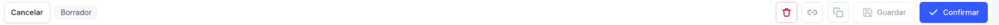
  <figcaption>Barra de acciones del Presupuesto de venta.</figcaption>
</figure>

La barra superior del formulario muestra estas acciones:

| Acción | Descripción | Estado |
| :--- | :--- | :--- |
| **Cancelar** | Descarta los cambios sin guardar y vuelve a la lista. | Todos los estados |
| **Guardar** | Guarda el presupuesto sin cambiar su estado. | Solo en Borrador |
| **Confirmar** | En Borrador, abre la ventana **Enviar a evaluación** y pasa el presupuesto a Bajo evaluación (ver [Crear un presupuesto](#crear-un-presupuesto)). En Bajo evaluación y en Aceptado, abre la ventana **Confirmar presupuesto de venta** para crear el pedido o la factura (ver [Gestionar presupuestos](#gestionar-presupuestos)). | Borrador, Bajo evaluación y Aceptado |
| **Copiar enlace** | Copia el enlace directo a este presupuesto, para compartirlo con otra persona de tu equipo. | Todos los estados |
| **Copia** | Crea un borrador nuevo con los mismos datos del presupuesto. | Todos los estados |
| **Enviar / Descargar** | Icono con forma de sobre. Abre el panel de envío por email, desde donde también puedes descargar el PDF. | Bajo evaluación, Aceptado y estados Cerrado |
| **Imprimir** | Crea una copia para imprimir y entregar en persona. | Bajo evaluación, Aceptado y estados Cerrado |
| **Rechazar** | En el menú de tres puntos. Cierra el presupuesto como **Cerrado - Rechazado**, sin crear ningún pedido ni factura. | Solo en Bajo evaluación |
| **Papelera** | Elimina el presupuesto. Antes te pide confirmación. | Solo en Borrador |

## Artículos Relacionados

- [¿Qué es el portal del cliente?](../que-es-el-portal-del-cliente/que-es-el-portal-del-cliente.md)
- [Crear y gestionar pedidos](../crear-y-gestionar-pedidos/crear-y-gestionar-pedidos.md)
- [Crear una factura de venta](../crear-una-factura-de-venta/crear-una-factura-de-venta.md)

---
Esta obra está bajo la licencia :material-creative-commons: :fontawesome-brands-creative-commons-by: :fontawesome-brands-creative-commons-sa: [CC BY-SA 2.5 ES](https://creativecommons.org/licenses/by-sa/2.5/es/){target="_blank"} de [Futit Services S.L](https://etendo.software){target="_blank"}.
