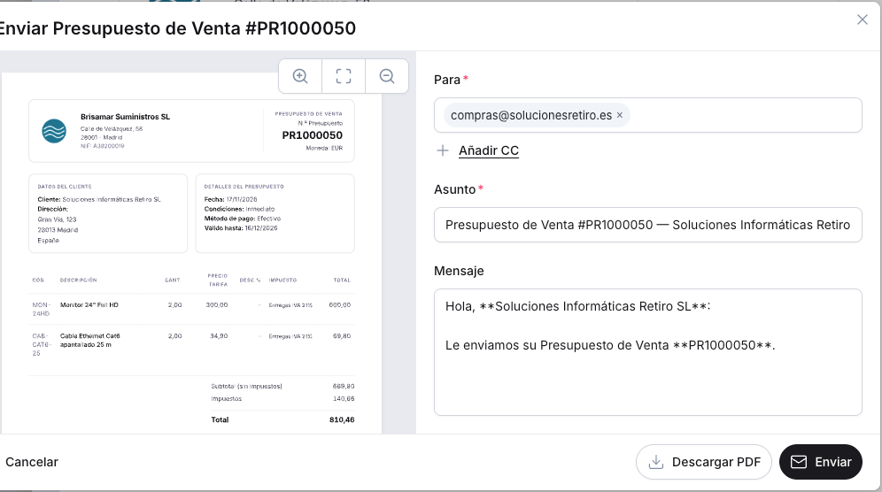
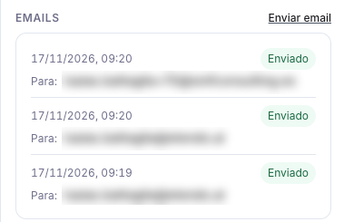

# Enviar documentos por email

Puedes mandarle un documento a tu cliente o a tu proveedor por correo sin salir de Etendo, con el PDF ya adjunto. La ventana de envío es la misma en todas las ventanas, así que lo que aprendas aquí te sirve para cualquiera de ellas.

Funciona en los documentos que tú le mandas a la otra parte:

- **Ventas** — el presupuesto, el pedido, el albarán y la factura, incluida la rectificativa.
- **Compras** — el pedido que le mandas a tu proveedor.

La factura de compra no se envía desde aquí: esa la recibes tú del proveedor.

!!! info "El documento tiene que estar confirmado"
    El botón **Enviar** solo aparece cuando el documento ha salido de **Borrador**. Mientras sigue en borrador, ni la vista lista ni la vista detalle ni el formulario lo muestran.

## Enviar el documento

1. Abre el documento desde su ventana. Tienes el botón **Enviar** en el panel derecho de la vista detalle, y el icono con forma de sobre entre los accesos rápidos de la fila y en la barra del formulario.

2. Haz clic en **Enviar**. Se abre la ventana de envío, con el nombre y el número del documento en el título:

    <figure markdown="span">
      
      <figcaption>La ventana de envío, con la vista previa del documento y el mensaje ya preparado.</figcaption>
    </figure>

    A la izquierda tienes la vista previa del PDF que se va a adjuntar, con botones para acercarlo, alejarlo o verlo a pantalla completa.

3. Revisa los datos del correo:

    - **Para** — a quién se lo mandas. Ya viene con la dirección del contacto, si la tiene guardada. Haz clic en la cruz para quitarla y escribe otra si quieres mandarlo a otra persona.
    - **Añadir CC** — para sumar a alguien en copia.
    - **Asunto** — ya viene con el tipo de documento, su número y el nombre del contacto. Puedes cambiarlo.
    - **Mensaje** — un saludo y una línea diciendo qué documento se envía. Escribe aquí lo que quieras añadir.

4. Si quieres revisar el documento antes de mandarlo, descárgalo con **Descargar PDF** sin salir de la ventana.

5. Haz clic en **Enviar**.

!!! tip "Tu cliente también puede verlo en el portal (beta)"
    Si tu cuenta tiene activado el portal del cliente, en los documentos de venta el email incluye el botón **Ver documento en el portal**. Con ese enlace tu cliente consulta y descarga sus documentos durante 48 horas, y puede aceptar o rechazar tus presupuestos sin escribirte. Más información en [Portal del cliente](../portal-del-cliente/portal-del-cliente.md).

## Consultar los envíos

Cada envío queda guardado en la sección **EMAILS** del panel derecho, con la fecha, la hora, el destinatario y si salió correctamente:

<figure markdown="span">
  
  <figcaption>El historial guarda cada envío con su fecha, su destinatario y el resultado.</figcaption>
</figure>

Desde el enlace **Enviar email** de esa misma sección abres la ventana de envío otra vez. Mientras no hayas mandado ninguno, la sección avisa de que todavía no se ha enviado nada.

!!! info "Enviar el mismo documento varias veces"
    Puedes reenviarlo tantas veces como haga falta, por ejemplo si el cliente te pide otra copia. Cada envío se suma al historial y ninguno cambia el estado del documento.

!!! tip "Si prefieres mandarlo por otro canal"
    Para compartirlo por mensajería o desde tu propio correo, usa **Descargar PDF** y manda el archivo por donde quieras. Ten en cuenta que esos envíos no quedan en el historial: ahí solo se guardan los que haces con el botón **Enviar** de Etendo.

## Artículos Relacionados

- [Portal del cliente](../portal-del-cliente/portal-del-cliente.md)
- [Gestionar tus facturas de venta](../gestionar-tus-facturas-de-venta/gestionar-tus-facturas-de-venta.md)
- [Crear y gestionar presupuestos](../crear-y-gestionar-presupuestos/crear-y-gestionar-presupuestos.md)
- [Gestionar tus pedidos de compra](../../../operaciones/compras/gestionar-tus-pedidos-de-compra/gestionar-tus-pedidos-de-compra.md)

---
Esta obra está bajo la licencia :material-creative-commons: :fontawesome-brands-creative-commons-by: :fontawesome-brands-creative-commons-sa: [CC BY-SA 2.5 ES](https://creativecommons.org/licenses/by-sa/2.5/es/){target="_blank"} de [Futit Services S.L](https://etendo.software){target="_blank"}.
