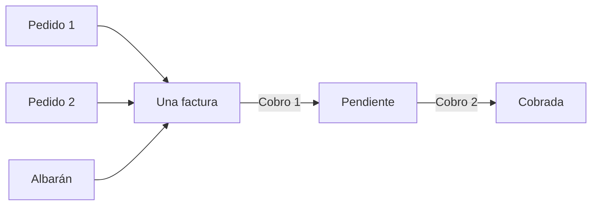
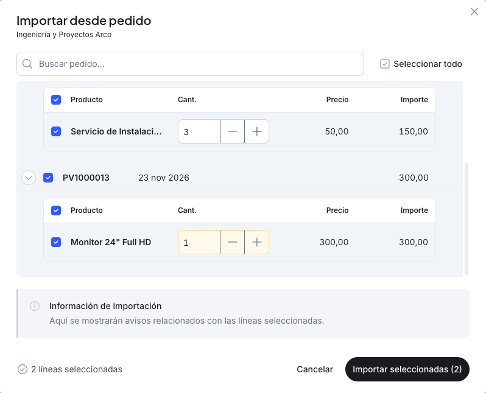
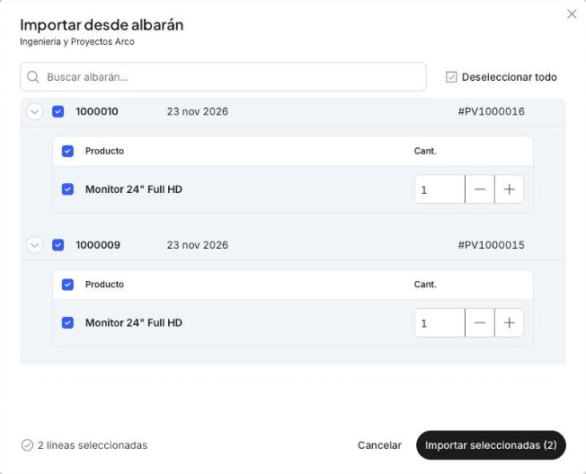
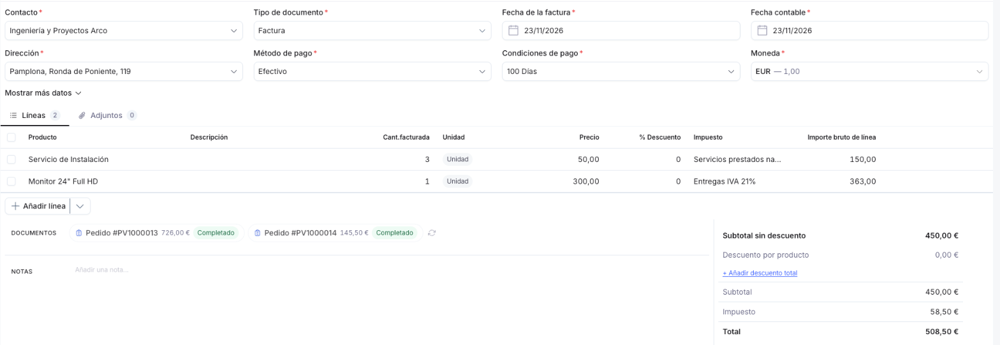
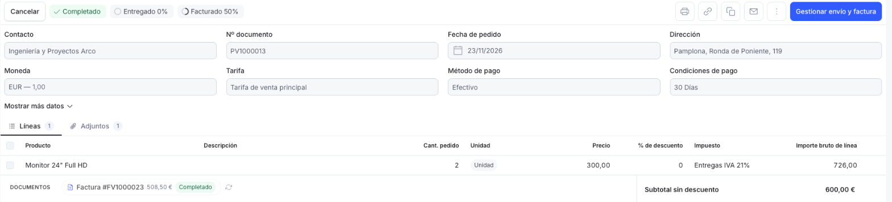

# Facturación agrupada y cobros parciales

Si un cliente te hace varios pedidos a lo largo del mes, o recibe la mercancía en varias entregas, no necesitas emitirle una factura por cada uno. Puedes reunirlos en una sola **factura de venta**, facturar solo lo que ya le has entregado y cobrársela en varios pagos.

**Antes de empezar**, necesitas tener confirmados los [pedidos de venta](../crear-y-gestionar-pedidos/crear-y-gestionar-pedidos.md) o completados los [albaranes](../crear-y-gestionar-albaranes/crear-y-gestionar-albaranes.md) que vas a facturar. Todos tienen que ser del mismo cliente y estar en la misma moneda.

---

## 1. Crea la factura

1. Accede a **[Ventas > Factura](https://app.etendo.ai/sales-invoice){target="_blank"}** y haz clic en **+ Nueva factura**.
2. Elige el **Contacto**. Revisa que la **Moneda** sea la de los pedidos o albaranes que vas a facturar: el importador solo te muestra los que están en la misma moneda que la factura.

Para el resto de la cabecera, consulta [Crear una factura de venta](../crear-una-factura-de-venta/crear-una-factura-de-venta.md).

## 2. Importa varios pedidos

<figure markdown="span">
  
  <figcaption>Ventana Importar desde pedido: eliges los pedidos y, en cada línea, cuánto facturas.</figcaption>
</figure>

1. En la pestaña **Líneas**, haz clic en **Importar desde pedido**. Se abre una ventana con los pedidos confirmados del cliente que tienen algo pendiente de facturar, con su fecha y su importe.
2. Marca la casilla de cada pedido que quieras incluir. Al marcarlo, se despliegan sus líneas.
3. En cada línea, revisa la **Cant.**: viene con todo lo pendiente. Si solo vas a facturar una parte, por ejemplo lo que ya has entregado, bájala con **−** o escribe la cantidad. Desmarca las líneas que no quieras facturar todavía.
4. Haz clic en **Importar seleccionadas**. Las líneas se añaden a la factura con el precio, el impuesto y el descuento de cada pedido.

### Si los pedidos tienen descuento global

Un pedido con descuento global aparece en la lista con la etiqueta **% Dto. global**. Al marcarlo, puedes elegir con **Llevar el descuento global del pedido** si ese descuento pasa a la factura como **Descuento total**.

El descuento solo se lleva si es el mismo en todos los pedidos que marcas. Si mezclas pedidos con descuentos distintos, o uno con descuento y otro sin él, verás el aviso *Los pedidos seleccionados tienen descuentos globales distintos* y la factura se crea sin descuento global. En ese caso, haz dos facturas o añade tú el descuento con **+ Añadir descuento total**.

## 3. O importa varios albaranes

<figure markdown="span">
  
  <figcaption>Ventana Importar desde albarán: cada albarán muestra el pedido del que sale.</figcaption>
</figure>

Si facturas por lo entregado, haz clic en **Importar desde albarán**. Funciona igual: marcas los albaranes, ajustas la **Cant.** de cada línea y haz clic en **Importar seleccionadas**. Al lado de cada albarán ves el pedido del que sale.

!!! warning "El descuento global no viaja con el albarán"
    Al importar desde un albarán, el descuento global del pedido no pasa a la factura y no aparece ningún aviso. Si el pedido tenía descuento global, añádelo tú con **+ Añadir descuento total** antes de confirmar la factura.

Cuando la factura ya tiene líneas, el botón pasa a **+ Añadir línea** y las dos opciones de importar están en su desplegable, así que puedes combinar pedidos y albaranes en la misma factura. Etendo nunca factura dos veces lo mismo: lo que ya está en otra factura, aunque sea un borrador, no se ofrece de nuevo.

## 4. Revisa y confirma la factura

<figure markdown="span">
  
  <figcaption>La factura agrupada enlaza en DOCUMENTOS cada pedido del que sale.</figcaption>
</figure>

En **DOCUMENTOS**, debajo de las líneas, ves cada pedido y cada albarán del que sale la factura. Antes de confirmarla, revisa:

- **Condiciones de pago** — la factura usa las del contacto, no las de los pedidos. Si con este cliente acordaste otro plazo para estos pedidos, cámbialo aquí.
- **Total** — comprueba el descuento total si lo hubiera.

Haz clic en **Confirmar**.

## 5. Factura más adelante lo pendiente

<figure markdown="span">
  
  <figcaption>Un pedido facturado en parte muestra cuánto lleva facturado.</figcaption>
</figure>

Si facturaste solo una parte de un pedido, el pedido muestra el porcentaje facturado, por ejemplo **Facturado 50%**, y en **DOCUMENTOS** enlaza a la factura. Lo que queda sigue apareciendo en **Importar desde pedido** para tu siguiente factura.

!!! tip "Termina desde el pedido lo que empezaste desde el pedido"
    Si facturaste parte de un pedido antes de entregarlo, el albarán que haces después no aparece en **Importar desde albarán**. Factura lo que falta con **Importar desde pedido**.

## 6. Cobra la factura en varios pagos

Cada factura tiene una única fecha de vencimiento, que Etendo calcula con sus **Condiciones de pago** (ver [Cómo configurar las condiciones de pago](../../../sistema/configuracion/como-configurar-las-condiciones-de-pago/como-configurar-las-condiciones-de-pago.md)). Si con el cliente acordaste pagar en varios plazos, registra cada pago como un cobro parcial cuando llegue:

1. Abre la factura y haz clic en **Añadir cobro**.
2. Escribe en **Importe** lo que te ha pagado esta vez. La **Diferencia** muestra lo que falta, por ejemplo **Falta 200,00 €**.
3. Deja desactivado **Ajustar diferencia** y haz clic en **Confirmar**. La factura queda con ese importe pendiente.
4. Repite con cada pago hasta que la factura quede cobrada.

Mientras quede saldo, el indicador de la factura muestra **Parcial** con lo cobrado y el total, y pasa a **Vencido** si llega la fecha de vencimiento sin cobrarse del todo. Todos los detalles del cobro están en [Añadir cobros a tu factura de venta](../anadir-cobros-a-tu-factura-de-venta/anadir-cobros-a-tu-factura-de-venta.md).

---

## Artículos relacionados

- [Crear una factura de venta](../crear-una-factura-de-venta/crear-una-factura-de-venta.md)
- [Añadir cobros a tu factura de venta](../anadir-cobros-a-tu-factura-de-venta/anadir-cobros-a-tu-factura-de-venta.md)
- [Crear y gestionar pedidos](../crear-y-gestionar-pedidos/crear-y-gestionar-pedidos.md)

---
Esta obra está bajo la licencia :material-creative-commons: :fontawesome-brands-creative-commons-by: :fontawesome-brands-creative-commons-sa: [CC BY-SA 2.5 ES](https://creativecommons.org/licenses/by-sa/2.5/es/){target="_blank"} de [Futit Services S.L](https://etendo.software){target="_blank"}.
