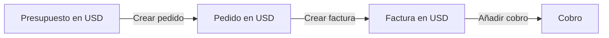
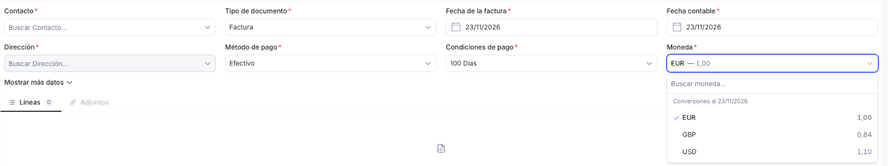
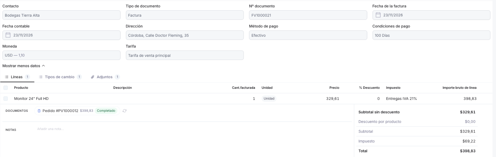
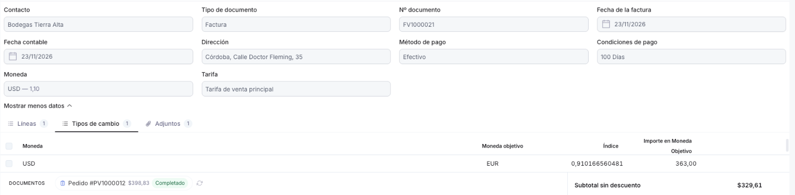
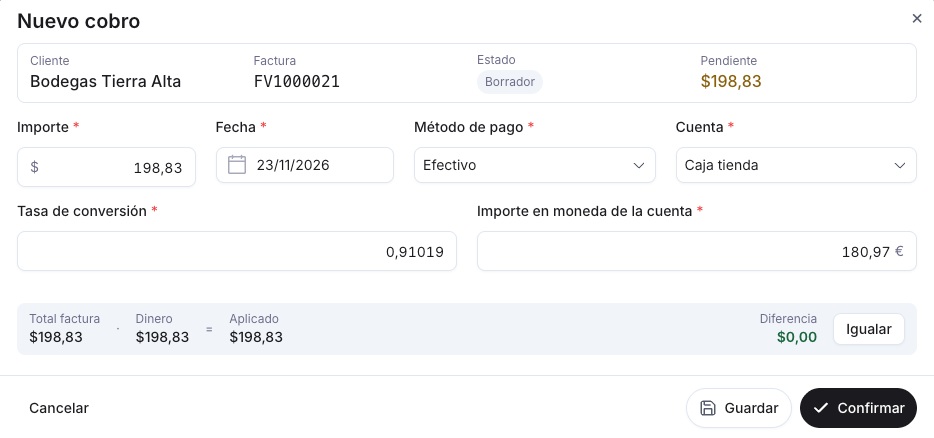

# Facturar en otra moneda

Si tienes clientes que te pagan en otra moneda, puedes emitirles el presupuesto, el pedido y la factura de venta directamente en esa moneda. El cliente ve los importes en la moneda acordada, y Etendo los convierte a la moneda de tu empresa para que tus informes y tu contabilidad cuadren.

**Antes de empezar**, necesitas:

- El [contacto](../../contactos/como-crear-un-contacto/como-crear-un-contacto.md) del cliente, con su dirección.
- Que la moneda en la que vas a facturar tenga **tipo de cambio** con la de tu empresa. Etendo actualiza cada día los tipos de cambio y en la lista de monedas solo aparecen las que lo tienen.

---

## 1. Elige la moneda del documento

<figure markdown="span">
  
  <figcaption>El desplegable Moneda muestra el tipo de cambio de cada moneda para la fecha del documento.</figcaption>
</figure>

La moneda se elige en la cabecera de cada documento, y funciona igual en el [presupuesto](../crear-y-gestionar-presupuestos/crear-y-gestionar-presupuestos.md), el [pedido](../crear-y-gestionar-pedidos/crear-y-gestionar-pedidos.md) y la [factura de venta](../crear-una-factura-de-venta/crear-una-factura-de-venta.md):

1. Crea el documento como siempre y elige el **Contacto**.
2. Haz clic en **Moneda**. La lista muestra las **Conversiones** del día del documento: cuántas unidades de cada moneda equivalen a una de la moneda de tu empresa.
3. Elige la moneda que has acordado con el cliente. El campo pasa a mostrar la moneda y su tipo de cambio, por ejemplo `USD — 1,10`, y los totales del documento se muestran en esa moneda.

Si cambias la fecha del documento, Etendo busca el tipo de cambio de ese día y lo aplica. Si para esa fecha no hay ninguno registrado, tienes que escribirlo tú con el lápiz, como se explica a continuación: sin tipo de cambio no puedes guardar ni confirmar el documento.

### Cambiar el tipo de cambio a mano

Si tu banco o tu asesor te indican otro tipo de cambio, o no hay ninguno registrado para la fecha del documento, haz clic en el lápiz que aparece junto a **Moneda**, escribe el nuevo valor y confírmalo con ✓. Solo puedes cambiarlo mientras el documento está en **Borrador**.

!!! warning "El tipo de cambio no recalcula las líneas que ya has añadido"
    Etendo convierte el precio de cada producto en el momento de añadirlo. Si cambias el tipo de cambio después, las líneas que ya estaban mantienen su precio. Elige la moneda y ajusta el tipo de cambio antes de añadir las líneas.

## 2. Añade las líneas y revisa los precios

<figure markdown="span">
  
  <figcaption>Factura en dólares: el precio de la tarifa se convierte solo y los totales se muestran en la moneda de la factura.</figcaption>
</figure>

Tu tarifa de venta tiene los precios en la moneda de tu empresa. Al buscar un producto, la lista te muestra su precio en las dos monedas, y al elegirlo, Etendo lo convierte con el tipo de cambio del documento. Por ejemplo, un producto que en la tarifa vale 300,00 € entra en una factura en dólares a 329,61.

Si has acordado con el cliente un precio redondo en su moneda, cámbialo en el **Precio** de la línea. Los impuestos y los totales se calculan en la moneda del documento.

## 3. Pasa de presupuesto a pedido y a factura

Cuando generas el pedido desde el presupuesto, o la factura desde el pedido o el albarán, el documento nuevo mantiene la moneda y los precios del anterior.

Lo que no se mantiene es un tipo de cambio que hayas escrito a mano: el documento nuevo toma el del día de su propia fecha. Si lo habías ajustado, revísalo en el documento nuevo antes de confirmarlo.

Si creas la factura vacía y usas **Importar desde pedido** o **Importar desde albarán**, solo aparecen los documentos del mismo cliente **en la misma moneda que la factura**. Si la factura está en otra, verás el aviso *No hay pedidos confirmados para este cliente en la moneda de la factura*: cambia la **Moneda** de la factura y vuelve a intentarlo.

## 4. Consulta el equivalente en tu moneda

<figure markdown="span">
  
  <figcaption>La pestaña Tipos de cambio de la factura muestra cuánto vale en la moneda de tu empresa.</figcaption>
</figure>

En una factura en otra moneda aparece la pestaña **Tipos de cambio**. Ahí ves cuánto vale la factura en la moneda de tu empresa, en la columna **Importe en Moneda Objetivo**.

En la vista detalle de la factura, el **Total** se muestra en la moneda de tu empresa, con la moneda de la factura al lado. Debajo aparecen el tipo de cambio y el importe original, por ejemplo `(1,10) $398,83`.

## 5. Cobra la factura

<figure markdown="span">
  
  <figcaption>Si el dinero entra en una cuenta en otra moneda, la ventana Nuevo cobro te pide la conversión.</figcaption>
</figure>

El cobro se registra desde la factura con **Añadir cobro**, como cualquier otro. Lo explicamos en [Añadir cobros a tu factura de venta](../anadir-cobros-a-tu-factura-de-venta/anadir-cobros-a-tu-factura-de-venta.md). En otra moneda cambia lo siguiente:

- **Importe** — se escribe en la moneda de la factura.
- **Cuenta** — elige dónde entra el dinero. Si tienes una caja o una cuenta bancaria en la misma moneda que la factura, por ejemplo una cuenta en dólares, el cobro entra tal cual y no hay nada que convertir.
- **Tasa de conversión** e **Importe en moneda de la cuenta** — solo aparecen cuando la **Cuenta** está en otra moneda que la factura, por ejemplo tu cuenta en euros. La tasa viene con la del día. Si sabes cuánto te ha abonado el banco, escríbelo en **Importe en moneda de la cuenta** y Etendo calcula la tasa sola, o al revés.
- **Cobros parciales** — puedes cobrar una parte y dejar el resto pendiente, igual que en tu moneda.
- **No puedes cobrar de más** — si el importe supera lo pendiente, aparece el aviso *Exceso* y no puedes confirmar el cobro hasta ajustarlo.

!!! info "Para tu asesor"
    La factura se registra en tu contabilidad con el tipo de cambio de la factura, que ves en su pestaña **Tipos de cambio**. El cobro usa la **Tasa de conversión** del día del cobro. Si las dos no coinciden, lo que vale el cobro en la moneda de tu empresa no es igual a lo que valía la factura, y esa diferencia es una **diferencia de cambio**, positiva o negativa. El **Índice** de la pestaña **Tipos de cambio** está expresado al revés que el tipo de la cabecera: convierte de la moneda de la factura a la de tu empresa.

<!-- TODO (Teo/asesor): confirmar en qué cuenta contable registra Etendo la diferencia de cambio al contabilizar el cobro. En la prueba del 23/11 el cobro aún no tenía asiento. -->

---

## Artículos relacionados

- [Crear una factura de venta](../crear-una-factura-de-venta/crear-una-factura-de-venta.md)
- [Añadir cobros a tu factura de venta](../anadir-cobros-a-tu-factura-de-venta/anadir-cobros-a-tu-factura-de-venta.md)
- [Crear y gestionar pedidos](../crear-y-gestionar-pedidos/crear-y-gestionar-pedidos.md)

---
Esta obra está bajo la licencia :material-creative-commons: :fontawesome-brands-creative-commons-by: :fontawesome-brands-creative-commons-sa: [CC BY-SA 2.5 ES](https://creativecommons.org/licenses/by-sa/2.5/es/){target="_blank"} de [Futit Services S.L](https://etendo.software){target="_blank"}.
