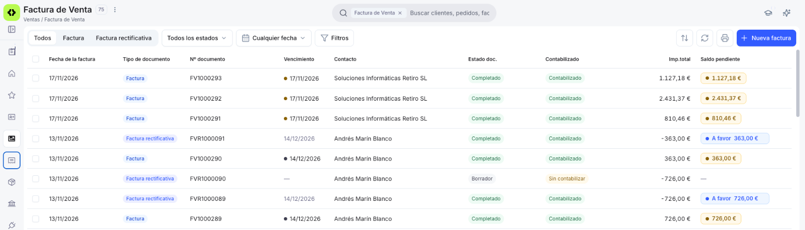
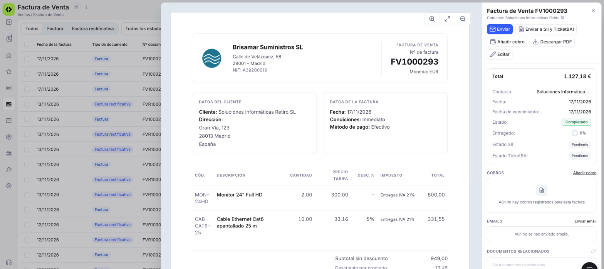

# Gestionar tus facturas de venta

Cuando ya tengas facturas de venta emitidas, necesitarás consultarlas, seguir su cobro y saber qué te queda por entregar. Este artículo repasa la ventana **[Ventas > Factura](https://app.etendo.ai/sales-invoice){target="_blank"}**: la vista lista, la vista detalle, los estados y las acciones disponibles. Si todavía no has creado ninguna factura, empieza por [Crear una factura de venta](../crear-una-factura-de-venta/crear-una-factura-de-venta.md).

## Vista Lista

<figure markdown="span">
  
  <figcaption>Vista lista de Factura de Venta, con las pestañas de tipo de documento y los filtros de estado y fecha.</figcaption>
</figure>

La vista lista muestra todas tus facturas con las columnas **Fecha de la factura**, **Tipo de documento**, **Nº documento**, **Vencimiento**, **Contacto**, **Estado doc.** (ver [Estados del Documento](#estados-del-documento)), **Contabilizado**, **Imp.total**, **Saldo pendiente** y **Estado de entrega**.

- **Vencimiento** — el día en que te tienen que pagar la factura. Lleva un punto de color a la izquierda mientras está pendiente de cobro. En las rectificativas y en los borradores aparece en gris o como **—**.
- **Saldo pendiente** — lo que te queda por cobrar de esa factura. En las rectificativas muestra **A favor**, con el importe que le debes al cliente.
- **Estado de entrega** — qué parte de la factura ya has entregado con un [albarán](../crear-y-gestionar-albaranes/crear-y-gestionar-albaranes.md). Muestra un indicador circular con el porcentaje: verde y completo al 100 %, gris y vacío al 0 %.

Para encontrar una factura, tienes estas opciones:

- **Pestañas de tipo de documento** — **Todos**, **Factura** y **Factura rectificativa**.
- **Filtrar por estado** — el selector **Todos los estados** de la barra superior.
- **Filtrar por fecha** — el selector **Cualquier fecha**.
- **Filtros** — para añadir más criterios de búsqueda.

Junto a **+ Nueva factura**, en la esquina superior derecha, tienes botones para ordenar, actualizar e imprimir la lista.

Al pasar el cursor sobre una fila aparecen accesos rápidos para trabajar con esa factura sin abrirla: **Editar**, **Clonar**, **Enviar / Descargar**, **Más acciones** y **Eliminar**.

!!! info "Para tu asesor"
    La columna **Contabilizado** muestra si la factura ya está registrada en tu contabilidad: **Contabilizado** cuando lo está y **Sin contabilizar** mientras no lo esté. Para registrarla, usa la acción **Contabilizar** (ver [Acciones Disponibles](#acciones-disponibles)).

## Vista Detalle

<figure markdown="span">
  
  <figcaption>Vista detalle de la Factura de Venta, con la previsualización del PDF y el panel lateral de información clave.</figcaption>
</figure>

Haz clic en una factura de la lista para abrir la vista detalle. En el centro ves el PDF de la factura, con botones para acercarlo, alejarlo o verlo a pantalla completa. El PDF muestra tus datos y los del cliente, la fecha, las condiciones y el método de pago, cada línea con su **Cantidad**, **Precio tarifa**, **Desc.%**, **Impuesto** y **Total**, y el desglose de totales.

En el panel derecho, bajo el número de la factura y el cliente, tienes estos botones:

- **Enviar** — abre el panel de envío por email al cliente. Ver [Enviar documentos por email](../enviar-documentos-por-email/enviar-documentos-por-email.md).
- **Añadir cobro** — registra un cobro total o parcial de la factura. Ver [Añadir cobros a tu factura de venta](../anadir-cobros-a-tu-factura-de-venta/anadir-cobros-a-tu-factura-de-venta.md).
- **Descargar PDF** — descarga la factura en PDF.
- **Editar** — abre el formulario completo.

Debajo, el panel resume el **Total**, el **Contacto**, la **Fecha**, la **Fecha de vencimiento**, el **Estado** y lo **Entregado**, con el mismo indicador circular de la lista. Más abajo tiene tres secciones:

- **COBROS** — los cobros registrados. Mientras no haya ninguno, muestra «Aún no hay cobros registrados para esta factura». Con el enlace **Añadir cobro** registras uno.
- **EMAILS** — los correos que le enviaste al cliente. Desde el enlace **Enviar email** puedes mandar uno nuevo.
- **DOCUMENTOS RELACIONADOS** — el pedido o el albarán de los que sale la factura.

## Estados del Documento

El estado se muestra como una etiqueta junto al botón **Cancelar**, en la barra superior del formulario.

| Estado | Descripción |
|---|---|
| Borrador | En preparación. Puedes cambiar todos sus datos y todavía no cuenta para tu contabilidad. |
| Completado | Confirmada. Queda pendiente de cobro y, si incluye mercancía, de entrega. |

--8<-- "overrides/snippets/factura-de-venta-no-editable.md"

    Tienes el detalle de **Reactivar** en [Acciones Disponibles](#acciones-disponibles) y las formas de corregirla en [Crear una factura rectificativa](../crear-una-factura-rectificativa/crear-una-factura-rectificativa.md).

Junto al estado, la barra superior muestra la etiqueta **Sin contabilizar** hasta que registras la factura en tu contabilidad, y **Contabilizado** cuando ya lo está. A su lado, la etiqueta **Entregado 0%** avanza a medida que entregas la mercancía.

A la derecha de la barra, el indicador de cobro muestra el importe que te queda por cobrar y un enlace **Ver →** para consultar los cobros de la factura. Aparece como **Pendiente** mientras la factura está en plazo, y como **Vencido** cuando la fecha de vencimiento ha pasado sin que se haya registrado el cobro completo.

## Acciones Disponibles

La barra superior del formulario muestra estas acciones:

| Acción | Descripción | Estado |
| :--- | :--- | :--- |
| **Cancelar** | Descarta los cambios sin guardar y vuelve a la lista. | Todos los estados |
| **Guardar** | Guarda la factura sin cambiar su estado. | Solo en Borrador |
| **Confirmar** | Abre la ventana **¿Gestionar envío?** y pasa la factura a Completado (ver [Crear una factura de venta](../crear-una-factura-de-venta/crear-una-factura-de-venta.md#confirmar-la-factura)). | Solo en Borrador |
| **Copiar enlace** | Copia el enlace directo a esta factura, para compartirlo con otra persona de tu equipo. | Todos los estados |
| **Clonar** | Crea un borrador nuevo con los mismos datos de la factura. | Todos los estados |
| **Enviar / Descargar** | Icono con forma de sobre. Abre el panel de envío por email, desde donde también puedes descargar el PDF. | Solo en Completado |
| **Imprimir** | Crea una copia para imprimir. | Solo en Completado |
| **Añadir cobro** | En la vista detalle. Registra un cobro total o parcial. Ver [Añadir cobros a tu factura de venta](../anadir-cobros-a-tu-factura-de-venta/anadir-cobros-a-tu-factura-de-venta.md). | Solo en Completado |
| **Gestionar envío** | Crea el [albarán](../crear-y-gestionar-albaranes/crear-y-gestionar-albaranes.md) en Borrador con las líneas pendientes de entregar. | Completado, mientras quede algo por entregar |
| **Reactivar** | En el menú de tres puntos. Devuelve la factura a Borrador para corregirla. Solo funciona si no tiene cobros registrados, si todavía no se ha enviado a la administración tributaria y, si incluye mercancía, si aún no la has entregado. Si ya no puedes reactivarla, corrígela con una [factura rectificativa](../crear-una-factura-rectificativa/crear-una-factura-rectificativa.md). | Solo en Completado |
| **Contabilizar** | En el menú de tres puntos. Registra la factura en tu contabilidad. Si tienes dudas, consúltalo con tu asesor. | Completado, sin contabilizar |
| **Descontabilizar** | En el menú de tres puntos. Deshace ese registro y devuelve la factura a **Sin contabilizar**. Consúltalo con tu asesor antes de usarlo. | Completado, contabilizado |
| **Papelera** | Elimina la factura. Antes te pide confirmación. | Solo en Borrador |

## Artículos Relacionados

- [Crear una factura de venta](../crear-una-factura-de-venta/crear-una-factura-de-venta.md)
- [Añadir cobros a tu factura de venta](../anadir-cobros-a-tu-factura-de-venta/anadir-cobros-a-tu-factura-de-venta.md)
- [Enviar documentos por email](../enviar-documentos-por-email/enviar-documentos-por-email.md)

---
Esta obra está bajo la licencia :material-creative-commons: :fontawesome-brands-creative-commons-by: :fontawesome-brands-creative-commons-sa: [CC BY-SA 2.5 ES](https://creativecommons.org/licenses/by-sa/2.5/es/){target="_blank"} de [Futit Services S.L](https://etendo.software){target="_blank"}.
