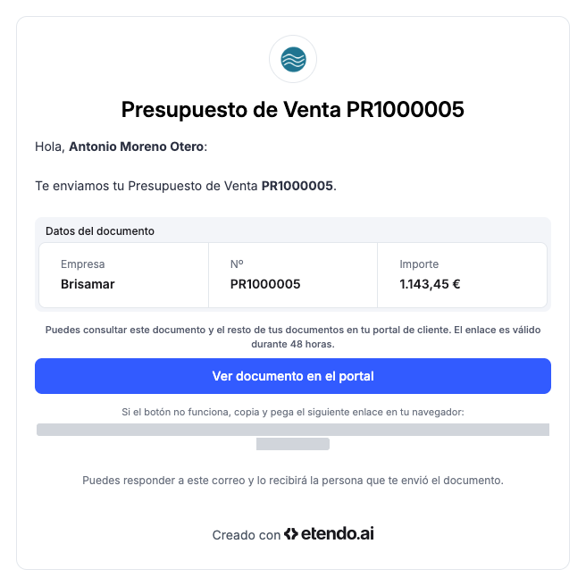
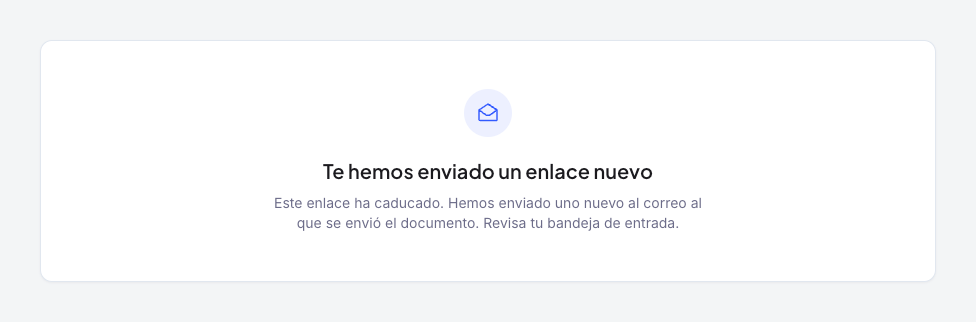
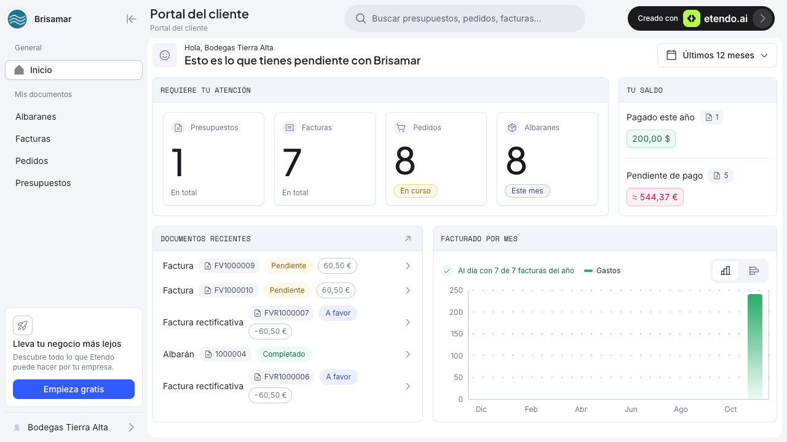
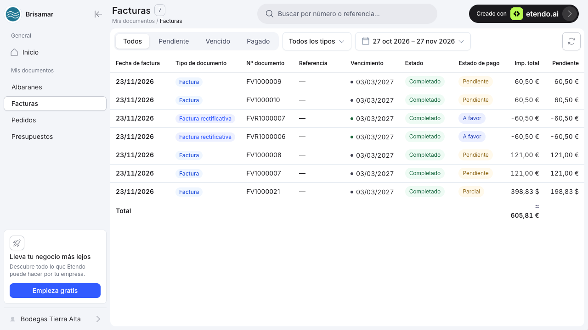
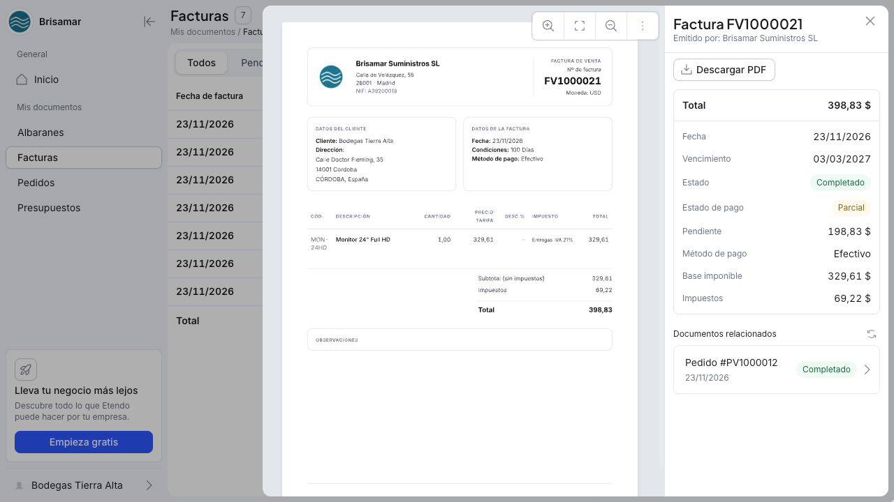
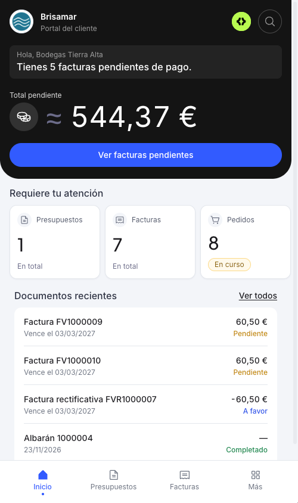

# ¿Qué es el portal del cliente?

--8<-- "overrides/snippets/funcionalidad-beta.md"

El **portal del cliente** es una web donde tus clientes consultan los documentos de venta que les envías. Así no tienen que pedirte copias de una factura ni escribirte para responder a un presupuesto.

Tu cliente no necesita usuario ni contraseña. Entra con el enlace que le llega cada vez que le [envías un documento por email](../enviar-documentos-por-email/enviar-documentos-por-email.md). Desde el portal puede:

- **Ver y descargar** sus presupuestos, pedidos, albaranes y facturas.
- **Saber qué tiene pendiente contigo**: presupuestos por responder, facturas por pagar y pedidos en curso.
- **Aceptar o rechazar tus presupuestos**. Es lo único que puede cambiar: el resto del portal es de solo lectura. Ver [cómo responde tu cliente a un presupuesto](../crear-y-gestionar-presupuestos/crear-y-gestionar-presupuestos.md#si-responde-desde-el-portal-del-cliente-beta).

## Cómo llega tu cliente al portal

<figure markdown="span">
  { width=480 }
  <figcaption>Cada email de un documento de venta incluye el acceso al portal.</figcaption>
</figure>

No tienes que hacer nada distinto. Cuando envías un presupuesto, un pedido, un albarán o una factura con el botón **Enviar**, el email incluye:

- El botón **Ver documento en el portal**.
- El mismo enlace escrito en texto, por si el programa de correo de tu cliente no muestra el botón.

El PDF no va adjunto: tu cliente lo ve y lo descarga desde el portal. El enlace abre directamente el documento que enviaste. Desde ahí, tu cliente puede ver el resto de documentos que tiene contigo.

## Cuánto dura el acceso

<figure markdown="span">
  
  <figcaption>Al abrir un enlace caducado, tu cliente recibe uno nuevo por email.</figcaption>
</figure>

Cada enlace sirve durante **48 horas**. En ese plazo, tu cliente puede abrirlo todas las veces que quiera.

- **Reenviar un documento no anula los enlaces anteriores.** Cada envío trae su propio enlace.
- **Si tu cliente abre un enlace caducado, recibe uno nuevo sin que hagas nada**, siempre que le hayas enviado el documento a una dirección guardada en su ficha (ver [Qué direcciones mantienen el acceso](#que-direcciones-mantienen-el-acceso)). El portal le muestra **Te hemos enviado un enlace nuevo** y le llega el email **Su nuevo enlace al portal de cliente de …**.
- **Si vuelve a abrir el enlace caducado en menos de 15 minutos**, ve **Ya te enviamos un enlace nuevo** y no le llega otro email.
- **Si el contacto está bloqueado o inactivo, o el plan de tu empresa en Etendo ha vencido**, el portal muestra **No podemos darte acceso al portal** y no envía ningún enlace.

### Qué direcciones mantienen el acceso

El enlace solo se renueva para las direcciones que tienes guardadas en la ficha del contacto:

- El **Correo electrónico** del contacto.
- El correo de cualquiera de sus personas de contacto, en la sub-solapa [**Persona**](../../contactos/gestionar-tus-contactos/gestionar-tus-contactos.md#persona).

Si envías el documento a otra dirección, Etendo la trata como externa. Esa persona puede usar el enlace durante 48 horas, pero cuando caduca no recibe uno nuevo. Para que vuelva a entrar, tienes que enviarle el documento otra vez. Así controlas quién ve los documentos de tu cliente.

!!! tip "Para que una persona mantenga el acceso"
    Añádela como persona de contacto en la ficha del cliente, con su correo, desde **Añadir Persona** en la sub-solapa **Persona**. A partir de ahí, sus enlaces se renuevan solos al caducar.

!!! info "Cómo cortar el acceso a un cliente"
    No hay un botón para quitarle el acceso. El enlace caduca solo, y deja de renovarse si bloqueas al cliente o lo desactivas en su ficha de [Contactos](../../contactos/gestionar-tus-contactos/gestionar-tus-contactos.md).

## Qué ve tu cliente

<figure markdown="span">
  
  <figcaption>El inicio resume lo que tu cliente tiene pendiente contigo.</figcaption>
</figure>

El portal lleva el nombre y el logo de tu empresa, y solo muestra los documentos que le has emitido a ese cliente. Si trabajas con varias empresas en Etendo, cada una tiene su propio portal.

- **Inicio** — lo que tiene pendiente contigo, lo que ha pagado este año, sus documentos recientes y un gráfico con lo facturado por mes.
- **Mis documentos** — en la barra lateral, los listados de **Albaranes**, **Facturas**, **Pedidos** y **Presupuestos**.
- **Buscador** — en la barra superior, para encontrar un documento por su número o su referencia.
- **Idioma** — tu cliente puede cambiar el portal a inglés haciendo clic en su nombre, abajo a la izquierda. El PDF sigue en el idioma del documento.

### Listados de documentos

<figure markdown="span">
  
  <figcaption>En el listado de facturas, tu cliente ve el estado de pago y lo que queda pendiente de cada una.</figcaption>
</figure>

Cada listado muestra los documentos del último mes. Tu cliente puede filtrarlos por estado con las pestañas de arriba y cambiar el período con el selector de fechas. En **Facturas** también puede filtrar por tipo de documento.

Si le has facturado en varias monedas, los totales se muestran aproximados en euros, con el signo **≈** delante.

!!! info "Los borradores no se ven"
    El portal solo muestra documentos confirmados. Lo que tengas en **Borrador** no le aparece a tu cliente.

### Detalle de un documento

<figure markdown="span">
  
  <figcaption>El detalle muestra el mismo PDF que le enviaste por email.</figcaption>
</figure>

Al abrir un documento, tu cliente ve el PDF y, al lado, un resumen con el total y el estado. En las facturas, el resumen incluye también el vencimiento y lo que queda pendiente.

- **Descargar PDF** — descarga el mismo PDF que le enviaste por email.
- **Documentos relacionados** — para pasar de un documento a otro de la misma venta, por ejemplo del pedido a la factura.

### En el teléfono

<figure markdown="span">
  { width=320 }
  <figcaption>En el teléfono, el inicio destaca lo que queda pendiente de pago.</figcaption>
</figure>

El portal se adapta a la pantalla del teléfono. Arriba muestra el total pendiente de pago, con el botón **Ver facturas pendientes**. Abajo hay una barra con **Inicio**, **Presupuestos**, **Facturas** y **Más**, que abre **Pedidos** y **Albaranes**.

## Recursos y próximos pasos

- [Enviar documentos por email](../enviar-documentos-por-email/enviar-documentos-por-email.md) — para mandarle a tu cliente el enlace al portal.
- [Crear y gestionar presupuestos](../crear-y-gestionar-presupuestos/crear-y-gestionar-presupuestos.md#si-responde-desde-el-portal-del-cliente-beta) — qué hace tu cliente cuando responde a un presupuesto desde el portal y qué cambia en Etendo.

## Artículos Relacionados

- [Crear y gestionar pedidos](../crear-y-gestionar-pedidos/crear-y-gestionar-pedidos.md)
- [Gestionar tus facturas de venta](../gestionar-tus-facturas-de-venta/gestionar-tus-facturas-de-venta.md)
- [Gestionar tus contactos](../../contactos/gestionar-tus-contactos/gestionar-tus-contactos.md)

---
Esta obra está bajo la licencia :material-creative-commons: :fontawesome-brands-creative-commons-by: :fontawesome-brands-creative-commons-sa: [CC BY-SA 2.5 ES](https://creativecommons.org/licenses/by-sa/2.5/es/){target="_blank"} de [Futit Services S.L](https://etendo.software){target="_blank"}.
