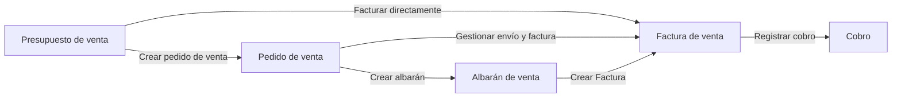

# ¿Qué es la sección Ventas?

La sección **Ventas** reúne todos los documentos con los que registras el ciclo comercial con tus clientes: desde la oferta inicial hasta el cobro, incluyendo las devoluciones. La encuentras en el menú lateral, en **Comercial > Ventas**, con cinco opciones: **Presupuesto**, **Pedido**, **Albarán**, **Factura** y **Albarán de devolución**.

Todos estos documentos comparten el mismo [contacto](../../contactos/que-es-la-seccion-contactos/que-es-la-seccion-contactos.md) y se encadenan entre sí, de forma que no necesitas volver a escribir los mismos datos en cada paso.

## El ciclo de venta

Cada documento de venta puede crear el siguiente cuando tú lo decides. Nada se genera solo.

- **[Presupuesto de venta](../crear-y-gestionar-presupuestos/crear-y-gestionar-presupuestos.md)** — documento opcional. Es la oferta comercial que le envías al cliente con productos, precios y condiciones, antes de que se comprometa a comprar.
- **[Pedido de venta](../crear-y-gestionar-pedidos/crear-y-gestionar-pedidos.md)** — formaliza el compromiso de compra del cliente. Es el punto de partida habitual cuando hay stock o entregas físicas de por medio.
- **[Albarán de venta](../crear-y-gestionar-albaranes/crear-y-gestionar-albaranes.md)** — documenta la entrega física de la mercancía.
- **[Factura de venta](../crear-una-factura-de-venta/crear-una-factura-de-venta.md)** — el documento fiscal que le indica al cliente cuánto te debe y cuándo tiene que pagarte.
- **Cobro** — lo que el cliente te paga por una factura, de una vez o en varias partes. Ver [Añadir cobros a tu factura de venta](../anadir-cobros-a-tu-factura-de-venta/anadir-cobros-a-tu-factura-de-venta.md).

## El ciclo de devolución

Cuando un cliente te devuelve mercancía, la registras en dos pasos. Primero, un albarán de devolución para la mercancía que vuelve a tu almacén. Después, una [factura rectificativa](../crear-una-factura-rectificativa/crear-una-factura-rectificativa.md) para corregir lo que el cliente te debe. Para ver el proceso completo, consulta [Crear y gestionar devoluciones](../crear-y-gestionar-devoluciones/crear-y-gestionar-devoluciones.md).

## Recursos y próximos pasos

- [Crear y gestionar presupuestos](../crear-y-gestionar-presupuestos/crear-y-gestionar-presupuestos.md)
- [Crear y gestionar pedidos](../crear-y-gestionar-pedidos/crear-y-gestionar-pedidos.md)
- [Crear y gestionar albaranes](../crear-y-gestionar-albaranes/crear-y-gestionar-albaranes.md)
- [Crear una factura de venta](../crear-una-factura-de-venta/crear-una-factura-de-venta.md)
- [Gestionar tus facturas de venta](../gestionar-tus-facturas-de-venta/gestionar-tus-facturas-de-venta.md)
- [Enviar documentos por email](../enviar-documentos-por-email/enviar-documentos-por-email.md)
- [Añadir cobros a tu factura de venta](../anadir-cobros-a-tu-factura-de-venta/anadir-cobros-a-tu-factura-de-venta.md)
- [Crear y gestionar devoluciones](../crear-y-gestionar-devoluciones/crear-y-gestionar-devoluciones.md)
- [Crear una factura rectificativa](../crear-una-factura-rectificativa/crear-una-factura-rectificativa.md)

Empieza por el documento que necesites ahora: no hace falta seguir un orden fijo.

## Artículos Relacionados

- [¿Qué es la sección Contactos?](../../contactos/que-es-la-seccion-contactos/que-es-la-seccion-contactos.md)
- [Documentos de venta: preguntas frecuentes](../documentos-de-venta-preguntas-frecuentes/documentos-de-venta-preguntas-frecuentes.md)

---
Esta obra está bajo la licencia :material-creative-commons: :fontawesome-brands-creative-commons-by: :fontawesome-brands-creative-commons-sa: [CC BY-SA 2.5 ES](https://creativecommons.org/licenses/by-sa/2.5/es/){target="_blank"} de [Futit Services S.L](https://etendo.software){target="_blank"}.
