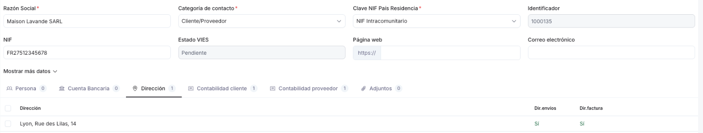
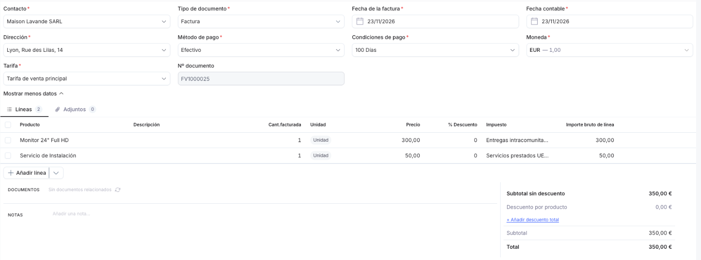
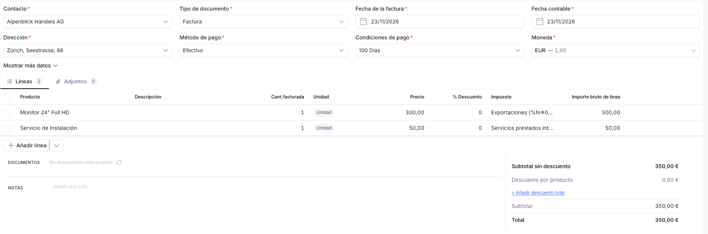
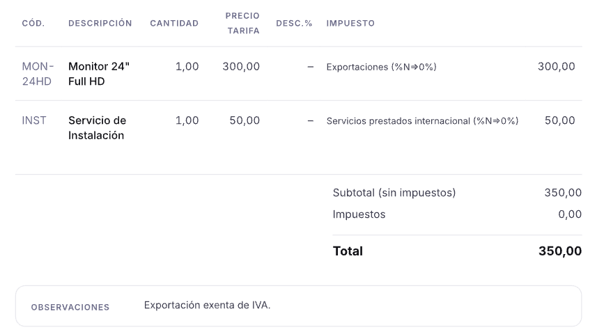

# Ventas intracomunitarias y exportaciones

Cuando le vendes a una empresa de otro país de la Unión Europea, o a un cliente de fuera de ella, normalmente la factura no lleva IVA. Etendo lo resuelve por ti: según dónde está tu cliente, cada línea de la factura toma el impuesto que corresponde, sin cuota. Este artículo explica qué tienes que preparar en la ficha del cliente y qué revisar en la factura.

**Antes de empezar**, necesitas tener el [contacto](../../contactos/como-crear-un-contacto/como-crear-un-contacto.md) del cliente con su dirección completa, incluido el **País**.

---

## 1. Prepara la ficha del cliente

<figure markdown="span">
  
  <figcaption>Ficha de un cliente intracomunitario: con la clave NIF Intracomunitario aparece el Estado VIES.</figcaption>
</figure>

En **[Comercial > Contactos](https://app.etendo.ai/contacts){target="_blank"}**, abre la ficha del cliente y revisa:

- **Clave NIF País Residencia** — el tipo de identificación fiscal del cliente:
    - Para una empresa de otro país de la Unión Europea, elige **NIF Intracomunitario** y escribe en **NIF** su número de operador intracomunitario, con el prefijo de su país.
    - Para un cliente de fuera de la Unión Europea, elige la que corresponda a su documento, por ejemplo **Documento oficial de identificación expedido por el país**.
- **Estado VIES** — solo aparece con **NIF Intracomunitario**. Indica si el número ya se comprobó en VIES, el sistema europeo que confirma que el cliente está dado de alta como operador intracomunitario. Al crear el contacto queda en **Pendiente**, y se valida desde el [Modelo 349](../../../impuestos/modelo-349/modelo-349.md).
- **Dirección** — en la pestaña **Dirección**, comprueba que el **País** de la dirección de facturación sea el correcto. Es el dato que usa Etendo para elegir el impuesto de cada línea.

## 2. Crea la factura y revisa los impuestos

<figure markdown="span">
  
  <figcaption>Factura a un cliente intracomunitario: el total no lleva IVA.</figcaption>
</figure>

Crea la factura como siempre (ver [Crear una factura de venta](../crear-una-factura-de-venta/crear-una-factura-de-venta.md)). Al añadir cada producto o servicio, el **Impuesto** de la línea se completa solo según el país del cliente:

| Cliente | Productos | Servicios |
|:--|:--|:--|
| Empresa de otro país de la Unión Europea | **Entregas intracomunitarias** | **Servicios prestados UE** |
| Cliente de fuera de la Unión Europea | **Exportaciones** | **Servicios prestados internacional** |

Todos estos impuestos son al 0 %, así que el **Impuesto** del total queda en cero. Lo que aparece entre paréntesis en su nombre, por ejemplo `(%N⇒0%)`, indica el tipo de IVA que tendría el producto en una venta nacional: normal, reducido o superreducido.

<figure markdown="span">
  
  <figcaption>Factura de exportación: los impuestos cambian, pero el total tampoco lleva IVA.</figcaption>
</figure>

!!! warning "Etendo no comprueba el NIF del cliente"
    El impuesto se elige por el país de la dirección, aunque el cliente no tenga un **NIF Intracomunitario** o su **Estado VIES** siga en **Pendiente**. Si le vendes a un particular o a una empresa sin número de operador intracomunitario, la venta puede llevar IVA: consulta con tu asesor qué impuesto corresponde y cámbialo en la columna **Impuesto** de cada línea.

## 3. Añade la mención legal en la factura

<figure markdown="span">
  
  <figcaption>Lo que escribes en NOTAS aparece en el PDF, en OBSERVACIONES.</figcaption>
</figure>

Una factura sin IVA tiene que explicar por qué no lo lleva. El PDF de Etendo muestra el nombre del impuesto de cada línea, pero no añade ese texto por su cuenta. Escríbelo tú antes de confirmar la factura:

1. En la factura, debajo de las líneas, haz clic en **NOTAS** (*Añadir una nota...*).
2. Escribe la mención que te indique tu asesor, por ejemplo que la entrega está exenta o que el impuesto lo declara el cliente.
3. Haz clic fuera del campo. Verás el aviso **Nota guardada**.

Al confirmar la factura, el texto aparece en el PDF en el apartado **OBSERVACIONES**.

## 4. Declara tus ventas intracomunitarias

Las facturas a clientes intracomunitarios se declaran en el [Modelo 349](../../../impuestos/modelo-349/modelo-349.md). Etendo las incluye en el cálculo cuando están **Completado** y **Contabilizado**, y desde la misma declaración puedes validar en VIES el número de los clientes que siguen en **Pendiente**. Las exportaciones no van en el Modelo 349.

!!! info "Para tu asesor"
    En una venta intracomunitaria entre empresas, la factura sale sin IVA y es el cliente quien lo declara en su país, por inversión del sujeto pasivo. Para que la entrega quede exenta, el cliente tiene que estar dado de alta en VIES en la fecha de la operación. Las exportaciones fuera de la Unión Europea están exentas, y conviene guardar la documentación de la salida de la mercancía.

---

## Artículos relacionados

- [Crear una factura de venta](../crear-una-factura-de-venta/crear-una-factura-de-venta.md)
- [Modelo 349](../../../impuestos/modelo-349/modelo-349.md)
- [Cómo crear un contacto](../../contactos/como-crear-un-contacto/como-crear-un-contacto.md)

---
Esta obra está bajo la licencia :material-creative-commons: :fontawesome-brands-creative-commons-by: :fontawesome-brands-creative-commons-sa: [CC BY-SA 2.5 ES](https://creativecommons.org/licenses/by-sa/2.5/es/){target="_blank"} de [Futit Services S.L](https://etendo.software){target="_blank"}.
