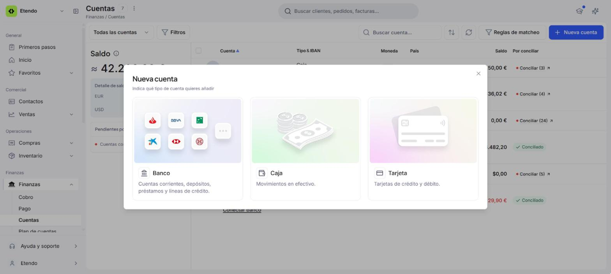
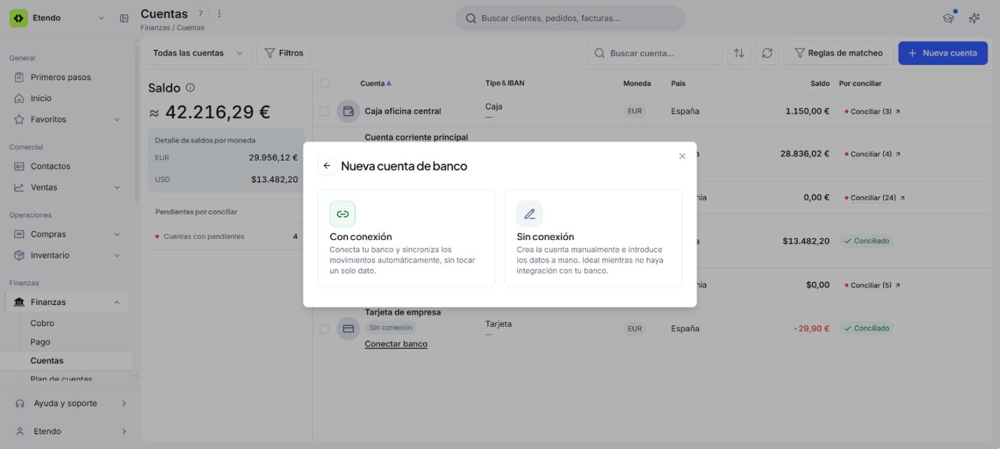
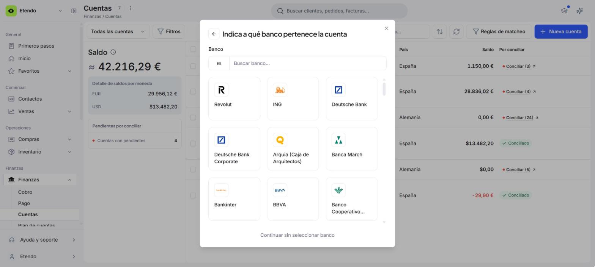
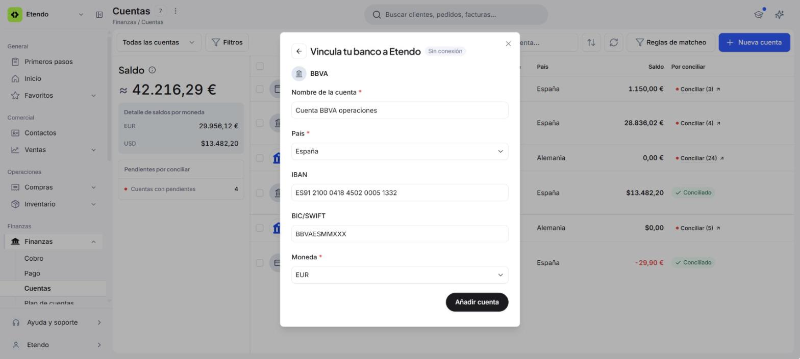
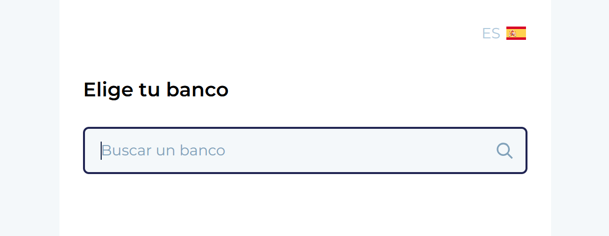

---
tags:
    - Cuentas
    - Finanzas
    - Bancos
    - Etendo
---

# Añadir y configurar un banco, tarjeta o caja

Antes de registrar movimientos, importar extractos o conciliar, necesitas dar de alta al menos una cuenta en **Cuentas**. Etendo admite tres tipos de cuenta: **Banco**, **Caja** y **Tarjeta**.

## Elegir el tipo de cuenta

1. Ve a **[Finanzas > Cuentas](https://app.etendo.ai/financial-account){target="_blank"}**.
2. Haz clic en **Nueva cuenta**.
3. Elige el tipo de cuenta:
    - **Banco**: cuentas corrientes, depósitos, préstamos y líneas de crédito.
    - **Caja**: movimientos en efectivo.
    - **Tarjeta**: tarjetas de crédito y débito.

Si eliges **Banco** o **Tarjeta**, Etendo te pregunta si quieres crear la cuenta **Con conexión** (sincroniza los movimientos automáticamente con tu banco) o **Sin conexión** (introduces los datos a mano). **Caja** no tiene esta opción y pasa directamente al formulario.

## Añadir una cuenta sin conexión

Usa esta opción si tu banco no admite conexión o prefieres traer los movimientos importando el extracto.

1. Elige **Sin conexión**.
2. En **Indica a qué banco pertenece la cuenta**, busca tu banco o selecciónalo de la lista. Etendo usa su logo en el listado y propone su nombre como nombre de la cuenta. Si no aparece o no quieres indicarlo, haz clic en **Continuar sin seleccionar banco**.

    

3. Completa el formulario:
    - **Nombre de la cuenta** (obligatorio).
    - **País** (obligatorio; España por defecto).
    - **IBAN** y **BIC/SWIFT**: solo en cuentas de tipo **Banco**. Etendo valida el IBAN y no te deja continuar si no es correcto.
    - **Moneda** (obligatoria; EUR por defecto).
4. Haz clic en **Añadir cuenta**.

En una **Tarjeta** o una **Caja**, el formulario pide solo **Nombre de la cuenta**, **País** y **Moneda**.

Una cuenta creada sin conexión puede conectarse más adelante con tu banco. Consulta [Conectar, desconectar, archivar, desarchivar o eliminar una cuenta](../como-conectar-desconectar-desactivar-o-eliminar-una-cuenta-bancaria/como-conectar-desconectar-desactivar-o-eliminar-una-cuenta-bancaria.md).

## Añadir una cuenta con conexión

Usa esta opción para que Etendo reciba los movimientos directamente de tu banco, sin importar archivos.

1. Elige **Con conexión**. Etendo muestra el aviso **Conectando con tu banco…** y abre una ventana aparte, **Conectar Cuenta**.
2. En esa ventana, en **Elige tu banco**, busca tu banco por su nombre y selecciónalo.

    

3. Completa la autenticación con tu banco. La ventana se cierra sola al terminar.

!!! tip "Si cambias de idea"
    Si no quieres terminar la conexión, cierra la ventana **Conectar Cuenta**. No se crea ninguna cuenta hasta que completas la autenticación con tu banco.

Cuando la conexión está activa, la cuenta aparece en el listado con el estado **Sincronizado**.

## Completar la configuración

Después de crear la cuenta, abre **Editar cuenta** para completar los datos que el alta no pide. Lo encontrarás al pasar el cursor sobre la cuenta en el listado (icono de lápiz), en su menú **⋮** o dentro de la cuenta, arriba a la derecha.

- **General**: la conexión bancaria, la **Configuración de conciliación** (tolerancias de fecha e importe que usa Automatch para sugerir coincidencias) y la **Configuración de diferencias**.
- **Contabilidad**: las cuentas contables con las que se registran los movimientos de la cuenta. Normalmente las configura tu asesor contable.

El detalle de cada campo está en [Cómo editar una cuenta](../como-editar-una-cuenta/como-editar-una-cuenta.md).

## Recursos y próximos pasos

- **Banco o Tarjeta sin conexión**: trae sus operaciones con [Importar o descargar el extracto bancario](../como-importar-o-descargar-el-extracto-bancario/como-importar-o-descargar-el-extracto-bancario.md).
- **Caja**: registra sus entradas y salidas desde [Gestionar caja y movimientos en efectivo](../como-gestionar-caja-y-movimientos-en-efectivo/como-gestionar-caja-y-movimientos-en-efectivo.md).
- **Conciliación**: cuando tengas líneas de extracto, concílialas siguiendo [¿Qué es la conciliación bancaria en Etendo?](../que-es-la-conciliacion-bancaria-en-etendo/que-es-la-conciliacion-bancaria-en-etendo.md).

---

## Artículos Relacionados

- [¿Qué es la sección Finanzas?](../que-es-finanzas/que-es-finanzas.md)
- [Cómo editar una cuenta](../como-editar-una-cuenta/como-editar-una-cuenta.md)
- [Conectar, desconectar, archivar, desarchivar o eliminar una cuenta](../como-conectar-desconectar-desactivar-o-eliminar-una-cuenta-bancaria/como-conectar-desconectar-desactivar-o-eliminar-una-cuenta-bancaria.md)
- [Gestionar caja y movimientos en efectivo](../como-gestionar-caja-y-movimientos-en-efectivo/como-gestionar-caja-y-movimientos-en-efectivo.md)
- [Importar o descargar el extracto bancario](../como-importar-o-descargar-el-extracto-bancario/como-importar-o-descargar-el-extracto-bancario.md)

---
Esta obra está bajo la licencia :material-creative-commons: :fontawesome-brands-creative-commons-by: :fontawesome-brands-creative-commons-sa: [CC BY-SA 2.5 ES](https://creativecommons.org/licenses/by-sa/2.5/es/){target="_blank"} de [Futit Services S.L](https://etendo.software){target="_blank"}.
