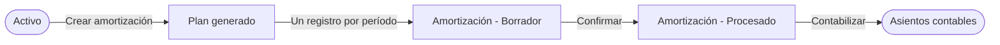
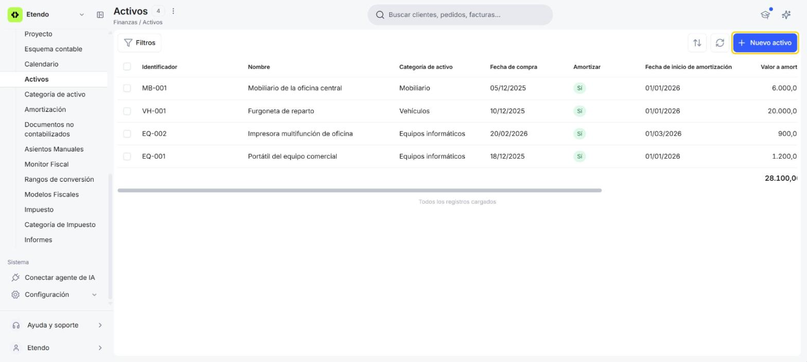
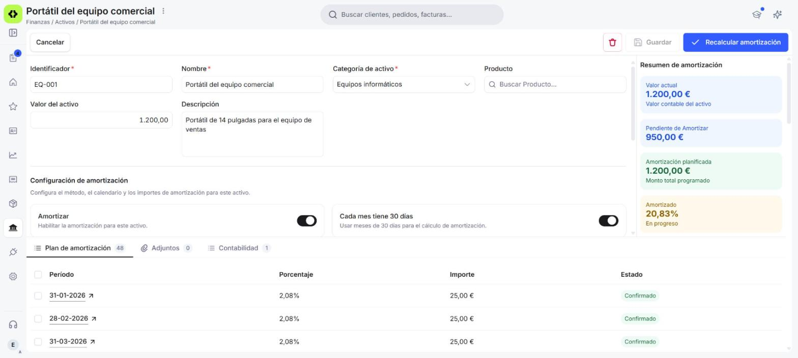
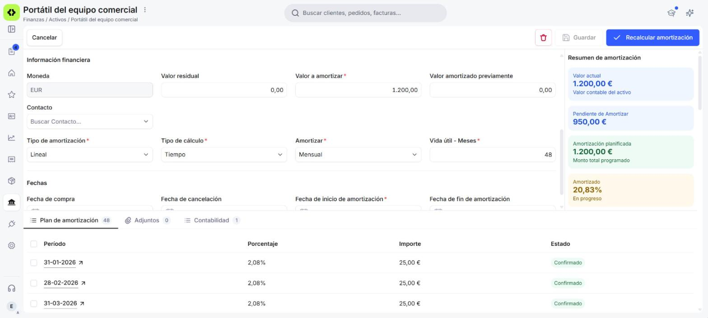
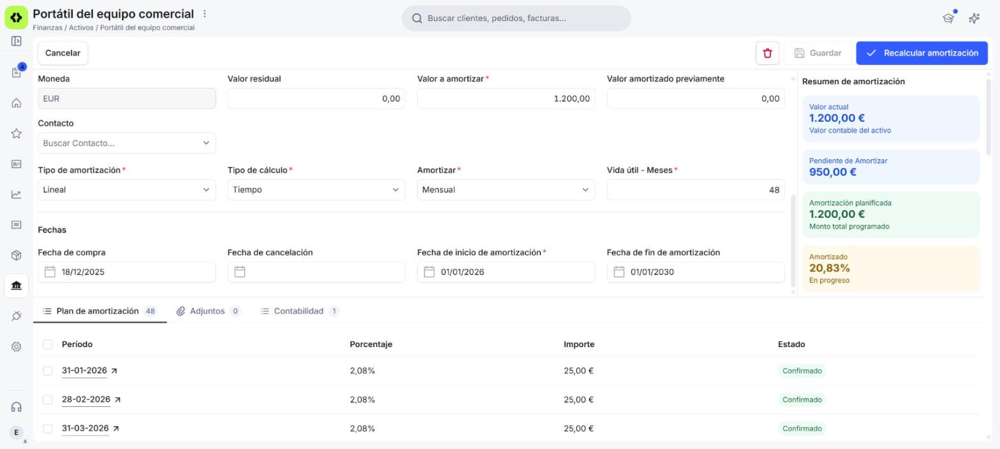
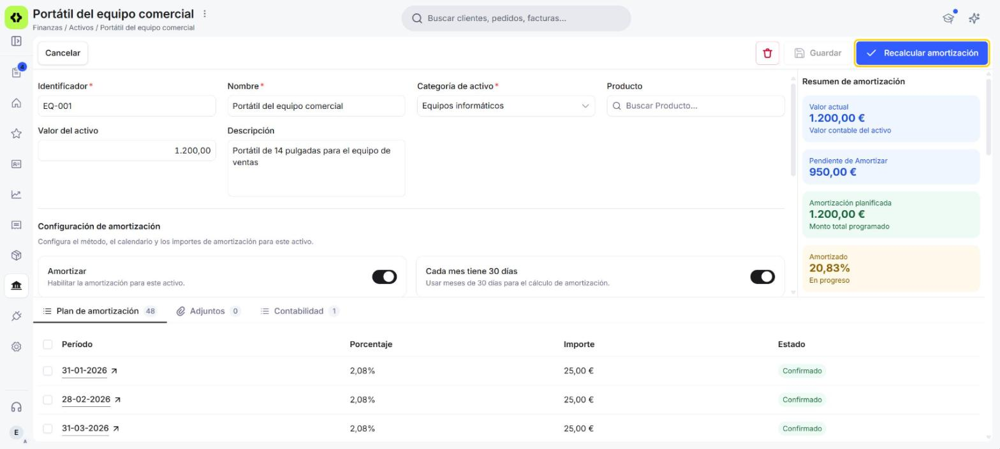

# Apuntar un activo

Un **activo** es un bien fijo de la empresa (vehículo, equipo informático, maquinaria) que se amortiza a lo largo de su vida útil. **Apuntar** un activo es el proceso de registrarlo en Etendo para que el sistema pueda calcular y gestionar su amortización: se hace cada vez que la empresa adquiere un bien fijo o cuando se migran activos existentes desde otro sistema.

!!! info "Antes de empezar"
    - Ten a mano la factura de compra: necesitas el importe y la fecha.
    - Comprueba con tu asesor qué **Categoría de activo** corresponde al bien (por ejemplo, *Equipos informáticos* o *Vehículos*). Las categorías se crean y se revisan en **[Finanzas > Categoría de activo](https://app.etendo.ai/asset-group){target="_blank"}**.

## 1. Crea el activo

<figure markdown="span">
  
  <figcaption>Lista de Activos con varios bienes ya registrados y el botón + Nuevo activo.</figcaption>
</figure>

1. Ve a **[Finanzas > Activos](https://app.etendo.ai/assets){target="_blank"}**.
2. Haz clic en **+ Nuevo activo**.

## 2. Identifica el bien

<figure markdown="span">
  
  <figcaption>Datos del portátil EQ-001, con su categoría y su valor de compra.</figcaption>
</figure>

Estos datos aparecen en la parte de arriba del formulario y te sirven para reconocer el activo en la lista:

- **Identificador** *(obligatorio)* — un código corto para encontrarlo rápido. Si ya numeras tus bienes, por ejemplo con una etiqueta pegada en el equipo, usa ese mismo código: `EQ-001`.
- **Nombre** *(obligatorio)* — qué es, dicho de forma que cualquiera de tu equipo lo reconozca: *Portátil del equipo comercial*.
- **Categoría de activo** *(obligatorio)* — el tipo de bien, por ejemplo *Equipos informáticos*. Al elegirla, Etendo propone la forma de amortizar que tiene configurada esa categoría; puedes cambiarla después en este mismo activo.
- **Producto** — si el bien también está dado de alta en tu catálogo de productos, puedes relacionarlo aquí.
- **Valor del activo** — lo que pagaste por el bien: `1.200`.
- **Descripción** — cualquier dato que te ayude a localizarlo: número de serie, dónde está o quién lo usa.

## 3. Configura la amortización

<figure markdown="span">
  
  <figcaption>Portátil EQ-001: 1.200 € repartidos en 48 cuotas mensuales.</figcaption>
</figure>

Aquí decides si el bien se amortiza y a qué ritmo.

1. Activa **Amortizar**. Al hacerlo aparecen el interruptor **Cada mes tiene 30 días** y las secciones **Información financiera** y **Fechas**. Si lo dejas desactivado, el activo queda registrado, pero Etendo no calcula su amortización.
2. Revisa el **Valor residual**: lo que calculas que valdrá el bien cuando dejes de usarlo, por ejemplo lo que te darían al venderlo. Si no esperas recuperar nada, déjalo en `0`.
3. Revisa el **Valor a amortizar** *(obligatorio)*. Se completa solo con el valor del activo menos el valor residual. Puedes cambiarlo si tu asesor te indica otro importe.
4. Si el bien ya se venía amortizando antes de empezar con Etendo, escribe en **Valor amortizado previamente** lo que ya se amortizó.
5. Si quieres, relaciona el bien con un **Contacto**.
6. Deja **Tipo de amortización** *(obligatorio)* en *Lineal*: el valor se reparte en partes iguales.
7. Elige el **Tipo de cálculo** *(obligatorio)* según lo que sepas del bien:

=== "Si sabes cuánto tiempo lo vas a usar"

    Elige *Tiempo*. Después indica en **Amortizar** cada cuánto quieres anotar la amortización (*Mensual* o *Anual*) y en **Vida útil - Meses** o **Vida útil - Años** durante cuánto tiempo vas a usar el bien.

    - Portátil `EQ-001`: 1.200 €, mensual, 48 meses → 25 € al mes.
    - Mobiliario `MB-001`: 6.000 €, anual, 10 años → 600 € al año.

=== "Si tu asesor te da un porcentaje anual"

    Elige *Porcentaje* y escribe el **% Amortización anual** *(obligatorio)*. Con este cálculo, Etendo anota la amortización una vez al año, el 31 de diciembre.

    - Vehículo `VH-001`: 24.000 € de valor, 4.000 € de valor residual y 16 % anual → 3.200 € al año.

## 4. Indica las fechas

<figure markdown="span">
  
  <figcaption>Fechas del portátil EQ-001: comprado el 18/12/2025 y amortizándose desde el 01/01/2026.</figcaption>
</figure>

- **Fecha de compra** — la fecha de la factura de compra.
- **Fecha de inicio de amortización** *(obligatorio)* — desde cuándo usas el bien. Es el punto de partida de la primera cuota.
- **Fecha de fin de amortización** — cuándo termina de amortizarse. Si amortizas por *Tiempo* con periodicidad *Mensual*, se completa sola; en los demás casos queda vacía.
- **Fecha de cancelación** — déjala vacía mientras el bien siga siendo tuyo.

Haz clic en **Guardar**.

## 5. Genera el plan de amortización

<figure markdown="span">
  
  <figcaption>Portátil EQ-001 con su plan generado: una cuota de 25 € por mes y el resumen del activo.</figcaption>
</figure>

Haz clic en **Crear amortización**. Etendo calcula las cuotas y las muestra en la pestaña **Plan de amortización**: en el caso del portátil, una línea de 25 € por cada uno de los 48 meses. El panel **Resumen de amortización** te muestra cuánto queda pendiente de amortizar y qué porcentaje llevas.

!!! warning "Sin este paso no hay amortización"
    Si no haces clic en **Crear amortización**, el activo queda registrado, pero Etendo no prepara ninguna cuota.

Una vez generado el plan, el botón pasa a llamarse **Recalcular amortización**. Úsalo si cambias después el valor, el ritmo o las fechas del bien, para volver a calcular el plan.

Para llevar cada cuota a tu contabilidad, consulta [Crear y ejecutar un plan de amortización](../como-crear-y-ejecutar-un-plan-de-amortizacion/como-crear-y-ejecutar-un-plan-de-amortizacion.md).

!!! tip "Guarda la factura de compra con el activo"
    Después de guardar el activo, en su pestaña **Adjuntos** puedes subir la factura de compra, la garantía o cualquier otro documento del bien (PDF, Word, Excel, PowerPoint, imágenes, XML, ZIP o RTF). Así lo tienes todo en un mismo sitio.

!!! info "Para tu asesor"
    - Las cuentas contables de la amortización salen de la **Categoría de activo**, en su pestaña **Contabilidad**. Al crear una categoría, Etendo le asigna unas cuentas por defecto que conviene revisar antes de registrar activos en ella.
    - La pestaña **Contabilidad** del activo muestra, por esquema contable, las cuentas de **Amortización acumulada** y de **Amortización** que se usan para ese bien.
    - Con *Porcentaje*, el porcentaje se aplica sobre el **Valor a amortizar** y se genera una línea por año, fechada el 31 de diciembre.
    - **Cada mes tiene 30 días** calcula todos los meses como si tuvieran 30 días, para que las cuotas mensuales sean iguales.
    - Los asientos de cada período se generan al contabilizar el registro de **Amortización** correspondiente.

---

## Artículos Relacionados

- [Activos: referencia de campos](../referencia-de-campos-de-activo/referencia-de-campos-de-activo.md)
- [Crear y ejecutar un plan de amortización](../como-crear-y-ejecutar-un-plan-de-amortizacion/como-crear-y-ejecutar-un-plan-de-amortizacion.md)
- [Glosario de Finanzas](../glosario-de-finanzas/glosario-de-finanzas.md)

---
Esta obra está bajo la licencia :material-creative-commons: :fontawesome-brands-creative-commons-by: :fontawesome-brands-creative-commons-sa: [CC BY-SA 2.5 ES](https://creativecommons.org/licenses/by-sa/2.5/es/){target="_blank"} de [Futit Services S.L](https://etendo.software){target="_blank"}.
