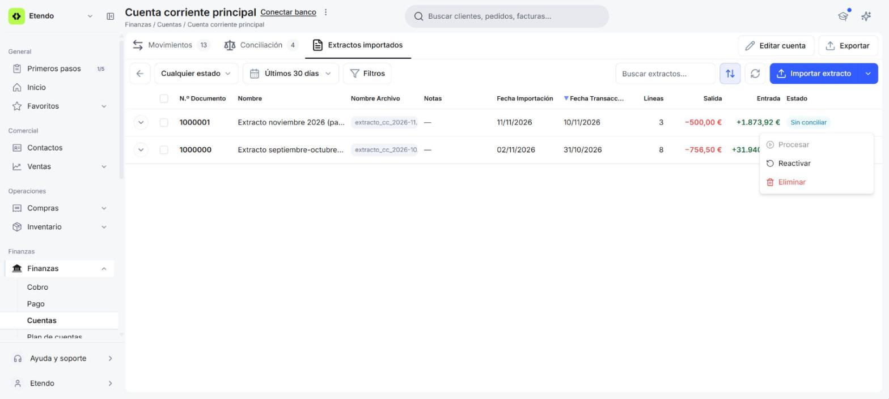
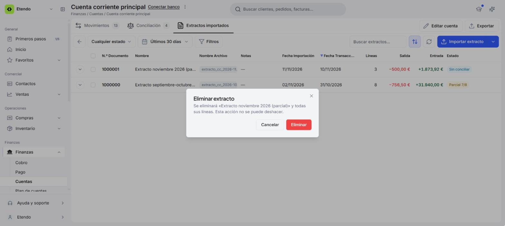
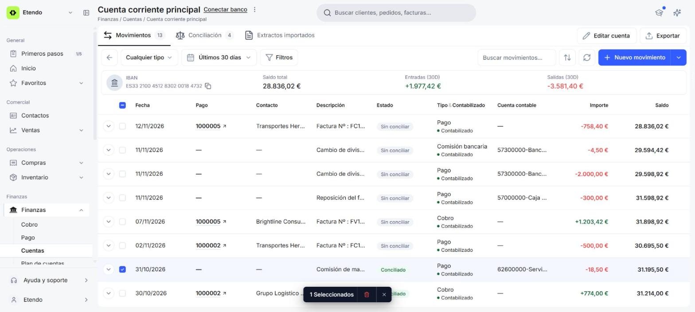
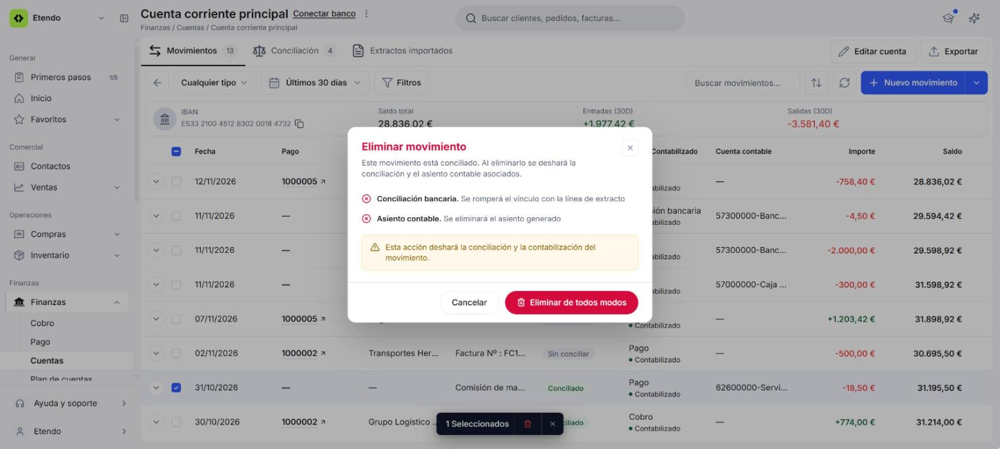

---
tags:
    - Cuentas
    - Finanzas
    - Extracto Bancario
    - Etendo
---

# Borrar un extracto o un movimiento

En una cuenta puedes borrar dos cosas distintas:

- Un **extracto importado**, con todas sus líneas de extracto. Es lo que necesitas si subiste un archivo equivocado o dos veces el mismo.
- Un **movimiento** de la pestaña **Movimientos**, por ejemplo uno que registraste a mano por error.

Importar un extracto no crea movimientos: crea un extracto con sus líneas, que no cambian el saldo de la cuenta hasta que las concilias. Por eso, para deshacer una importación, borra el extracto, no movimientos.

En ambos casos el borrado solo afecta a Etendo; el archivo original de tu banco no se modifica.

## Borrar un extracto importado

1. Abre la cuenta desde **[Finanzas > Cuentas](https://app.etendo.ai/financial-account){target="_blank"}** y ve a la pestaña **Extractos importados**.
2. Localiza el extracto por su **N.º Documento**, **Nombre** o **Nombre Archivo**. Si tienes dudas, haz clic en la flecha de la izquierda para ver sus líneas y comprobar que es el que quieres borrar.
3. Pasa el cursor sobre la fila, abre el menú de acciones (**⋮**) y elige **Eliminar**.

    

4. Confirma en el diálogo **Eliminar extracto**, que indica que se eliminará el extracto con todas sus líneas y que la acción no se puede deshacer.

    

También puedes marcar la casilla de uno o varios extractos y hacer clic en el icono de papelera de la barra **Seleccionados** que aparece abajo.

!!! warning "Revisa el estado antes de borrar"
    Etendo no avisa al borrar un extracto que ya tiene líneas conciliadas. Si su **Estado** es **Parcial** o **Conciliado**, desconcilia antes esas líneas desde la pestaña **Conciliación** (consulta [Conciliar o desconciliar movimientos contra documentos](../como-conciliar-o-desconciliar-movimientos-contra-documentos/como-conciliar-o-desconciliar-movimientos-contra-documentos.md)) para no dejar conciliaciones a medias.

!!! info "No se pueden borrar líneas sueltas"
    Las líneas de un extracto no se borran una a una. Si solo algunas están mal, borra el extracto completo y vuelve a importarlo con el archivo corregido.

## Borrar un movimiento

1. En la cuenta, ve a la pestaña **Movimientos**. La columna **Estado** indica si cada movimiento está **Sin conciliar** o **Conciliado**.
2. Marca la casilla del movimiento que quieres borrar. Para seleccionar varios, marca cada fila o usa la casilla del encabezado, que selecciona todas las filas visibles con los filtros aplicados.
3. En la barra **Seleccionados** que aparece abajo, haz clic en el icono de papelera. También puedes abrir el menú **⋮** de la fila y elegir **Eliminar**.

    

4. Confirma en el diálogo:
    - Si el movimiento está **Sin conciliar**, el diálogo **Eliminar registros** te pide confirmar que quieres eliminarlo, porque la acción no se puede deshacer. Haz clic en **Eliminar**.
    - Si está **Conciliado**, el diálogo **Eliminar movimiento** te avisa de que se romperá el vínculo con la línea de extracto y se eliminará el asiento contable generado. Si estás seguro, haz clic en **Eliminar de todos modos**.

    

## Volver a importar el extracto

Una vez borrado el extracto incorrecto, sube el archivo de nuevo siguiendo [Importar o descargar el extracto bancario](../como-importar-o-descargar-el-extracto-bancario/como-importar-o-descargar-el-extracto-bancario.md). Borra siempre el extracto duplicado antes de reimportar; si no, la pestaña **Conciliación** mostrará cada operación dos veces como pendiente.

---

## Artículos Relacionados

- [Importar o descargar el extracto bancario](../como-importar-o-descargar-el-extracto-bancario/como-importar-o-descargar-el-extracto-bancario.md)
- [Conciliar o desconciliar movimientos contra documentos](../como-conciliar-o-desconciliar-movimientos-contra-documentos/como-conciliar-o-desconciliar-movimientos-contra-documentos.md)
- [¿Qué es la conciliación bancaria en Etendo?](../que-es-la-conciliacion-bancaria-en-etendo/que-es-la-conciliacion-bancaria-en-etendo.md)
- [Gestionar pagos y cobros](../como-gestionar-pagos-y-cobros/como-gestionar-pagos-y-cobros.md)

---
Esta obra está bajo la licencia :material-creative-commons: :fontawesome-brands-creative-commons-by: :fontawesome-brands-creative-commons-sa: [CC BY-SA 2.5 ES](https://creativecommons.org/licenses/by-sa/2.5/es/){target="_blank"} de [Futit Services S.L](https://etendo.software){target="_blank"}.
