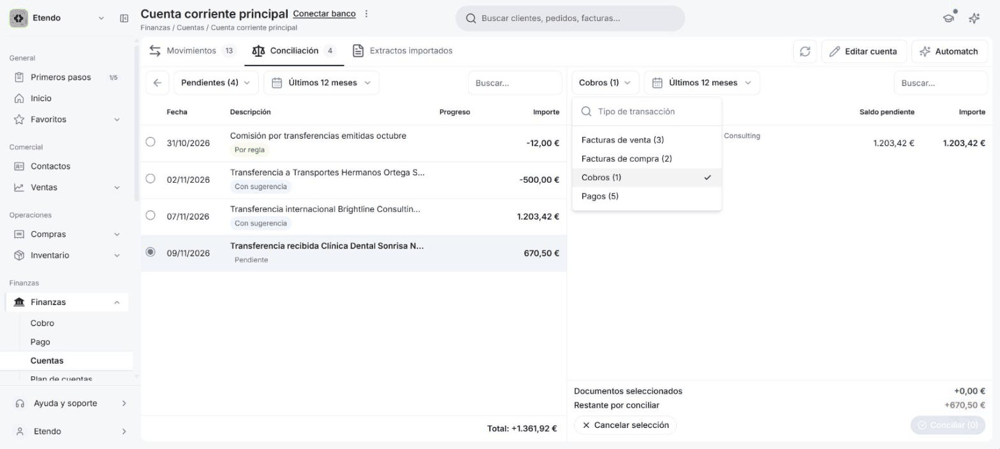
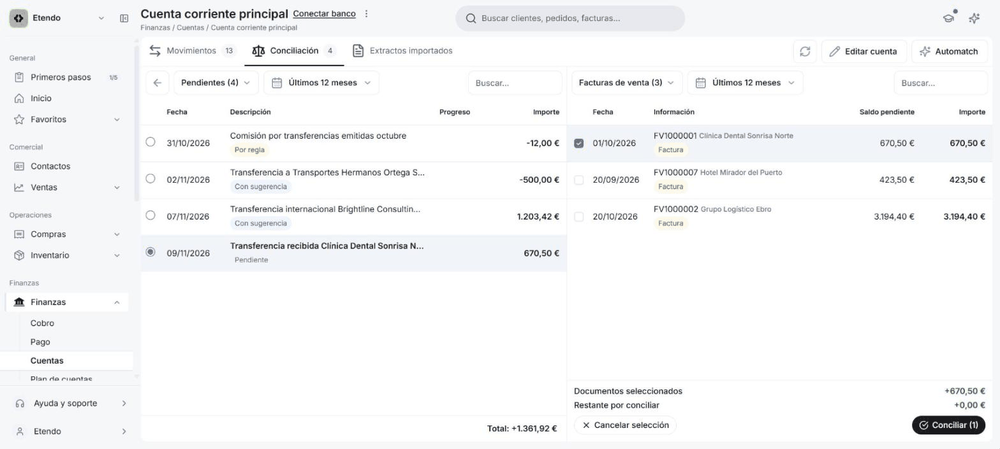
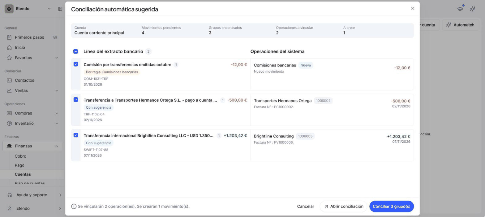
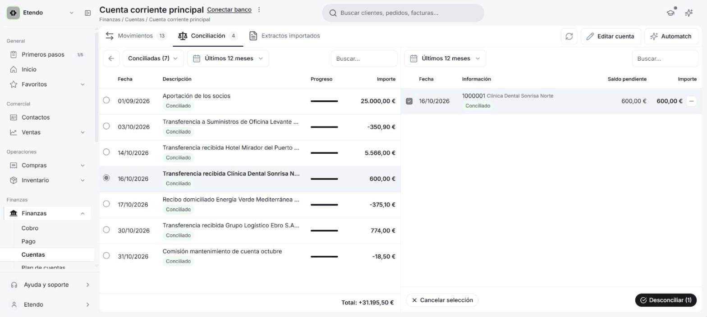
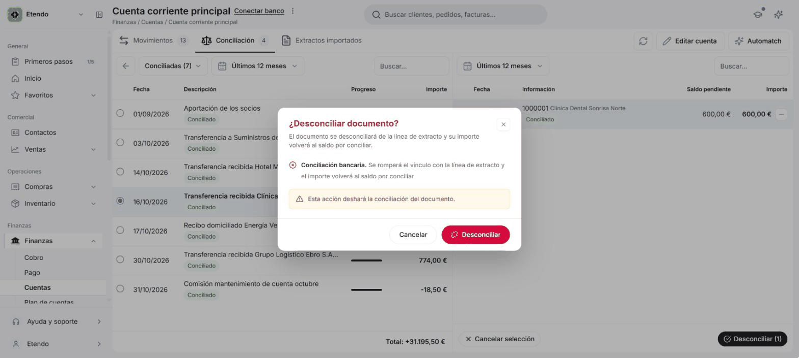

---
tags:
    - Cuentas
    - Finanzas
    - Conciliación Bancaria
    - Etendo
---

# Conciliar o desconciliar movimientos contra documentos

Conciliar vincula una línea de tu extracto bancario con el documento de Etendo que le corresponde (una factura, un cobro o un pago). Puedes hacerlo a mano, línea por línea, o dejar que Etendo proponga las coincidencias con Automatch.

## Filtros de la pestaña Conciliación

En la pestaña **Conciliación** de una cuenta, puedes filtrar las líneas de extracto por estado. Cada filtro muestra entre paréntesis cuántas líneas contiene:

- **Todos**: todas las líneas del periodo.
- **Pendientes**: líneas sin conciliar. Incluye las que tienen sugerencia o regla.
- **Con sugerencia**: Automatch encontró un documento que coincide.
- **Por regla**: la línea coincide con una [regla de matcheo](../como-configurar-reglas-para-automatizar-la-conciliacion-bancaria/como-configurar-reglas-para-automatizar-la-conciliacion-bancaria.md).
- **Con diferencia**: líneas cuyo importe no cuadra con los documentos vinculados.
- **Conciliadas**: líneas ya vinculadas a su documento.

## Conciliar un movimiento contra un documento

1. Abre la cuenta desde **[Finanzas > Cuentas](https://app.etendo.ai/financial-account){target="_blank"}** y ve a la pestaña **Conciliación**.
2. Filtra por **Pendientes** y selecciona una línea en el panel izquierdo.
3. En el desplegable de la cabecera del panel derecho, elige el tipo de documento a buscar: **Facturas de venta**, **Facturas de compra**, **Cobros** o **Pagos**. Cada opción indica cuántos documentos hay disponibles.

    

4. Marca la casilla de cada documento que corresponda a la línea. Abajo se actualizan **Documentos seleccionados** y **Restante por conciliar**.
5. Cuando el restante llega a 0, haz clic en **Conciliar**. El número entre paréntesis indica cuántos documentos vas a vincular.

    

Si te equivocas al marcar, haz clic en **Cancelar selección** para empezar de nuevo.

## Conciliar varias líneas con Automatch

Haz clic en **Automatch** (arriba a la derecha) para abrir **Conciliación automática sugerida**. Si hay sugerencias, la ventana se abre sola al entrar en la pestaña **Conciliación**.

Etendo agrupa cada línea del extracto con su operación del sistema y muestra un resumen: **Movimientos pendientes**, **Grupos encontrados**, **Operaciones a vincular** y **A crear**.

- Las líneas **Con sugerencia** se vinculan a un documento existente (por ejemplo, una factura).
- Las líneas **Por regla** no tienen documento: Etendo crea un movimiento nuevo con los datos de la regla, marcado como **Nueva**.

Desmarca los grupos que no quieras conciliar y confirma con **Conciliar [N] grupo(s)**. Si prefieres revisar una línea a mano, haz clic en **Abrir conciliación**.

## Desconciliar un movimiento

1. En la pestaña **Conciliación**, cambia el filtro a **Conciliadas**.
2. Selecciona la línea que quieres desconciliar. El panel derecho muestra el documento vinculado, ya marcado.
3. Haz clic en **Desconciliar**. El número entre paréntesis indica cuántos documentos vas a desconciliar.

    

4. En el diálogo **¿Desconciliar documento?**, haz clic en **Desconciliar** para confirmar. Se rompe el vínculo con la línea de extracto y su importe vuelve al saldo por conciliar.

    

Una vez desconciliado, ya puedes reactivar el cobro o el pago si necesitas modificarlo.

---

## Artículos Relacionados

- [¿Qué es la conciliación bancaria en Etendo?](../que-es-la-conciliacion-bancaria-en-etendo/que-es-la-conciliacion-bancaria-en-etendo.md)
- [Importar o descargar el extracto bancario](../como-importar-o-descargar-el-extracto-bancario/como-importar-o-descargar-el-extracto-bancario.md)
- [Configurar reglas para automatizar la conciliación](../como-configurar-reglas-para-automatizar-la-conciliacion-bancaria/como-configurar-reglas-para-automatizar-la-conciliacion-bancaria.md)
- [Registrar un cobro](../como-registrar-un-cobro/como-registrar-un-cobro.md)
- [Registrar un pago](../como-registrar-un-pago/como-registrar-un-pago.md)
- [Gestionar pagos y cobros](../como-gestionar-pagos-y-cobros/como-gestionar-pagos-y-cobros.md)

---
Esta obra está bajo la licencia :material-creative-commons: :fontawesome-brands-creative-commons-by: :fontawesome-brands-creative-commons-sa: [CC BY-SA 2.5 ES](https://creativecommons.org/licenses/by-sa/2.5/es/){target="_blank"} de [Futit Services S.L](https://etendo.software){target="_blank"}.
