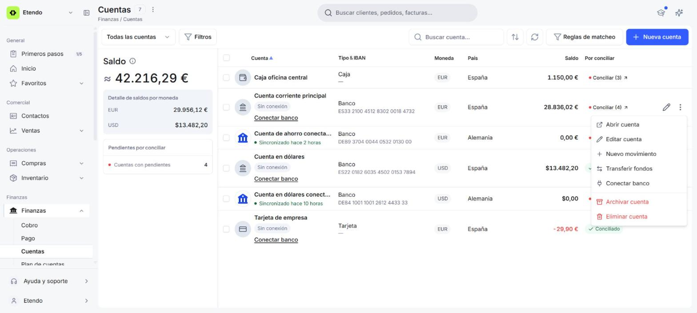
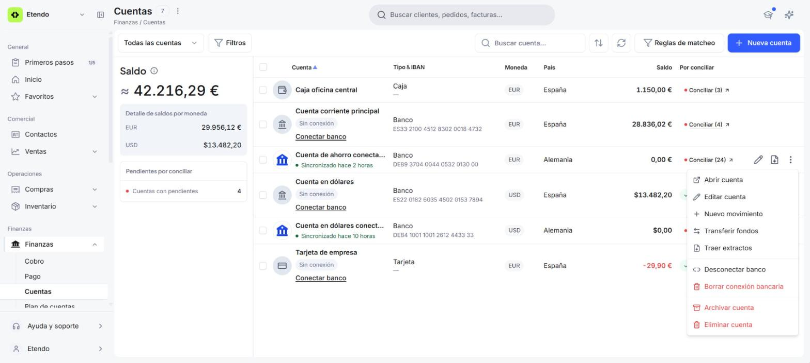
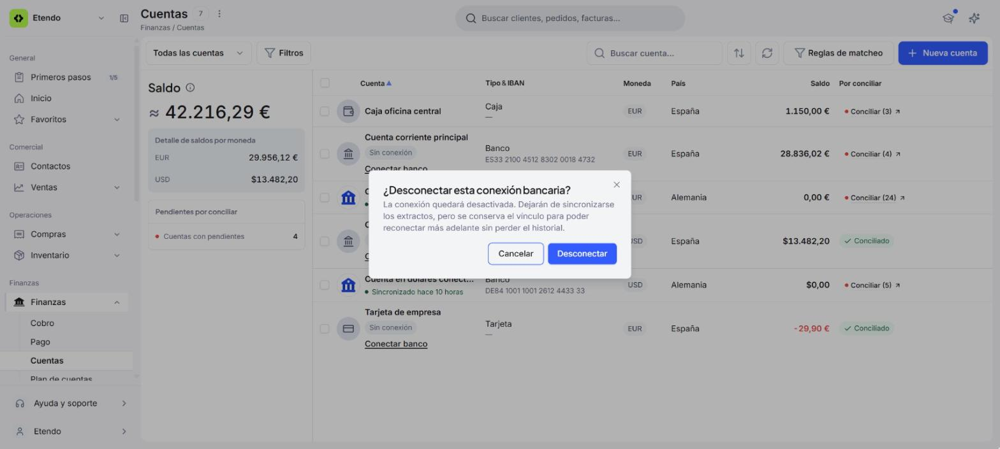
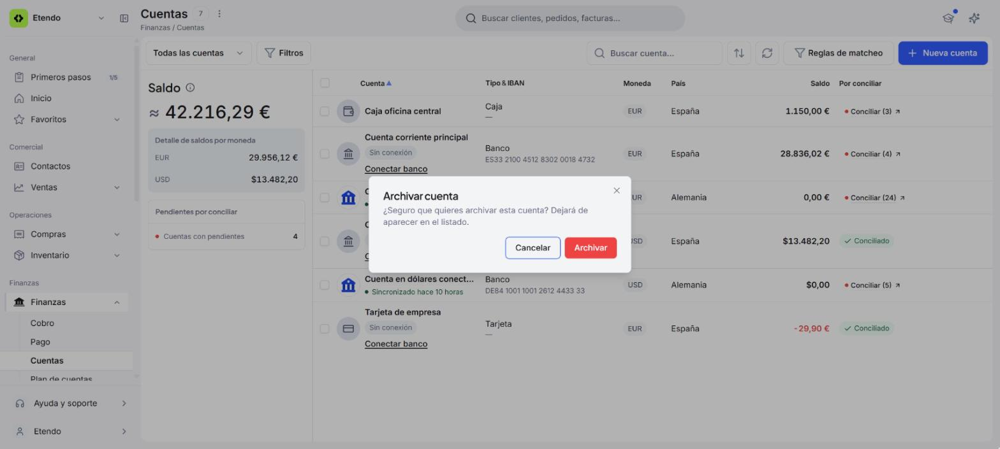

---
tags:
    - Cuentas
    - Finanzas
    - Bancos
    - Etendo
features: [psd2-statement-import-settings]
---

# Conectar, desconectar, archivar, desarchivar o eliminar una cuenta

Una vez que tienes una cuenta creada en **Cuentas**, puedes conectarla con tu banco para recibir sus movimientos automáticamente, desconectarla, dejar de usarla sin perder su historial o eliminarla.

Todas las acciones de esta página están en el menú de la cuenta: ve a **[Finanzas > Cuentas](https://app.etendo.ai/financial-account){target="_blank"}**, pasa el cursor sobre la fila de la cuenta y haz clic en el icono **⋮** de la derecha. Las opciones dependen del tipo de cuenta y de si está conectada.

## Conectar una cuenta con tu banco

Aplica a cuentas de tipo **Banco** o **Tarjeta** que están **Sin conexión**. Una **Caja** no se conecta con ningún banco: sus movimientos se registran a mano.

1. Haz clic en el enlace **Conectar banco** que aparece bajo el nombre de la cuenta, o elige **Conectar banco** en su menú **⋮**. También lo tienes en **Editar cuenta**, en la sección **Conexión bancaria**.
2. Etendo muestra el aviso **Conectando con tu banco…** y abre una ventana aparte, **Conectar Cuenta**.
3. En **Elige tu banco**, busca tu banco por su nombre y selecciónalo.
4. Completa la autenticación con tu banco. La ventana se cierra sola al terminar.

Cuando la conexión está activa, la cuenta muestra en el listado **Sincronizado hace…** con el tiempo transcurrido desde la última sincronización. Mientras esté conectada, sus extractos llegan desde tu banco, y también puedes traerlos cuando quieras con **Traer extractos**, en su menú **⋮**.

!!! tip "Comprueba que tus extractos están al día"
    **Sincronizado hace…**, bajo el nombre de la cuenta, indica cuándo se trajeron los últimos extractos; pasa el cursor por encima para ver la fecha y la hora exactas. El mismo dato aparece en **Editar cuenta**, sección **Conexión bancaria** (**Última sincronización**), junto con los días que faltan para que expire la autorización de tu banco. Si la fecha deja de avanzar o la autorización está a punto de caducar, haz clic en **Re-autorizar** para no interrumpir la sincronización. Las cuentas sin conexión no muestran este dato.

## Desconectar una cuenta de tu banco

Aplica solo a cuentas conectadas. Al desconectar se detiene la sincronización automática; la cuenta no se elimina.

1. En el menú **⋮** de la cuenta conectada, selecciona **Desconectar banco**. También está al pie de **Editar cuenta**.
2. Confirma con **Desconectar** en el diálogo **¿Desconectar esta conexión bancaria?**, que avisa de que dejarán de sincronizarse los extractos, pero se conserva el vínculo para poder reconectar más adelante sin perder el historial.

    

!!! warning "Desconectar no es lo mismo que Borrar conexión bancaria"
    El menú de una cuenta conectada también ofrece **Borrar conexión bancaria**. Esta opción elimina la conexión con el proveedor bancario de forma permanente: no se puede restaurar y, si vuelves a conectar, se empieza de cero y los movimientos que ya tenías pueden volver a traerse. Si solo quieres pausar la sincronización, usa **Desconectar banco**.

## Archivar una cuenta

Archivar es la forma de **desactivar** una cuenta que ya no usas: deja de aparecer en el listado, pero conserva su historial y puedes recuperarla en cualquier momento.

1. En el menú **⋮** de la cuenta, selecciona **Archivar cuenta**. También tienes el botón **Archivar cuenta** al pie de [Editar cuenta](../como-editar-una-cuenta/como-editar-una-cuenta.md).
2. Confirma con **Archivar** en el diálogo **Archivar cuenta**.

    

La cuenta deja de aparecer en el listado. Para verla, abre el desplegable **Todas las cuentas** y elige **Inactivas**.

## Desarchivar una cuenta

1. En el listado de **Cuentas**, abre el desplegable **Todas las cuentas** y elige **Inactivas**.
2. En el menú **⋮** de la cuenta, selecciona **Desarchivar cuenta**.
3. Confirma con **Desarchivar** en el diálogo **Desarchivar cuenta**. La cuenta vuelve a aparecer en el listado y puedes operar con ella con normalidad.

## Eliminar una cuenta

!!! warning "Acción irreversible"
    A diferencia de **Archivar cuenta**, **Eliminar cuenta** no se puede deshacer. Si no estás seguro, archívala.

1. En el menú **⋮** de la cuenta, selecciona **Eliminar cuenta**.
2. Confirma con **Eliminar** en el diálogo **Eliminar cuenta**: *"¿Seguro que quieres eliminar esta cuenta? Esta acción no se puede deshacer."*

---

## Artículos Relacionados

- [Añadir y configurar un banco, tarjeta o caja](../como-anadir-y-configurar-un-banco-tarjeta-o-caja/como-anadir-y-configurar-un-banco-tarjeta-o-caja.md)
- [Cómo editar una cuenta](../como-editar-una-cuenta/como-editar-una-cuenta.md)
- [Importar o descargar el extracto bancario](../como-importar-o-descargar-el-extracto-bancario/como-importar-o-descargar-el-extracto-bancario.md)
- [Borrar un extracto o un movimiento](../como-borrar-transacciones-del-extracto-bancario/como-borrar-transacciones-del-extracto-bancario.md)
- [¿Qué es la conciliación bancaria en Etendo?](../que-es-la-conciliacion-bancaria-en-etendo/que-es-la-conciliacion-bancaria-en-etendo.md)

---
Esta obra está bajo la licencia :material-creative-commons: :fontawesome-brands-creative-commons-by: :fontawesome-brands-creative-commons-sa: [CC BY-SA 2.5 ES](https://creativecommons.org/licenses/by-sa/2.5/es/){target="_blank"} de [Futit Services S.L](https://etendo.software){target="_blank"}.
