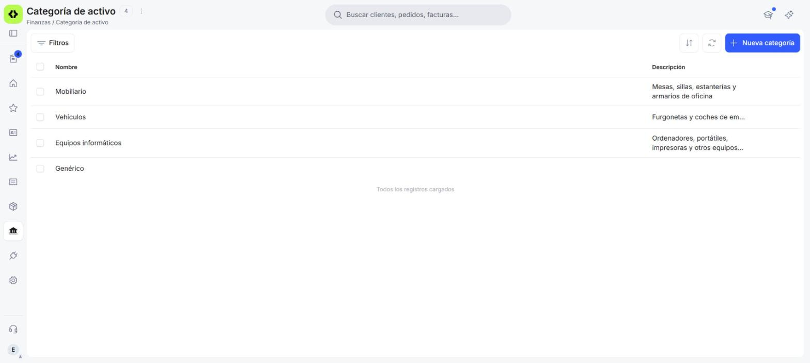
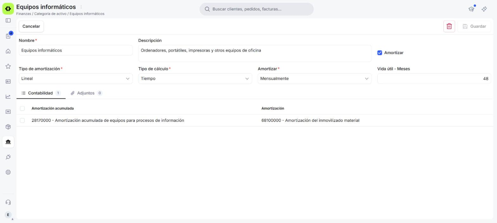

# Cómo configurar las categorías de activo

Una **categoría de activo** agrupa los bienes del mismo tipo, por ejemplo `Equipos informáticos`, `Vehículos` o `Mobiliario`. Cada categoría guarda la forma de amortizar habitual para ese tipo de bien y las cuentas contables donde se anota su amortización. Cuando registras un activo y eliges su categoría, Etendo te propone esa forma de amortizar.

## Consultar tus categorías

<figure markdown="span">
  
  <figcaption>Lista de categorías de activo.</figcaption>
</figure>

1. En el menú lateral, dentro de **Finanzas**, haz clic en **[Categoría de activo](https://app.etendo.ai/asset-group){target="_blank"}**.
2. Revisa la lista: para cada categoría ves su **Nombre** y su **Descripción**.
3. Haz clic en una categoría para abrir su ficha.

## Crear una categoría

<figure markdown="span">
  
  <figcaption>Categoría que se amortiza mensualmente durante 48 meses.</figcaption>
</figure>

1. Haz clic en **Nueva categoría**.
2. Completa **Nombre** *(obligatorio)*, por ejemplo `Equipos informáticos`, y si quieres una **Descripción**.
3. Si los bienes de esta categoría se amortizan, marca **Amortizar** y completa los campos que aparecen:
    - **Tipo de amortización** *(obligatorio)* — **Lineal**, la única opción.
    - **Tipo de cálculo** *(obligatorio)* — viene con **Porcentaje**, para amortizar un porcentaje fijo cada año. Cámbialo a **Tiempo** si amortizas según los años o meses de vida útil.
    - Con **Tiempo**: en el desplegable **Amortizar** *(obligatorio)* elige **Mensualmente** o **Anualmente**, y completa **Vida útil - Meses** o **Vida útil - Años**.
    - Con **Porcentaje**: completa **% anual amortización**.
4. Haz clic en **Guardar**.

Al guardar, Etendo le asigna unas cuentas por defecto en la pestaña **Contabilidad**: **Amortización acumulada** y **Amortización**. Revísalas antes de registrar activos en la categoría. Para cambiarlas, pasa el ratón por la fila y haz clic en el lápiz: la fila pasa a editarse y puedes buscar y elegir otra cuenta en cada columna.

!!! info "Para tu asesor"
    - La pestaña **Contabilidad** indica, por esquema contable, la cuenta de **Amortización acumulada** (por ejemplo, `28170000`) y la de **Amortización** (por ejemplo, `68100000`) que se usan al contabilizar la amortización de los activos de la categoría.
    - Los valores de amortización de la categoría solo se proponen al crear el activo; después se pueden cambiar en cada activo.

## Artículos Relacionados

- [Apuntar un activo](../como-apuntar-un-activo/como-apuntar-un-activo.md)
- [Activos: referencia de campos](../referencia-de-campos-de-activo/referencia-de-campos-de-activo.md)
- [Crear y ejecutar un plan de amortización](../como-crear-y-ejecutar-un-plan-de-amortizacion/como-crear-y-ejecutar-un-plan-de-amortizacion.md)

---
Esta obra está bajo la licencia :material-creative-commons: :fontawesome-brands-creative-commons-by: :fontawesome-brands-creative-commons-sa: [CC BY-SA 2.5 ES](https://creativecommons.org/licenses/by-sa/2.5/es/){target="_blank"} de [Futit Services S.L](https://etendo.software){target="_blank"}.
