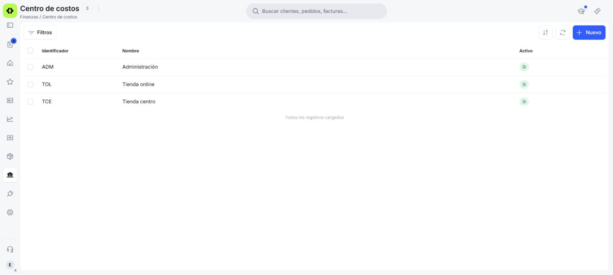
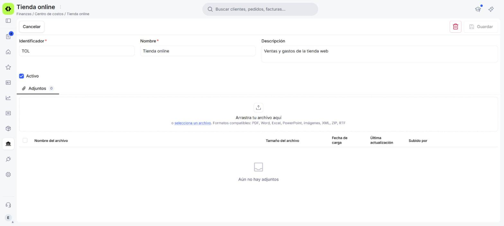

# Cómo configurar los centros de costos

Un **centro de costos** es un área de tu negocio de la que quieres conocer sus números por separado: una tienda, un departamento o una línea de negocio. Por ejemplo, `Tienda centro`, `Tienda online` y `Administración`. Así puedes analizar cuánto vende y cuánto gasta cada área, y no solo el total de la empresa.

Es opcional: Etendo funciona sin centros de costos, y la lista está vacía hasta que creas los tuyos. Crea uno solo para cada área que quieras seguir por su cuenta.

- Solo el rol **Administrador** ve esta ventana. Consulta [Acceso por rol](../../sistema/configuracion/glosario-de-roles-y-usuarios/glosario-de-roles-y-usuarios.md#acceso-por-rol).

## Consultar tus centros de costos

<figure markdown="span">
  
  <figcaption>Lista de centros de costos de una empresa con dos tiendas y un área de administración.</figcaption>
</figure>

1. En el menú lateral, dentro de **Finanzas**, haz clic en **[Centro de costos](https://app.etendo.ai/cost-center){target="_blank"}**.
2. Revisa la lista. Para cada centro de costos ves:
    - **Identificador** — un código corto que lo distingue de los demás.
    - **Nombre** — el nombre con el que lo reconoces.
    - **Activo** — *Sí* si el centro de costos está activo.

En la barra superior tienes **Filtros**, para buscar por identificador, nombre o si está activo; los botones para ordenar y actualizar la lista, y **+ Nuevo**, para crear uno. Mientras no hayas creado ninguno, la lista muestra *"Sin registros aún"*.

## Crear un centro de costos

<figure markdown="span">
  
  <figcaption>Centro de costos de la tienda online, con su identificador, nombre y descripción.</figcaption>
</figure>

En este ejemplo, tu empresa vende en una tienda física y en su web, y quiere saber qué deja cada canal.

1. Haz clic en **+ Nuevo**.
2. Completa **Identificador** *(obligatorio)* con un código corto que reconozcas, por ejemplo `TOL`.
3. Completa **Nombre** *(obligatorio)* con un nombre que se entienda solo: `Tienda online`.
4. Si quieres, completa **Descripción** para anotar qué incluye este centro de costos, por ejemplo `Ventas y gastos de la tienda web`.
5. Deja marcada la casilla **Activo**, que viene marcada por defecto.
6. Haz clic en **Guardar**. El botón se activa cuando completas **Identificador** y **Nombre**. Para salir sin crear nada, haz clic en **Cancelar**.

Repite estos pasos con cada área que quieras seguir. Una vez guardado, en la pestaña **Adjuntos** puedes subir documentos relacionados con el centro de costos.

!!! tip "Pocos centros de costos, bien elegidos"
    Crea solo los que vayas a revisar. Con dos o tres áreas claras, como cada tienda y la administración, ya puedes comparar cómo le va a cada una.

## Editar o desactivar un centro de costos

1. En la lista, haz clic en el centro de costos para abrir su ficha.
2. Cambia lo que necesites. Si un área deja de existir, por ejemplo porque cierras una tienda, desmarca **Activo**.
3. Haz clic en **Guardar**.

En la ficha también tienes el botón **Eliminar** (el icono de la papelera).

!!! info "Para tu asesor"
    - El centro de costos es una dimensión analítica: no cambia las cuentas contables en las que se registra cada operación, sino que la etiqueta con el área a la que pertenece, para poder analizar los resultados por área.
    - En **Finanzas > Informes > Diario de Asientos**, en **Dimensiones**, puedes filtrar los apuntes por centro de costos.

## Artículos Relacionados

- [Gestionar tu plan de cuentas](../gestionar-tu-plan-de-cuentas/gestionar-tu-plan-de-cuentas.md)
- [Glosario de Finanzas](../glosario-de-finanzas/glosario-de-finanzas.md)

---
Esta obra está bajo la licencia :material-creative-commons: :fontawesome-brands-creative-commons-by: :fontawesome-brands-creative-commons-sa: [CC BY-SA 2.5 ES](https://creativecommons.org/licenses/by-sa/2.5/es/){target="_blank"} de [Futit Services S.L](https://etendo.software){target="_blank"}.
