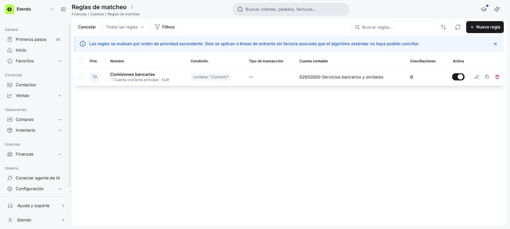

---
tags:
    - Cuentas
    - Finanzas
    - Conciliación Bancaria
    - Automatización
    - Etendo
---

# Configurar reglas para automatizar la conciliación

Algunos movimientos de tu banco se repiten con el mismo texto y no tienen una factura detrás, como la comisión mensual de mantenimiento. Con una regla de matcheo, Etendo reconoce esas líneas del extracto por su concepto y te propone crear el movimiento que les corresponde, con la cuenta contable ya asignada. Así no tienes que registrarlo y conciliarlo a mano cada vez.

!!! info "Cuándo se aplican"
    Las reglas se evalúan por orden de prioridad ascendente: primero se prueba la de número más bajo. Solo se aplican a líneas de extracto sin factura asociada que el algoritmo estándar (Automatch) no haya podido conciliar.

## Crear una regla de matcheo

1. Ve a **[Finanzas > Cuentas](https://app.etendo.ai/financial-account){target="_blank"}** y haz clic en **[Reglas de matcheo](https://app.etendo.ai/match-rule){target="_blank"}**.
2. Haz clic en **Nueva regla**. Se abre el formulario **Nueva regla de matcheo**.
3. Completa los campos obligatorios:
    - **Nombre**: cómo identificas la regla, por ejemplo "Comisión de mantenimiento". Es el nombre que verás después en la etiqueta **Por regla** de la conciliación.
    - **Patrón a buscar**: el texto que Etendo busca en el concepto de la línea de extracto, por ejemplo "mantenimiento".
    - **Cuenta contable**: la cuenta en la que se registra el movimiento que crea la regla.
    - **Condición sobre el concepto**: cómo se compara el patrón con el concepto de la línea: **Contiene**, **Empieza con** o **Coincide con patrón**.
    - **Prioridad**: un número; cuanto más bajo, antes se evalúa la regla. Por defecto es *20*.
4. Si lo necesitas, completa los campos opcionales:
    - **Afecta a**: deja **Todas las cuentas** (valor por defecto) o limita la regla a una cuenta concreta.
    - **Tipo de transacción**: por ejemplo, **Comisión**, **Retención** o **Transferencia**. También puedes crear uno nuevo desde el propio desplegable.
    - **Contacto**: el contacto que se asigna al movimiento.
    - **Dimensiones**: las dimensiones analíticas que tengas habilitadas (por ejemplo, **Producto**).
    - **Activa**: viene encendido; apágalo si quieres crear la regla sin que se aplique todavía.
5. Haz clic en **Crear regla**. La regla aparece en el listado de **Reglas de matcheo**.

!!! tip "Qué condición elegir"
    **Contiene** y **Empieza con** cubren la mayoría de los casos. **Coincide con patrón** sirve para patrones de texto más complejos; úsalo solo si conoces las expresiones regulares.

## Qué ocurre cuando una línea coincide con una regla

1. En la pestaña **Conciliación** de la cuenta, la línea aparece con la etiqueta **Por regla** y puedes encontrarla con el filtro **Por regla**.
2. En **Automatch**, la línea muestra la etiqueta **Por regla:** seguida del nombre de la regla y, en lugar de un documento existente, la operación aparece marcada como **Nueva** (**Nuevo movimiento**). El resumen la cuenta en **A crear** y el pie indica **Se crearán N movimiento(s)**.
3. Si la confirmas con **Conciliar [N] grupo(s)**, Etendo crea el movimiento con la cuenta contable de la regla y lo concilia con la línea de extracto. Si no quieres aplicar la regla a esa línea, desmarca su grupo antes de confirmar.

Encontrarás el paso a paso de Automatch en [Conciliar o desconciliar movimientos contra documentos](../como-conciliar-o-desconciliar-movimientos-contra-documentos/como-conciliar-o-desconciliar-movimientos-contra-documentos.md).

## Gestionar las reglas existentes

El listado de **Reglas de matcheo** muestra, para cada regla, su prioridad (**Prio.**), el **Nombre** con la cuenta a la que afecta, la **Condición**, el **Tipo de transacción**, la **Cuenta contable**, las **Conciliaciones** y si está **Activa**.

- **Activar o desactivar**: usa el interruptor de la columna **Activa**, sin entrar en la regla.
- **Editar, duplicar o eliminar**: pasa el cursor sobre la fila y usa los iconos que aparecen a la derecha (lápiz, copiar y papelera).
- **Cambiar el orden**: edita la regla y cambia su **Prioridad**.
- **Buscar**: escribe en **Buscar reglas...** para encontrar una regla por su texto.

La columna **Conciliaciones** indica cuántas veces se ha usado la regla para conciliar. Si una regla se queda en 0 mucho tiempo, revisa que su patrón coincida con el texto real que envía tu banco.

---

## Artículos Relacionados

- [¿Qué es la conciliación bancaria en Etendo?](../que-es-la-conciliacion-bancaria-en-etendo/que-es-la-conciliacion-bancaria-en-etendo.md)
- [Conciliar o desconciliar movimientos contra documentos](../como-conciliar-o-desconciliar-movimientos-contra-documentos/como-conciliar-o-desconciliar-movimientos-contra-documentos.md)
- [Importar o descargar el extracto bancario](../como-importar-o-descargar-el-extracto-bancario/como-importar-o-descargar-el-extracto-bancario.md)
- [Cómo editar una cuenta](../como-editar-una-cuenta/como-editar-una-cuenta.md)
- [Glosario de Finanzas](../glosario-de-finanzas/glosario-de-finanzas.md)

---
Esta obra está bajo la licencia :material-creative-commons: :fontawesome-brands-creative-commons-by: :fontawesome-brands-creative-commons-sa: [CC BY-SA 2.5 ES](https://creativecommons.org/licenses/by-sa/2.5/es/){target="_blank"} de [Futit Services S.L](https://etendo.software){target="_blank"}.
