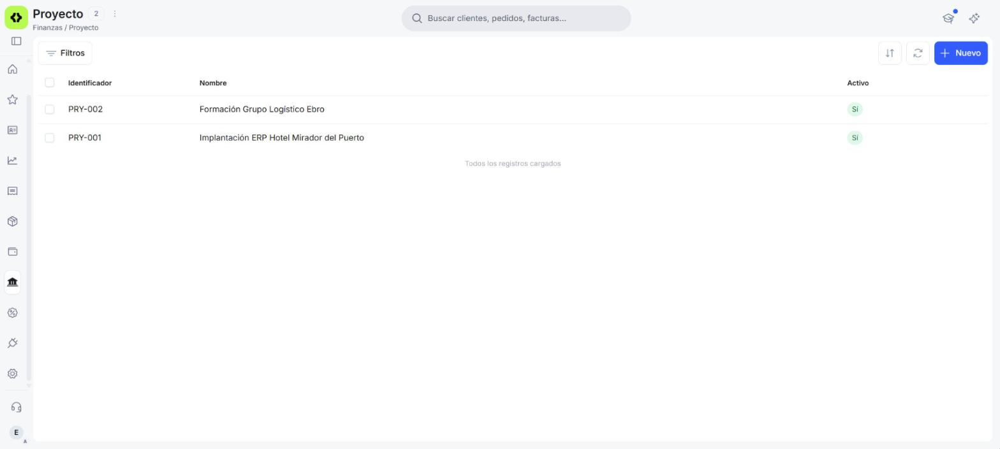
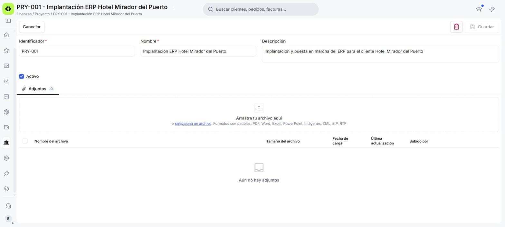

# Cómo crear un proyecto

Un **proyecto** es un trabajo concreto del que quieres conocer sus números por separado, por ejemplo una implantación o un curso para un cliente. Igual que el [centro de costos](../como-configurar-los-centros-de-costos/como-configurar-los-centros-de-costos.md), es opcional: la lista está vacía hasta que creas los tuyos.

## Consultar tus proyectos

<figure markdown="span">
  
  <figcaption>Lista de proyectos.</figcaption>
</figure>

1. En el menú lateral, dentro de **Finanzas**, haz clic en **[Proyecto](https://app.etendo.ai/service-project){target="_blank"}**.
2. Revisa la lista. Para cada proyecto ves su **Identificador**, su **Nombre** y si está **Activo**.
3. Haz clic en un proyecto para abrir su ficha.

## Crear un proyecto

<figure markdown="span">
  
  <figcaption>Ficha de un proyecto.</figcaption>
</figure>

1. Haz clic en **Nuevo**.
2. Completa **Identificador** *(obligatorio)* con un código corto, por ejemplo `PRY-001`.
3. Completa **Nombre** *(obligatorio)* con un nombre que se entienda solo: `Implantación ERP Hotel Mirador del Puerto`.
4. Si quieres, completa **Descripción** para anotar qué incluye el proyecto.
5. Deja marcada la casilla **Activo**.
6. Haz clic en **Guardar**.

Para cambiar un proyecto, ábrelo, cambia lo que necesites y haz clic en **Guardar**. Si un proyecto ya terminó, desmarca **Activo** en lugar de borrarlo.

!!! info "Para tu asesor"
    - El proyecto es una dimensión analítica, como el centro de costos: no cambia las cuentas en las que se registra cada operación, sino que la etiqueta con el proyecto al que pertenece.
    - La dimensión **Proyecto** se activa en **Finanzas > Esquema contable**, pestaña **Dimensiones**.

## Artículos Relacionados

- [Cómo configurar los centros de costos](../como-configurar-los-centros-de-costos/como-configurar-los-centros-de-costos.md)
- [Cómo revisar el esquema contable](../como-revisar-el-esquema-contable/como-revisar-el-esquema-contable.md)
- [Glosario de Finanzas](../glosario-de-finanzas/glosario-de-finanzas.md)

---
Esta obra está bajo la licencia :material-creative-commons: :fontawesome-brands-creative-commons-by: :fontawesome-brands-creative-commons-sa: [CC BY-SA 2.5 ES](https://creativecommons.org/licenses/by-sa/2.5/es/){target="_blank"} de [Futit Services S.L](https://etendo.software){target="_blank"}.
