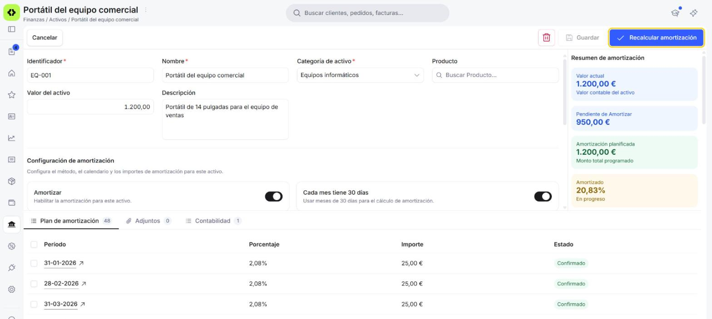
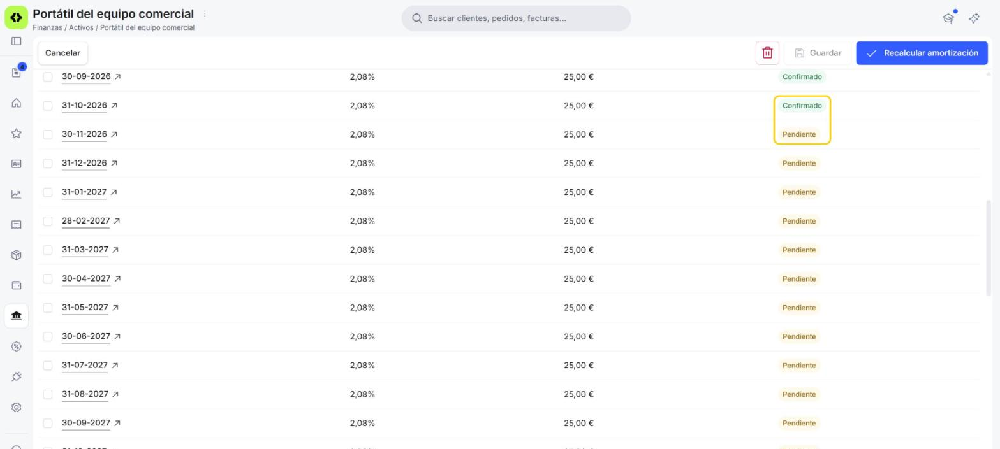
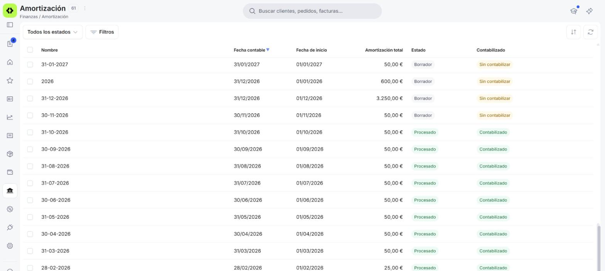
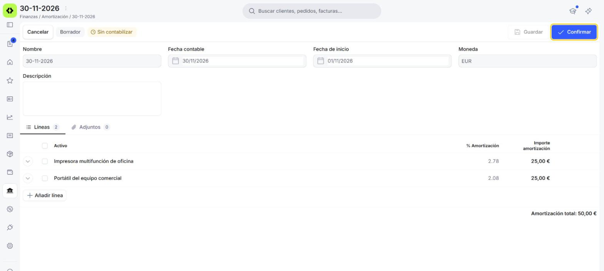

# Crear y ejecutar un plan de amortización

El **plan de amortización** reparte el valor de un activo en cuotas, una por mes o por año. Etendo agrupa las cuotas de todos tus activos con la misma fecha en un registro de **Amortización**: ese registro es el que confirmas para que el gasto entre en tu contabilidad.

- El activo tiene que tener activado **Amortizar** y completa la **Fecha de inicio de amortización**. Consulta [Apuntar un activo](../como-apuntar-un-activo/como-apuntar-un-activo.md).

## Generar el plan desde el activo

<figure markdown="span">
  
  <figcaption>Activo con su plan de amortización generado.</figcaption>
</figure>

1. En el menú lateral, dentro de **Finanzas**, haz clic en **[Activos](https://app.etendo.ai/assets){target="_blank"}** y abre el activo.
2. Revisa el **Tipo de cálculo**:
    - Con **Tiempo**: revisa **Amortizar** (**Mensual** o **Anual**) y la vida útil.
    - Con **Porcentaje**: revisa **% Amortización anual**. Con este cálculo se genera una cuota al año.
3. Si cambiaste algo, haz clic en **Guardar**.
4. Haz clic en **Crear amortización**. Etendo genera las cuotas en la pestaña **Plan de amortización**, con las columnas **Período**, **Porcentaje**, **Importe** y **Estado**.

    <figure markdown="span">
      
      <figcaption>Cuotas confirmadas hasta octubre y pendientes desde noviembre.</figcaption>
    </figure>

Cada cuota está **Pendiente** hasta que confirmas su registro de Amortización, y pasa a **Confirmado** después. A partir de ahora el botón se llama **Recalcular amortización**: úsalo si cambias el valor, el ritmo o las fechas del activo.

## Ejecutar la amortización de un período

<figure markdown="span">
  
  <figcaption>Lista de amortizaciones: un registro por mes o por año.</figcaption>
</figure>

Los registros de **Amortización** no se crean desde la lista: salen del plan de cada activo. Los mensuales se llaman con la fecha del período, por ejemplo `31-10-2026`, y los anuales con el año, por ejemplo `2026`.

1. En el menú lateral, dentro de **Finanzas**, haz clic en **[Amortización](https://app.etendo.ai/amortization){target="_blank"}**.
2. Abre el registro del período. Muestra las etiquetas **Borrador** y **Sin contabilizar**.

    <figure markdown="span">
      
      <figcaption>Registro en borrador, listo para confirmar.</figcaption>
    </figure>

3. Revisa la pestaña **Líneas**: hay una por activo, con su **% Amortización** y su **Importe amortización**, y abajo la **Amortización total**.
4. Haz clic en **Confirmar**. El registro pasa a **Procesado** y las cuotas de cada activo pasan a **Confirmado**.

El registro tiene que contabilizarse para que el gasto llegue a tu contabilidad, y entonces muestra **Contabilizado**. Si sigue como **Sin contabilizar**, puedes contabilizarlo desde **[Finanzas > Documentos no contabilizados](../como-revisar-los-documentos-no-contabilizados/como-revisar-los-documentos-no-contabilizados.md)**.

## Corregir una amortización

En un registro **Procesado**, el menú **⋮** ofrece **Reactivar**: haz clic en él para volver a editar el registro. Cuando termines, vuelve a confirmarlo.

!!! info "Para tu asesor"
    - Las cuentas de la amortización salen de la pestaña **Contabilidad** de la [categoría de activo](../como-configurar-las-categorias-de-activo/como-configurar-las-categorias-de-activo.md): **Amortización** (por ejemplo, `68100000`) y **Amortización acumulada** (por ejemplo, `28170000`).
    - Para confirmar el registro, su período tiene que estar abierto en el calendario contable.

## Artículos Relacionados

- [Apuntar un activo](../como-apuntar-un-activo/como-apuntar-un-activo.md)
- [Cómo configurar las categorías de activo](../como-configurar-las-categorias-de-activo/como-configurar-las-categorias-de-activo.md)
- [Glosario de Finanzas](../glosario-de-finanzas/glosario-de-finanzas.md)

---
Esta obra está bajo la licencia :material-creative-commons: :fontawesome-brands-creative-commons-by: :fontawesome-brands-creative-commons-sa: [CC BY-SA 2.5 ES](https://creativecommons.org/licenses/by-sa/2.5/es/){target="_blank"} de [Futit Services S.L](https://etendo.software){target="_blank"}.
