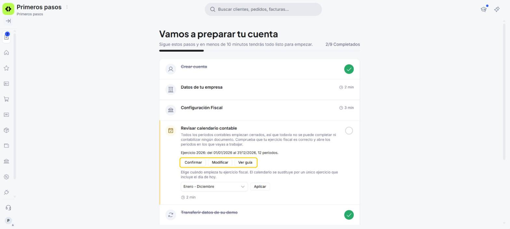
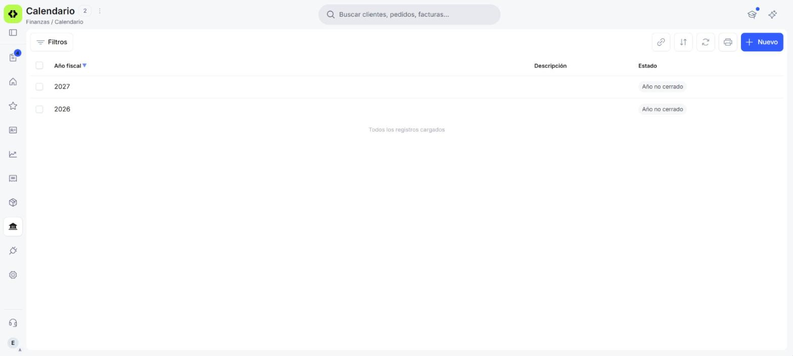
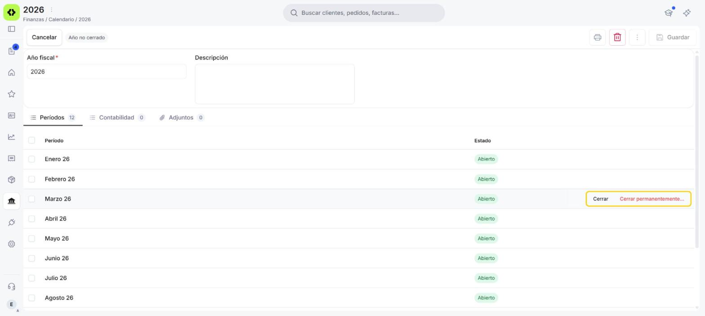
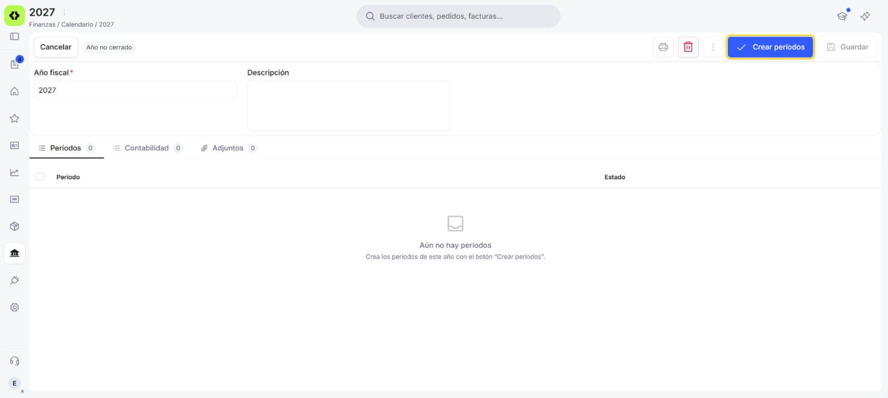
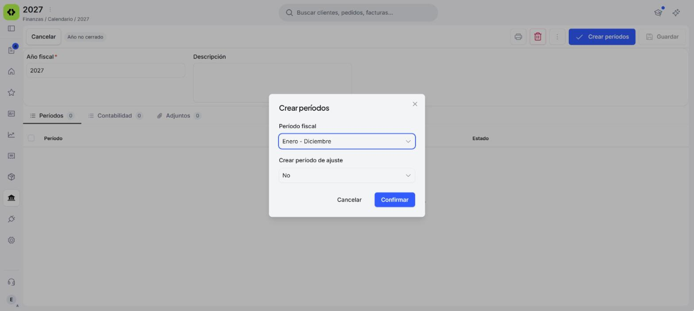

# Cómo gestionar el calendario contable

El **calendario contable** organiza cada año de tu empresa en **períodos**, uno por mes. Los períodos deciden en qué meses puedes registrar contabilidad: una factura, un cobro o un pago entra en tu contabilidad solo si su fecha cae en un período abierto. Cuando cierras un mes que ya revisaste, ya no se puede registrar nada con fecha de ese mes.

## Revisar el calendario en una cuenta nueva

Cuando creas tu entorno productivo, Etendo te propone un calendario de enero a diciembre del año en curso, con todos los períodos en estado **Nunca abierto**. Hasta que abras alguno, no puedes completar ni contabilizar ningún documento. Revísalo desde la tarea **Revisar calendario contable** del panel **Primeros pasos**.

<figure markdown="span">
  
  <figcaption>Tarea Revisar calendario contable, con las opciones de Modificar desplegadas.</figcaption>
</figure>

1. En el panel **Primeros pasos**, haz clic en **Revisar calendario contable**. Ves el ejercicio propuesto, por ejemplo *"Ejercicio 2026: del 01/01/2026 al 31/12/2026, 12 periodos."*
2. Elige una opción:
    - **Confirmar** — si tu ejercicio va de enero a diciembre.
    - **Modificar** — si tu ejercicio empieza en otro mes. Elige **Enero - Diciembre**, **Abril - Marzo**, **Julio - Junio** u **Octubre - Septiembre** y haz clic en **Aplicar**. Etendo sustituye el calendario por un único ejercicio que incluye el día de hoy.

    En los dos casos la tarea queda completada y los períodos siguen sin abrir. Al confirmar, Etendo muestra *"Calendario revisado. Ahora abre los periodos en los que vayas a trabajar."* y te lleva a **Calendario**.

3. Abre los períodos en los que vas a trabajar, como se explica en [Abrir o cerrar un período](#abrir-o-cerrar-un-periodo).

Si quieres que Etendo te muestre la ventana **Calendario** paso a paso, haz clic en **Ver guía**. La guía sigue disponible después de completar la tarea.

Si intentas contabilizar un documento con fecha en un período sin abrir, Etendo muestra *"El período contable de la fecha del documento no está abierto."* y un botón para ir a revisarlo.

## Consultar el calendario

<figure markdown="span">
  
  <figcaption>Lista de años del calendario contable.</figcaption>
</figure>

1. En el menú lateral, dentro de **Finanzas**, haz clic en **[Calendario](https://app.etendo.ai/calendar){target="_blank"}**.
2. Revisa la lista. Para cada año ves:
    - **Año fiscal** — el año, por ejemplo `2026`.
    - **Descripción** — una nota opcional sobre el año.
    - **Estado** — si el año está cerrado o no. Mientras trabajas en él, muestra *Año no cerrado*.
3. Haz clic en un año para abrir su ficha.

En la ficha ves los campos **Año fiscal** *(obligatorio)* y **Descripción**, y la etiqueta *Año no cerrado* junto a **Cancelar**. Debajo hay tres pestañas:

- **Períodos** — los meses del año y su estado. Desde aquí los abres o los cierras.
- **Contabilidad** — los asientos de cierre del año. Muestra *"Aún no hay asientos de cierre"* hasta que cierras el año.
- **Adjuntos** — para guardar archivos relacionados con ese año.

## Estados de un período

<figure markdown="span">
  
  <figcaption>Pestaña Períodos del año 2026, con las acciones de un período al pasar el ratón por su fila.</figcaption>
</figure>

En la pestaña **Períodos** ves cada mes con su nombre, por ejemplo **Enero 26** o **Febrero 26**, y su **Estado**:

| Estado | Qué significa |
|:-------|:--------------|
| **Nunca abierto** | El período todavía no se ha abierto. Ábrelo cuando empieces a trabajar en ese mes. |
| **Abierto** | Puedes registrar contabilidad con fecha de ese mes. |

Cuando cierras un período, deja de admitir contabilidad con fecha de ese mes.

## Abrir o cerrar un período

Cierra un mes cuando ya hayas revisado todo lo que tiene. Así nadie puede registrar por error una factura, un cobro o un pago con fecha de ese mes.

1. Abre el año en **Finanzas > Calendario** y ve a la pestaña **Períodos**.
2. Pasa el ratón por la fila del período. Aparecen las acciones que puedes hacer según su estado:
    - En un período **Nunca abierto**: **Abrir**, **Cerrar** y **Cerrar permanentemente…**
    - En un período **Abierto**: **Cerrar** y **Cerrar permanentemente…**
3. Haz clic en la acción que necesitas:
    - **Abrir** — permite registrar contabilidad con fecha de ese mes.
    - **Cerrar** — impide registrar contabilidad con fecha de ese mes. Si más adelante necesitas corregir algo, puedes volver a abrirlo.
    - **Cerrar permanentemente…** — cierra el período para siempre. Etendo te pide que lo confirmes: haz clic en **Cerrar permanentemente** para hacerlo, o en **Cancelar** para salir sin cambios.

Para abrir o cerrar varios meses a la vez, marca sus casillas: aparece una barra con **Abrir** y **Cerrar**.

!!! warning "Cerrar permanentemente no tiene vuelta atrás"
    Un período cerrado permanentemente no se puede volver a abrir. Úsalo solo cuando estés seguro de que ese mes no necesita ningún cambio más. Si tienes dudas, usa **Cerrar**: puedes volver a abrirlo cuando lo necesites.

## Crear el año siguiente

Antes de que empiece un año nuevo, créalo en el calendario para poder registrar contabilidad desde su primer día.

1. En la lista de **Calendario**, haz clic en **Nuevo**.
2. En **Año fiscal** *(obligatorio)*, escribe el año, por ejemplo `2027`.
3. Si quieres, completa **Descripción**.
4. Haz clic en **Guardar**. El año queda creado, pero todavía sin meses: la pestaña **Períodos** muestra *"Aún no hay períodos"*.

    <figure markdown="span">
      
      <figcaption>Año 2027 recién guardado, todavía sin períodos.</figcaption>
    </figure>

5. Haz clic en **Crear períodos**. Se abre la ventana **Crear períodos**.

    <figure markdown="span">
      
      <figcaption>Ventana Crear períodos.</figcaption>
    </figure>

6. En **Período fiscal**, elige en qué mes empieza y en qué mes termina el año: **Enero - Diciembre**, **Abril - Marzo**, **Julio - Junio** u **Octubre - Septiembre**. Elige el mismo que en el resto de tus años.
7. En **Crear período de ajuste**, deja **No**, salvo que te indiquen lo contrario.
8. Haz clic en **Confirmar**.

Etendo muestra *"Períodos creados correctamente"* y la pestaña **Períodos** muestra los 12 meses del año en estado **Nunca abierto**. El botón **Crear períodos** desaparece. Abre cada mes cuando empieces a trabajar en él, como se explica en [Abrir o cerrar un período](#abrir-o-cerrar-un-periodo).

## Cerrar el año

Cuando terminas un año, puedes cerrarlo desde su ficha: haz clic en el menú **⋮** y elige **Cerrar Año**. Los asientos de cierre que genera aparecen en la pestaña **Contabilidad** del año, con las columnas **Cuenta**, **Débito**, **Crédito** y **Descripción**.

!!! info "Para tu asesor"
    - La **Fecha contable** de cada documento decide en qué período entra en la contabilidad, y tiene que caer en un período abierto.
    - El **período de ajuste** es un período adicional al final del año para registrar los ajustes de cierre sin mezclarlos con las operaciones del último mes. Se crea con **Crear período de ajuste** al crear los períodos del año.
    - Los asientos de cierre del ejercicio se consultan en la pestaña **Contabilidad** del año.

## Artículos Relacionados

- [Gestionar tu plan de cuentas](../gestionar-tu-plan-de-cuentas/gestionar-tu-plan-de-cuentas.md)
- [Crear una factura de compra](../../operaciones/compras/crear-una-factura-de-compra/crear-una-factura-de-compra.md)
- [Glosario de Finanzas](../glosario-de-finanzas/glosario-de-finanzas.md)

---
Esta obra está bajo la licencia :material-creative-commons: :fontawesome-brands-creative-commons-by: :fontawesome-brands-creative-commons-sa: [CC BY-SA 2.5 ES](https://creativecommons.org/licenses/by-sa/2.5/es/){target="_blank"} de [Futit Services S.L](https://etendo.software){target="_blank"}.
