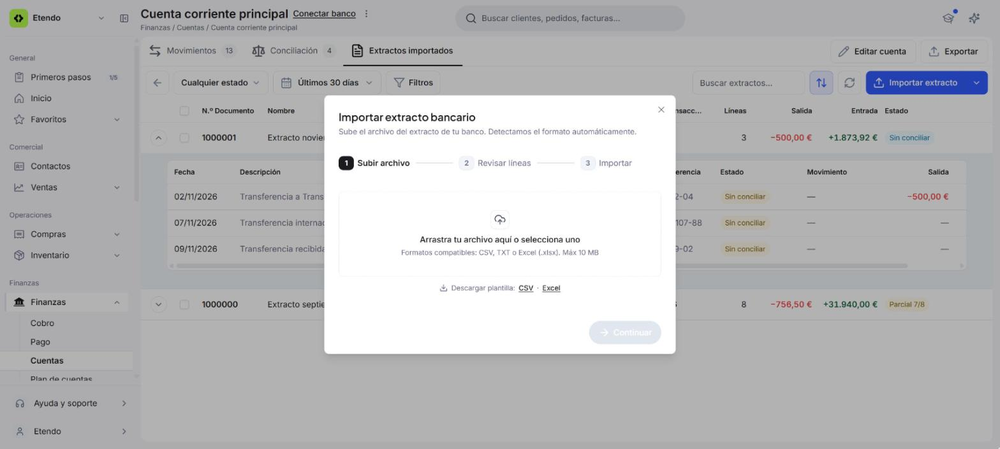
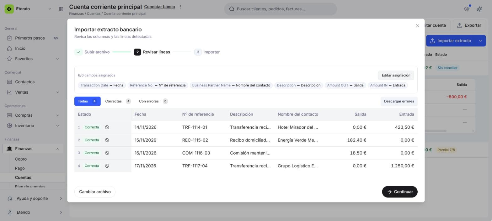
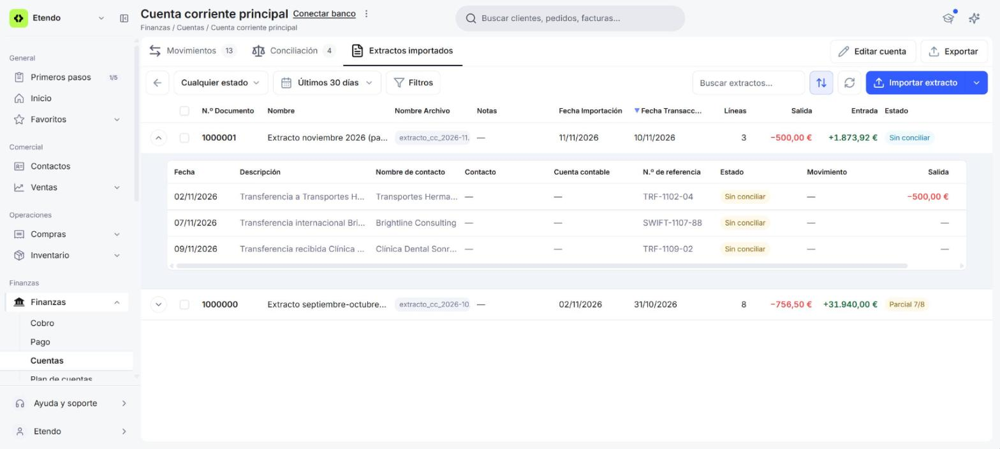

---
tags:
    - Cuentas
    - Finanzas
    - Extracto Bancario
    - Etendo
---

# Importar o descargar el extracto bancario

Si tu cuenta no está conectada con tu banco, puedes importar el extracto bancario como archivo. Etendo crea el extracto con una línea de extracto por cada operación del archivo, lista para que la concilies. También puedes descargar los datos de la cuenta para tu propio registro.

## Importar el extracto bancario

1. Abre la cuenta desde **[Finanzas > Cuentas](https://app.etendo.ai/financial-account){target="_blank"}** y ve a la pestaña **Extractos importados**.
2. Haz clic en **Importar extracto**. Se abre el asistente **Importar extracto bancario**.
3. En el paso **1. Subir archivo**, arrastra el archivo o selecciónalo desde tu equipo y haz clic en **Continuar**. Formatos compatibles: **CSV**, **TXT** o **Excel (.xlsx)**, de hasta 10 MB. Etendo detecta el formato automáticamente.

    Si tu banco no exporta en un formato reconocible, usa **Descargar plantilla** (**CSV** o **Excel**), copia en ella tus operaciones y súbela.

    

4. En el paso **2. Revisar líneas**, comprueba lo que Etendo ha detectado:
    - Arriba, la asignación de columnas: cada columna del archivo y el campo de Etendo al que corresponde (**Fecha**, **Nº de referencia**, **Descripción**, **Nombre del contacto**, **Salida** y **Entrada**). Si alguna no es correcta, haz clic en **Editar asignación**.
    - Debajo, las líneas de extracto, que puedes filtrar en **Todas**, **Correctas** y **Con errores**. Una línea con errores no se importa hasta que la corrijas: puedes editarla ahí mismo o saltarla. Con **Descargar errores** obtienes el detalle para revisarlo fuera de Etendo.

    Si no es el archivo correcto, haz clic en **Cambiar archivo** para subir otro.

    

5. Haz clic en **Continuar** y completa el paso **3. Importar** para crear el extracto y sus líneas.

El extracto aparece en la pestaña **Extractos importados** con su **N.º Documento**, **Nombre**, **Nombre Archivo**, **Notas**, **Fecha Importación**, **Fecha Transacción**, número de **Líneas**, importes de **Salida** y **Entrada**, y su **Estado**:

- **Borrador**: el extracto se guardó sin procesar.
- **Sin conciliar**: ninguna de sus líneas está conciliada todavía.
- **Parcial**: solo una parte de sus líneas está conciliada; la etiqueta indica cuántas (por ejemplo, **Parcial 7/8**).
- **Conciliado**: todas sus líneas están conciliadas.

Haz clic en la flecha de la izquierda de un extracto para ver sus líneas con su propio estado. Para conciliarlas, sigue [Conciliar o desconciliar movimientos contra documentos](../como-conciliar-o-desconciliar-movimientos-contra-documentos/como-conciliar-o-desconciliar-movimientos-contra-documentos.md).

!!! tip "Crear un extracto a mano"
    Si las operaciones no vienen en un archivo del banco, abre el desplegable de **Importar extracto** y elige **Nuevo extracto**. Completa el **Nombre del extracto**, la **Fecha transacción** y la **Fecha importación**, añade sus líneas con **Añadir línea** y haz clic en **Guardar y procesar**, o guárdalo en **Borrador** para terminarlo más tarde.

## Descargar el extracto bancario

1. Abre la cuenta y ve a la pestaña **Extractos importados** o **Movimientos**. La pestaña **Conciliación** no tiene esta opción.
2. Haz clic en **Exportar**, arriba a la derecha, junto a **Editar cuenta**.

La descarga empieza de inmediato y Etendo lo confirma con el aviso **Exportación completada**. El archivo contiene los datos registrados en Etendo, no el archivo original de tu banco.

---

## Artículos Relacionados

- [¿Qué es la conciliación bancaria en Etendo?](../que-es-la-conciliacion-bancaria-en-etendo/que-es-la-conciliacion-bancaria-en-etendo.md)
- [Conciliar o desconciliar movimientos contra documentos](../como-conciliar-o-desconciliar-movimientos-contra-documentos/como-conciliar-o-desconciliar-movimientos-contra-documentos.md)
- [Configurar reglas para automatizar la conciliación](../como-configurar-reglas-para-automatizar-la-conciliacion-bancaria/como-configurar-reglas-para-automatizar-la-conciliacion-bancaria.md)
- [Borrar un extracto o un movimiento](../como-borrar-transacciones-del-extracto-bancario/como-borrar-transacciones-del-extracto-bancario.md)
- [Conectar, desconectar, archivar, desarchivar o eliminar una cuenta](../como-conectar-desconectar-desactivar-o-eliminar-una-cuenta-bancaria/como-conectar-desconectar-desactivar-o-eliminar-una-cuenta-bancaria.md)
- [Añadir y configurar un banco, tarjeta o caja](../como-anadir-y-configurar-un-banco-tarjeta-o-caja/como-anadir-y-configurar-un-banco-tarjeta-o-caja.md)

---
Esta obra está bajo la licencia :material-creative-commons: :fontawesome-brands-creative-commons-by: :fontawesome-brands-creative-commons-sa: [CC BY-SA 2.5 ES](https://creativecommons.org/licenses/by-sa/2.5/es/){target="_blank"} de [Futit Services S.L](https://etendo.software){target="_blank"}.
