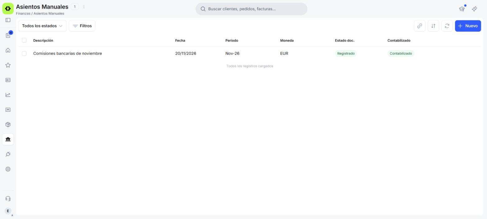
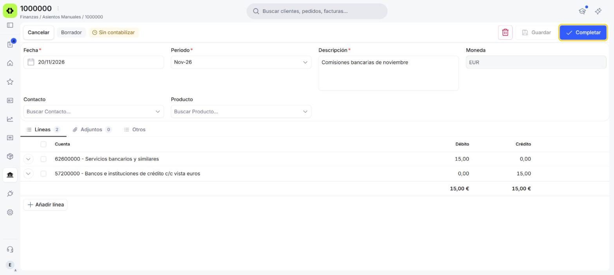
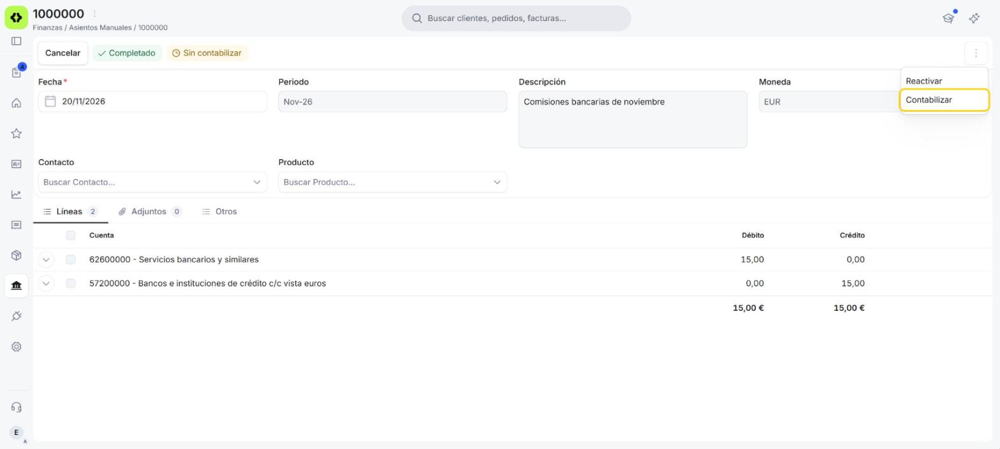

# Cómo registrar un asiento manual

Un **asiento manual** es una anotación que haces tú mismo en tu contabilidad, línea a línea. Úsalo para registrar lo que no llega por una factura, un cobro o un pago. Por ejemplo, las comisiones que te cobra el banco o un ajuste que necesitas hacer.

- La fecha del asiento tiene que caer en un mes abierto del calendario contable. Consulta [Abrir o cerrar un período](../como-gestionar-el-calendario-contable/como-gestionar-el-calendario-contable.md#abrir-o-cerrar-un-periodo).

## Crear un asiento manual

<figure markdown="span">
  
  <figcaption>Lista de asientos manuales.</figcaption>
</figure>

En este ejemplo registras las comisiones de 15,00 € que el banco te cobró en noviembre.

1. En el menú lateral, dentro de **Finanzas**, haz clic en **[Asientos Manuales](https://app.etendo.ai/manual-journals){target="_blank"}**.
2. Haz clic en **Nuevo**.
3. Revisa **Fecha** *(obligatorio)*. Viene con la fecha de hoy; cámbiala si el gasto es de otro día.
4. Revisa **Periodo** *(obligatorio)*. Viene con el mes de la fecha, por ejemplo `Nov-26`.
5. Completa **Descripción** *(obligatorio)* con un texto que te ayude a reconocer el asiento más adelante: `Comisiones bancarias de noviembre`.
6. Haz clic en **Guardar**. El asiento recibe un número y en la pestaña **Líneas** aparece el botón **+ Añadir líneas**.
7. Haz clic en **+ Añadir líneas** y completa la primera línea:
    - **Cuenta** — haz clic en el campo y, en la ventana **Cuenta**, escribe el número de la cuenta. Por ejemplo, escribe `626` y elige **62600000 - Servicios bancarios y similares**.
    - **Débito** — escribe el importe, `15,00`.
8. Presiona **Enter** o haz clic fuera de la línea para guardarla. Se abre una línea nueva, vacía.
9. Completa la segunda línea:
    - **Cuenta** — **57200000 - Bancos e instituciones de crédito c/c vista euros**.
    - **Crédito** — `15,00`.
10. Guarda la línea. Cuando no necesites más líneas, presiona **Esc** para cerrar la línea vacía.

Debajo de las líneas ves el total de **Débito** y el de **Crédito**. Para corregir una línea guardada, haz clic en el lápiz; para borrarla, en la papelera.

## Completar y contabilizar

<figure markdown="span">
  
  <figcaption>Asiento en borrador con sus dos líneas, listo para completar.</figcaption>
</figure>

Para que el asiento entre en tu contabilidad, primero lo completas y después lo contabilizas.

1. Comprueba que el total de **Débito** es igual al total de **Crédito**: un asiento siempre tiene que cuadrar.
2. Haz clic en **Completar**, arriba a la derecha. Etendo muestra *"Registro procesado"* y el asiento pasa a **Completado**, todavía **Sin contabilizar**.
3. Haz clic en el menú **⋮** y elige **Contabilizar**.

    <figure markdown="span">
      
      <figcaption>Menú ⋮ de un asiento completado.</figcaption>
    </figure>

Etendo muestra *"Documento contabilizado correctamente"* y el asiento pasa a **Contabilizado**. Desde ese momento sus campos quedan bloqueados.

## Corregir un asiento

- **Si está completado pero sin contabilizar**: en el menú **⋮**, haz clic en **Reactivar**. Etendo muestra *"Documento reactivado"* y el asiento vuelve a **Borrador**, así que puedes cambiar sus datos y sus líneas.
- **Si ya está contabilizado**: en el menú **⋮**, haz clic en **Descontabilizar**. El asiento vuelve a **Sin contabilizar**; después, en el mismo menú, haz clic en **Reactivar**.

Cuando termines los cambios, vuelve a completarlo y a contabilizarlo.

!!! info "Para tu asesor"
    - Las columnas **Débito** y **Crédito** equivalen al Debe y al Haber.
    - El **Periodo** del asiento decide en qué mes entra en la contabilidad, y tiene que estar abierto en el calendario contable.
    - **Descontabilizar** deja el asiento como **Sin contabilizar**; **Reactivar** lo devuelve a **Borrador** para poder modificar sus líneas.

## Artículos Relacionados

- [Gestionar tu plan de cuentas](../gestionar-tu-plan-de-cuentas/gestionar-tu-plan-de-cuentas.md)
- [Cómo gestionar el calendario contable](../como-gestionar-el-calendario-contable/como-gestionar-el-calendario-contable.md)
- [Glosario de Finanzas](../glosario-de-finanzas/glosario-de-finanzas.md)

---
Esta obra está bajo la licencia :material-creative-commons: :fontawesome-brands-creative-commons-by: :fontawesome-brands-creative-commons-sa: [CC BY-SA 2.5 ES](https://creativecommons.org/licenses/by-sa/2.5/es/){target="_blank"} de [Futit Services S.L](https://etendo.software){target="_blank"}.
