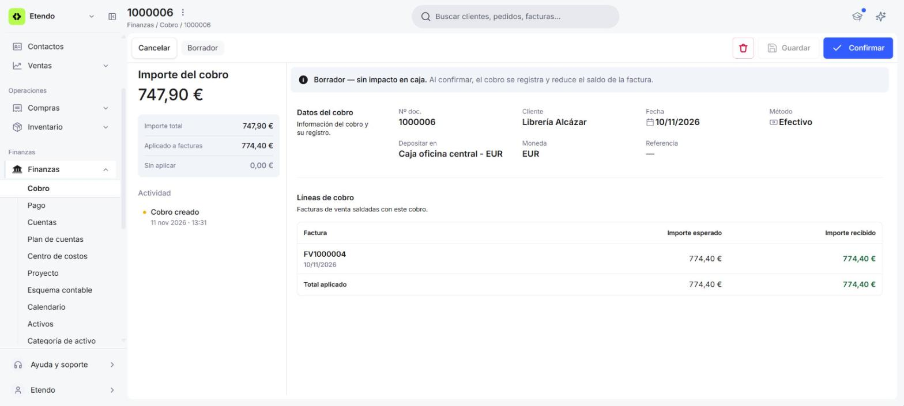
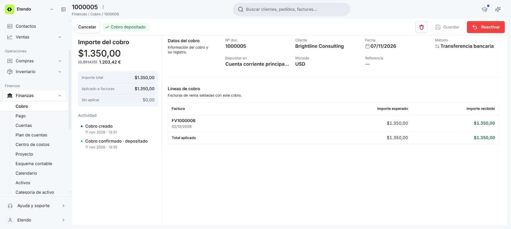

---
tags:
    - Finanzas
    - Cobros
    - Etendo
---

# Registrar un cobro

Un cobro registra el dinero que recibes de un cliente por una o más facturas de venta. En Etendo, el cobro siempre se crea desde la factura — Etendo lo asocia automáticamente al documento de origen — y queda visible tanto en el detalle de esa factura como en la vista global **[Finanzas > Cobro](https://app.etendo.ai/payment-in){target="_blank"}**.

## Crear el cobro desde una factura de venta

1. Abre la factura de venta a la que quieres registrar el cobro.
2. Haz clic en **Añadir cobro**.
3. Se abre el modal **Nuevo cobro**. Completa los campos:

    | Campo | Qué introducir |
    |---|---|
    | **Importe** | Se autocompleta con el importe pendiente de la factura. Puedes ajustarlo si el cliente paga parcialmente. |
    | **Fecha** | Fecha del cobro. |
    | **Método de pago** | Efectivo, Recibo, Tarjeta o Transferencia bancaria. |
    | **Cuenta** | Cuenta bancaria o caja donde se depositará el cobro. Las opciones dependen del método elegido. |

4. Si el cliente tiene saldo a favor o crédito de otras facturas, aparece la sección **Saldo a favor y crédito disponible**: marca la casilla de cada uno que quieras aplicar, total o parcialmente.
5. Revisa el bloque **Total factura / Dinero / Aplicado / Diferencia** para asegurarte de que la diferencia es 0,00 €. Si no lo es, el botón **Igualar** ajusta el importe.
6. Haz clic en:
    - **Guardar** — el cobro queda en estado **Borrador** (sin impacto en caja ni en el saldo de la factura).
    - **Confirmar** — el cobro pasa a estado **Cobro depositado** y reduce el saldo pendiente de la factura.

## Confirmar un cobro desde la vista global

Si guardaste un cobro en borrador y quieres confirmarlo más tarde:

1. Ve a **Finanzas > Cobro**.
2. Busca el cobro por número de documento, fecha o contacto. Puedes filtrar por **Borrador** en el desplegable de estados.
3. Haz clic sobre la fila para abrir el detalle.
4. Revisa los campos. El aviso de la parte superior indica: *«Borrador — sin impacto en caja. Al confirmar, el cobro se registra y reduce el saldo de la factura.»*

    

5. Haz clic en **Confirmar**. El estado pasa a **Cobro depositado**.

## Reactivar un cobro

Si necesitas corregir un cobro ya confirmado, puedes revertirlo siempre que no esté conciliado:

1. Abre el cobro desde **Finanzas > Cobro**.
2. Haz clic en **Reactivar**. El cobro vuelve a estado **Borrador**.
3. Realiza los cambios necesarios y vuelve a confirmar.

!!! warning "Cobros conciliados"
    Un cobro en estado **Conciliado** no se puede reactivar directamente. Primero debes desconciliarlo desde la conciliación bancaria.

## Cobros en moneda extranjera

Si la factura está en una moneda distinta a la de tu organización (por ejemplo, USD), el cobro se registra en esa misma moneda. En el detalle del cobro, el panel izquierdo muestra:

- El importe en la moneda original (p. ej. `$1.350,00`).
- El tipo de cambio aplicado y el equivalente en euros entre paréntesis (p. ej. `(0,891425) 1.203,42 €`).

El tipo de cambio se toma del **Rango de conversión** configurado para esa moneda en la fecha del cobro.

---

## Artículos Relacionados

- [¿Qué son las vistas Cobro y Pago?](../que-es-cobros-y-pagos/que-es-cobros-y-pagos.md)
- [Registrar un pago](../como-registrar-un-pago/como-registrar-un-pago.md)
- [Gestionar pagos y cobros](../como-gestionar-pagos-y-cobros/como-gestionar-pagos-y-cobros.md)
- [Conciliar o desconciliar movimientos contra documentos](../como-conciliar-o-desconciliar-movimientos-contra-documentos/como-conciliar-o-desconciliar-movimientos-contra-documentos.md)

---
Esta obra está bajo la licencia :material-creative-commons: :fontawesome-brands-creative-commons-by: :fontawesome-brands-creative-commons-sa: [CC BY-SA 2.5 ES](https://creativecommons.org/licenses/by-sa/2.5/es/){target="_blank"} de [Futit Services S.L](https://etendo.software){target="_blank"}.
