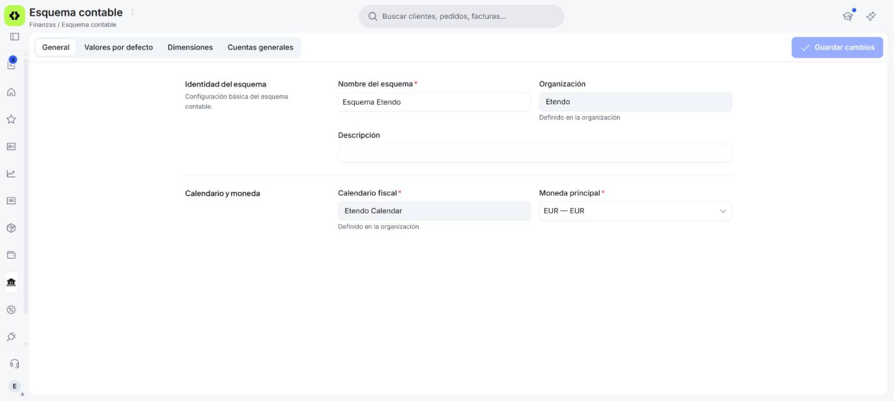
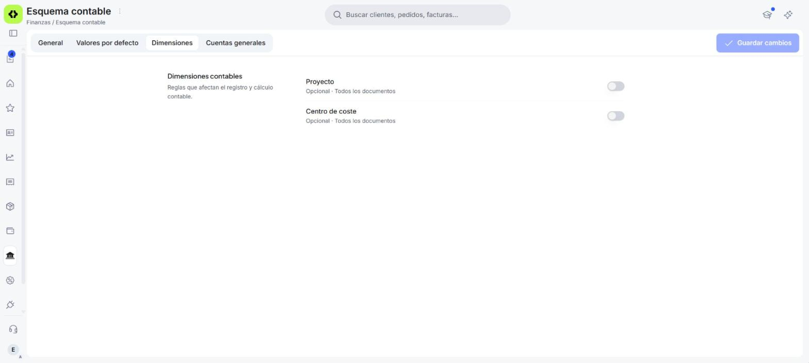

# Cómo revisar el esquema contable

El **esquema contable** reúne las reglas con las que Etendo lleva tu contabilidad: el calendario fiscal, la moneda principal, las cuentas que usa por defecto en cada tipo de operación y las dimensiones con las que puedes analizarla. Etendo ya viene con el esquema configurado para tu empresa, así que normalmente solo lo consultas.

## Consultar los datos generales

<figure markdown="span">
  
  <figcaption>Pestaña General del esquema contable.</figcaption>
</figure>

1. En el menú lateral, dentro de **Finanzas**, haz clic en **[Esquema contable](https://app.etendo.ai/general-ledger-configuration){target="_blank"}**.
2. En la pestaña **General** ves:
    - **Identidad del esquema** — **Nombre del esquema** *(obligatorio)*, **Organización** y **Descripción**.
    - **Calendario y moneda** — **Calendario fiscal** *(obligatorio)* y **Moneda principal** *(obligatorio)*.

    **Organización** y **Calendario fiscal** no se cambian aquí: debajo de ellos aparece *"Definido en la organización"*.

## Consultar las demás pestañas

<figure markdown="span">
  
  <figcaption>Pestaña Dimensiones del esquema contable.</figcaption>
</figure>

- **Valores por defecto** — las cuentas que Etendo usa por defecto, agrupadas en **Banco**, **Diario**, **Contactos**, **Impuestos**, **Producto**, **Activos**, **Proyecto**, **Almacén** y **Otras cuentas**. Por ejemplo, en **Contactos** está la **Cuenta a cobrar** de tus clientes y en **Impuestos**, el **IVA repercutido** y el **IVA soportado**.
- **Dimensiones** — las dimensiones contables **Proyecto** y **Centro de coste**. Cada una se activa o desactiva con su interruptor.
- **Cuentas generales** — las cuentas de **Cuentas de suspenso**, **Balanceo de moneda** y **Cierre de ejercicio**.

Para cambiar una cuenta, haz clic en el campo y búscala por su número o su nombre. El botón **Guardar cambios**, arriba a la derecha, guarda lo que hayas cambiado.

!!! info "Para tu asesor"
    - Las cuentas de **Valores por defecto** son las que Etendo asigna por defecto. Por ejemplo, la sección **Activos** (682 y 282) da las cuentas de **Amortización** y **Amortización acumulada** de cada categoría de activo nueva.
    - En **Cuentas generales**, **Cierre de ejercicio** indica las cuentas que se usan al cerrar el año desde el calendario contable.

## Artículos Relacionados

- [Gestionar tu plan de cuentas](../gestionar-tu-plan-de-cuentas/gestionar-tu-plan-de-cuentas.md)
- [Cómo gestionar el calendario contable](../como-gestionar-el-calendario-contable/como-gestionar-el-calendario-contable.md)
- [Cómo crear un proyecto](../como-crear-un-proyecto/como-crear-un-proyecto.md)

---
Esta obra está bajo la licencia :material-creative-commons: :fontawesome-brands-creative-commons-by: :fontawesome-brands-creative-commons-sa: [CC BY-SA 2.5 ES](https://creativecommons.org/licenses/by-sa/2.5/es/){target="_blank"} de [Futit Services S.L](https://etendo.software){target="_blank"}.
