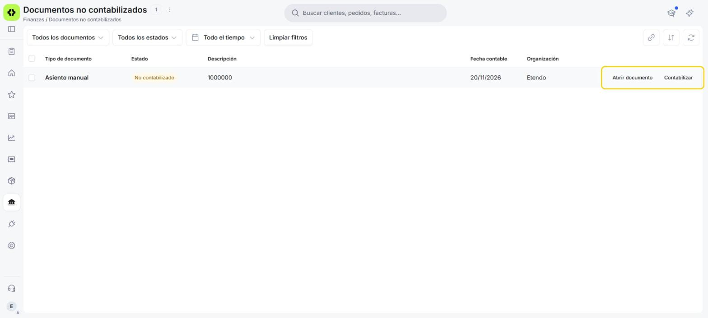
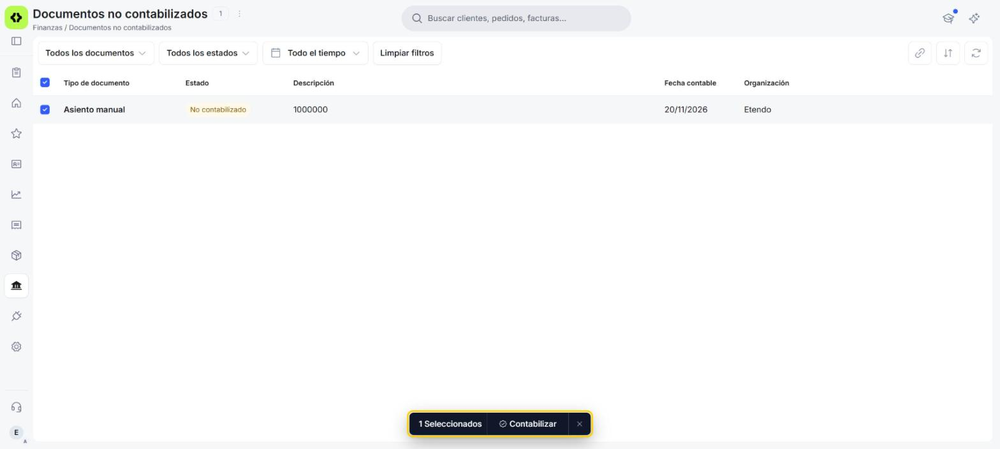

# Cómo revisar los documentos no contabilizados

La ventana **Documentos no contabilizados** reúne en una sola lista los documentos que todavía no están en tu contabilidad: facturas, albaranes, asientos manuales, amortizaciones y otros. Úsala para comprobar que no queda nada pendiente, por ejemplo antes de cerrar un mes, y para contabilizar lo que falte.

Si todo está al día, la lista muestra *"No hay documentos sin contabilizar"*. Si lo que ves es *"No encontramos documentos"*, es que ningún documento coincide con los filtros que aplicaste.

## Consultar los documentos pendientes

<figure markdown="span">
  
  <figcaption>Un asiento manual pendiente de contabilizar, con las acciones de su fila.</figcaption>
</figure>

1. En el menú lateral, dentro de **Finanzas**, haz clic en **[Documentos no contabilizados](https://app.etendo.ai/not-posted-documents){target="_blank"}**.
2. Revisa la lista. Para cada documento ves su **Tipo de documento**, **Estado**, **Descripción**, **Fecha contable** y **Organización**.
3. Si necesitas acotar la lista, usa los filtros de arriba:
    - **Todos los documentos** — para ver un solo tipo, por ejemplo **Factura (cliente)** o **Asiento manual**.
    - **Todos los estados** — para ver solo los documentos con un estado concreto.
    - **Últimos 12 meses** — para cambiar el rango de fechas: **Hoy**, **Ayer**, **Últimos 7 días**, **Últimos 30 días**, **Últimos 12 meses**, **Todo el tiempo** o **Personalizado**.

    Para quitar los filtros que hayas aplicado, haz clic en **Limpiar filtros**: la lista vuelve a mostrar los últimos 12 meses. Para ver documentos más antiguos, elige **Todo el tiempo**.

La columna **Estado** te indica por qué el documento sigue pendiente:

| Estado | Qué significa |
|:-------|:--------------|
| **No contabilizado** | El documento todavía no se ha contabilizado. |
| **Período cerrado** | Su fecha contable cae en un período cerrado del calendario contable. |
| **Cuenta no válida** | Alguna de las cuentas que usa el documento no es válida para contabilizar. |
| **Coste no calculado** | Todavía no se ha calculado el coste de los productos del documento. |
| **Error** | Etendo no pudo contabilizarlo por otro motivo. |

En el filtro de estados, **Todos los errores** muestra a la vez todos los documentos que tienen algún problema.

## Contabilizar un documento

1. Pasa el ratón por la fila del documento. Aparecen dos acciones:
    - **Abrir documento** — abre el documento para revisarlo o corregirlo.
    - **Contabilizar** — lo contabiliza directamente.
2. Haz clic en **Contabilizar**. Etendo muestra el número del documento con el mensaje *"Documento contabilizado correctamente"*, y el documento desaparece de la lista.

Para contabilizar varios a la vez, marca sus casillas y haz clic en **Contabilizar** en la barra que aparece abajo.

<figure markdown="span">
  
  <figcaption>Barra para contabilizar los documentos marcados.</figcaption>
</figure>

Si un documento tiene un estado de error, haz clic en **Abrir documento**, corrige lo que indica el estado y vuelve a contabilizarlo. Si el estado es **Período cerrado**, abre el período en el calendario contable o cambia la fecha contable del documento.

!!! info "Para tu asesor"
    - La lista incluye todos los tipos de documento que generan contabilidad: albaranes, facturas, asientos manuales, amortizaciones, consumos internos, devoluciones, inventarios, movimientos, relaciones albarán-factura y transacciones.
    - Revisarla, filtrando por **Todos los errores**, es un buen paso previo al cierre de cada período.

## Artículos Relacionados

- [Cómo registrar un asiento manual](../como-registrar-un-asiento-manual/como-registrar-un-asiento-manual.md)
- [Cómo gestionar el calendario contable](../como-gestionar-el-calendario-contable/como-gestionar-el-calendario-contable.md)
- [Glosario de Finanzas](../glosario-de-finanzas/glosario-de-finanzas.md)

---
Esta obra está bajo la licencia :material-creative-commons: :fontawesome-brands-creative-commons-by: :fontawesome-brands-creative-commons-sa: [CC BY-SA 2.5 ES](https://creativecommons.org/licenses/by-sa/2.5/es/){target="_blank"} de [Futit Services S.L](https://etendo.software){target="_blank"}.
