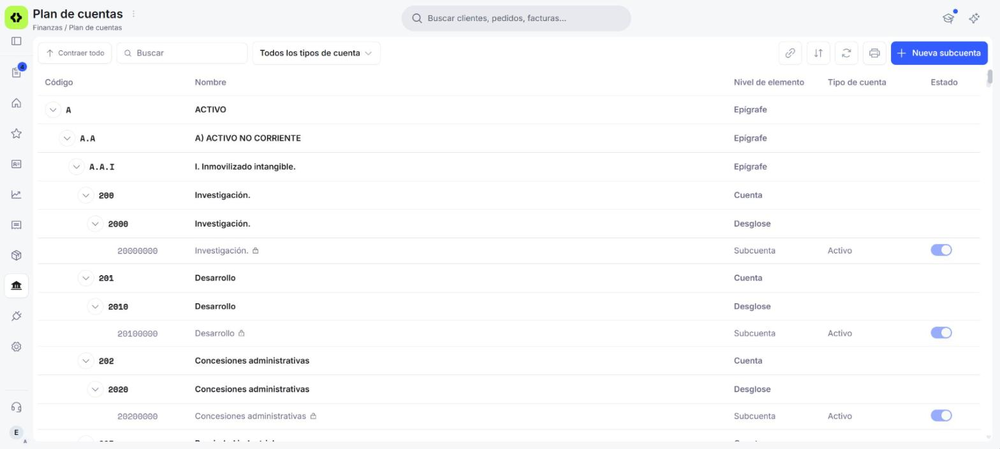
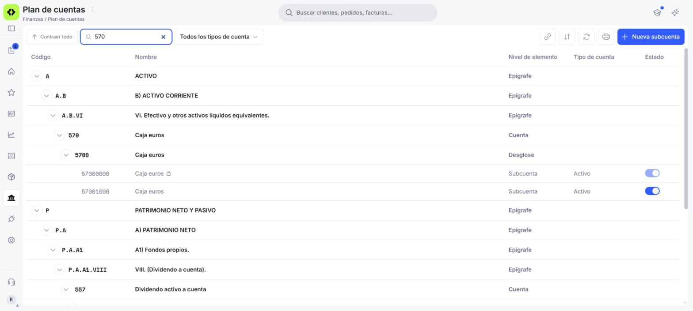
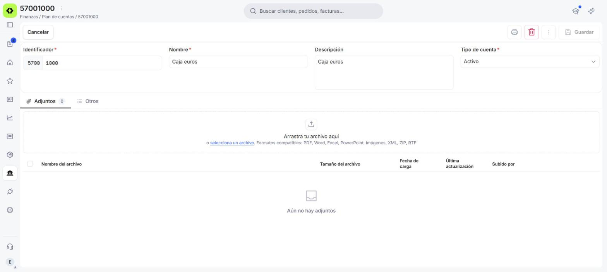
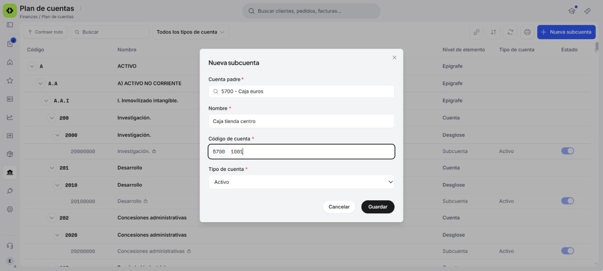

# Gestionar tu plan de cuentas

El **plan de cuentas** es la lista de cuentas contables donde Etendo registra cada operación de tu negocio: el dinero que tienes en el banco o en caja, lo que te deben tus clientes, lo que debes a tus proveedores, tus ventas y tus gastos. Cada vez que registras una factura, un cobro o un pago, Etendo lo anota en las cuentas que le corresponden.

Etendo te lo deja configurado, así que puedes empezar a trabajar sin tocarlo. En **[Finanzas > Plan de cuentas](https://app.etendo.ai/chart-of-accounts){target="_blank"}** puedes consultarlo y crear una **subcuenta** cuando quieras ver algo por separado, por ejemplo el efectivo de una tienda.

- Ven esta ventana los roles **Administrador** y **Finanzas**. Consulta [Acceso por rol](../../sistema/configuracion/glosario-de-roles-y-usuarios/glosario-de-roles-y-usuarios.md#acceso-por-rol).

## Vista Lista

<figure markdown="span">
  
  <figcaption>El plan de cuentas se muestra como un árbol que se despliega por niveles.</figcaption>
</figure>

El plan de cuentas se muestra como un **árbol**: cada línea agrupa las que tiene debajo. En el primer nivel están **A ACTIVO**, **O Otras cuentas**, **P PATRIMONIO NETO Y PASIVO** y **PYG Pérdidas y ganancias**. Por ejemplo, **A ACTIVO** contiene **A.A A) ACTIVO NO CORRIENTE**, que contiene **A.A.I I. Inmovilizado intangible.**, que contiene la cuenta **200 Investigación.**, su desglose **2000** y, dentro de este, la subcuenta **20000000 Investigación.**

Para cada línea ves:

- **Código** — el número que identifica la cuenta. Cuantas más cifras tiene, más concreta es.
- **Nombre** — para qué sirve la cuenta.
- **Nivel de elemento** — en qué escalón del árbol está: **Epígrafe**, **Cuenta**, **Desglose** o **Subcuenta**. Lo explica [Los niveles del árbol](#los-niveles-del-arbol).
- **Tipo de cuenta** — si la subcuenta recoge algo que tienes, algo que debes, un ingreso o un gasto. Consulta [Tipos de cuenta](#tipos-de-cuenta).
- **Estado** — interruptor que indica si la subcuenta está activa.

**Tipo de cuenta** y **Estado** solo aparecen en las subcuentas.

En la barra superior tienes:

- **Contraer todo** / **Expandir todo**, para cerrar o abrir todas las ramas a la vez.
- **Buscar**, para encontrar una cuenta por una parte de su código o de su nombre.
- El filtro **Todos los tipos de cuenta**, para ver solo las subcuentas de un tipo.
- Los botones para copiar el enlace de la vista, ordenar por **Código** o **Nombre**, actualizar e imprimir.
- **+ Nueva subcuenta**, para crear una subcuenta. Consulta [Crear una subcuenta](#crear-una-subcuenta).

### Encontrar una cuenta

<figure markdown="span">
  
  <figcaption>Al buscar «570», el árbol muestra las cuentas que coinciden junto con las ramas de las que cuelgan.</figcaption>
</figure>

Escribe en **Buscar** el principio del código o una palabra del nombre. Etendo muestra las cuentas que coinciden junto con las ramas de las que cuelgan, para que sepas dónde está cada una. Por ejemplo, `570` o `Caja` te llevan a las subcuentas de caja. Haz clic en la **×** del buscador para volver al árbol completo.

### Los niveles del árbol

| Nivel | Qué es | Ejemplo |
|:------|:-------|:--------|
| **Epígrafe** | Un apartado del balance o de la cuenta de resultados. Agrupa cuentas. | **A ACTIVO**, **A.A.I I. Inmovilizado intangible.** |
| **Cuenta** | Un grupo de operaciones del mismo tipo, con un código de 3 cifras. | **200 Investigación.** |
| **Desglose** | Una división de la cuenta, con un código de 4 cifras. | **2000** |
| **Subcuenta** | La cuenta concreta donde Etendo anota las operaciones, con un código de 8 cifras. Es el nivel que puedes crear tú. | **20000000 Investigación.** |

Solo las subcuentas se abren al hacer clic en su nombre. Los epígrafes, cuentas y desgloses solo se despliegan o se contraen.

### Tipos de cuenta

| Tipo | Qué recoge |
|:-----|:-----------|
| **Activo** | Lo que tiene tu empresa: dinero en el banco o en caja, lo que te deben tus clientes, tus equipos o tus locales. |
| **Pasivo** | Lo que debe tu empresa: a proveedores, a bancos o a la administración tributaria. |
| **Patrimonio neto** | Lo que han aportado los socios y los resultados acumulados. |
| **Ingreso** | Lo que ganas: ventas, servicios u otros ingresos. |
| **Gasto** | Lo que gastas: compras, sueldos, suministros, comisiones bancarias… |
| **Memorándum** | Cuentas de control que no forman parte del balance, en el grupo **O Otras cuentas**. |

### Subcuentas con candado

Algunas subcuentas tienen un **candado** junto al nombre: son *"Subcuenta de relleno — no editable"*. Vienen con el plan de cuentas y en su ficha no puedes cambiar el identificador, el nombre ni el tipo de cuenta; su interruptor **Estado** tampoco se puede cambiar. Las subcuentas sin candado, como las que creas tú, sí se pueden editar.

## Vista Detalle

<figure markdown="span">
  
  <figcaption>Ficha de una subcuenta, con sus pestañas Adjuntos y Otros.</figcaption>
</figure>

Al hacer clic en el nombre de una subcuenta, se abre su ficha con:

- **Identificador** *(obligatorio)* — las 4 cifras de su desglose, fijas, más 4 cifras propias. En el ejemplo, `5700` + `1000`.
- **Nombre** *(obligatorio)*.
- **Descripción**, para añadir una nota sobre para qué usas la subcuenta.
- **Tipo de cuenta** *(obligatorio)*.
- Dos pestañas: **Adjuntos**, para guardar documentos de la subcuenta, y **Otros**, con la casilla **Activo**.
- En la barra superior: **Cancelar**, imprimir, **Eliminar**, el menú **⋮** con **Nueva subcuenta**, y **Guardar**, que se activa cuando cambias algo.

## Acciones Disponibles

| Acción | Dónde | Descripción |
|:-------|:------|:------------|
| Buscar y filtrar | Barra superior | Encuentra una cuenta por código o nombre, o muestra solo un tipo de cuenta. |
| Contraer todo / Expandir todo | Barra superior | Cierra o abre todas las ramas del árbol. |
| Nueva subcuenta | Barra superior o menú **⋮** de la ficha | Crea una cuenta nueva dentro de un desglose. Consulta [Crear una subcuenta](#crear-una-subcuenta). |
| Editar | Ficha de la subcuenta | Cambia el identificador, el nombre, la descripción o el tipo de una subcuenta sin candado. |
| Eliminar | Ficha de la subcuenta | Elimina la subcuenta. |

### Crear una subcuenta

<figure markdown="span">
  
  <figcaption>Ventana Nueva subcuenta, completada para la caja de una tienda.</figcaption>
</figure>

Crea una subcuenta cuando quieras ver por separado algo que hoy se anota junto. En este ejemplo, tu empresa abre una tienda y quiere controlar su efectivo aparte de la caja general.

1. Haz clic en **+ Nueva subcuenta**.
2. En **Cuenta padre** *(obligatorio)*, haz clic en **Seleccionar cuenta…** y busca el desglose del que va a colgar la subcuenta. Solo se pueden elegir desgloses. En el ejemplo: `5700 - Caja euros`.
3. Completa **Nombre** *(obligatorio)* con un nombre que reconozcas al verlo en un informe: `Caja tienda centro`.
4. Completa el **Código de cuenta** *(obligatorio)*. Las 4 primeras cifras son las del desglose y ya vienen puestas; en el campo, Etendo te sugiere en gris el siguiente número libre para las 4 restantes. Escríbelo o elige otro libre. En el ejemplo: `5700` `1001`.
5. Revisa el **Tipo de cuenta** *(obligatorio)*. Se completa según la cuenta padre; para una caja o un banco, **Activo**.
6. Haz clic en **Guardar**. Para salir sin crear nada, haz clic en **Cancelar**.

La subcuenta aparece en el árbol bajo su desglose. Si es la subcuenta de un banco o de una caja, asígnala después en la pestaña **Contabilidad** de esa cuenta, como se explica en [Cómo editar una cuenta](../como-editar-una-cuenta/como-editar-una-cuenta.md#pestana-contabilidad).

!!! info "Para tu asesor"
    - El árbol sigue el orden del balance y de la cuenta de pérdidas y ganancias. Los **Epígrafes** son sus apartados, y de ellos cuelgan las cuentas de 3 cifras, los desgloses de 4 y las subcuentas de 8.
    - Las operaciones se anotan en las **Subcuentas**; los epígrafes, cuentas y desgloses agrupan.
    - El **Tipo de cuenta** decide en qué informe aparece la subcuenta (balance o resultados).
    - En el alta, la descripción no se pide: puedes añadirla después en la ficha de la subcuenta.

## Artículos Relacionados

- [Cómo editar una cuenta](../como-editar-una-cuenta/como-editar-una-cuenta.md)
- [Añadir y configurar un banco, tarjeta o caja](../como-anadir-y-configurar-un-banco-tarjeta-o-caja/como-anadir-y-configurar-un-banco-tarjeta-o-caja.md)
- [Glosario de Finanzas](../glosario-de-finanzas/glosario-de-finanzas.md)

---
Esta obra está bajo la licencia :material-creative-commons: :fontawesome-brands-creative-commons-by: :fontawesome-brands-creative-commons-sa: [CC BY-SA 2.5 ES](https://creativecommons.org/licenses/by-sa/2.5/es/){target="_blank"} de [Futit Services S.L](https://etendo.software){target="_blank"}.
