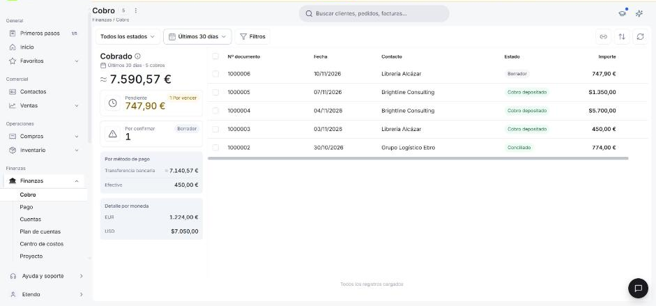
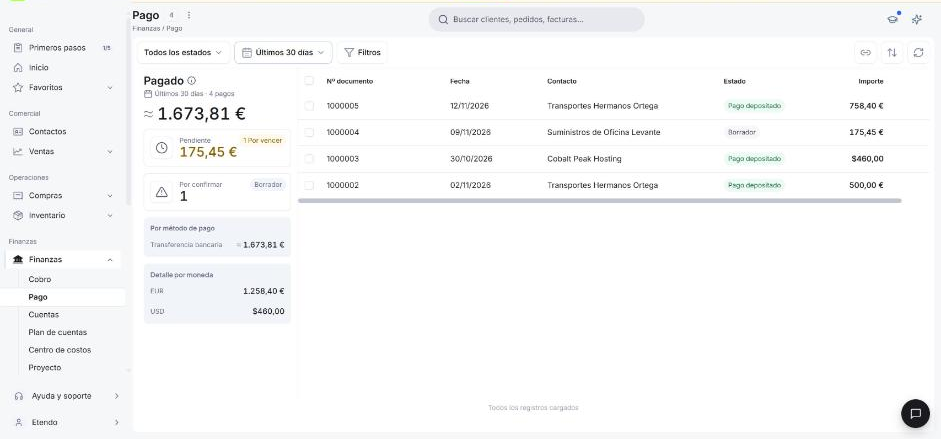

---
tags:
    - Finanzas
    - Cobros
    - Pagos
    - Etendo
---

# ¿Qué son las vistas Cobro y Pago?

Las vistas **Cobro** y **Pago** son los paneles globales donde Etendo centraliza todas las transacciones de dinero que entran y salen de tu organización:

- **[Finanzas > Cobro](https://app.etendo.ai/payment-in){target="_blank"}** — lista todos los cobros registrados, es decir, el dinero que recibes de tus clientes.
- **[Finanzas > Pago](https://app.etendo.ai/payment-out){target="_blank"}** — lista todos los pagos registrados, es decir, el dinero que entregas a tus proveedores.

Los cobros y pagos se crean desde las facturas (ver [Gestionar pagos y cobros](../como-gestionar-pagos-y-cobros/como-gestionar-pagos-y-cobros.md)), pero desde estas vistas puedes consultar su estado, filtrar por período o método, y realizar acciones como confirmar o reactivar.

## El panel de resumen

Cada vista tiene un panel lateral izquierdo que resume los movimientos del período seleccionado:

| Bloque | Descripción |
|---|---|
| **Cobrado** / **Pagado** | Total del período en la moneda de la organización |
| Período | Número de cobros o pagos incluidos en el filtro activo |
| **Pendiente** | Importe en borrador pendiente de confirmar |
| **Por confirmar** | Número de documentos en estado Borrador |
| **Por método de pago** | Desglose del total por cada método (Efectivo, Transferencia bancaria, etc.) |
| **Detalle por moneda** | Subtotal de cada moneda en su moneda original — aparece cuando hay transacciones en más de una moneda |

Cuando el total suma importes de distintas monedas, Etendo muestra el símbolo **≈** delante de la cifra para indicar que es una aproximación convertida al tipo de cambio vigente.

## La lista de transacciones

La tabla principal muestra todas las transacciones del período con estas columnas:

| Columna | Descripción |
|---|---|
| **Nº documento** | Número correlativo asignado por Etendo al crear el cobro o pago |
| **Fecha** | Fecha de la transacción |
| **Contacto** | Cliente (en Cobro) o Proveedor (en Pago) asociado a la transacción |
| **Estado** | Estado actual del documento (ver sección siguiente) |
| **Importe** | Importe en la moneda original de la transacción |

## Estados de un cobro o pago

Los documentos pasan por los siguientes estados:

| Estado | Descripción |
|---|---|
| **Borrador** | El cobro o pago está registrado pero aún no confirmado. No tiene impacto en caja ni en el saldo de la factura. |
| **Cobro depositado** / **Pago depositado** | Confirmado y depositado en la cuenta. El saldo de la factura queda reducido. |
| **Conciliado** | El movimiento ha sido conciliado contra el extracto bancario. |

## Filtros disponibles

**Por estado:** selecciona uno o varios estados para limitar la lista. Las opciones son: *Borrador*, *Cobro/Pago depositado* y *Conciliado*.

**Por período:**

| Opción | Descripción |
|---|---|
| Hoy | Solo el día actual |
| Ayer | Solo el día anterior |
| Últimos 7 días | Los 7 días anteriores al actual |
| Últimos 30 días | Los 30 días anteriores (vista por defecto) |
| Últimos 12 meses | El año en curso y el anterior |
| Todo el tiempo | Sin filtro de fecha |
| Personalizado | Rango de fechas a elección |

**Filtros avanzados:** el botón **Filtros** de la barra superior permite aplicar criterios adicionales como el contacto o el importe.

## Cobros y pagos en varias monedas

Si tu organización opera con más de una moneda, las vistas Cobro y Pago muestran automáticamente el bloque **Detalle por moneda** en el panel de resumen. Cada línea muestra el subtotal en su moneda original, sin conversión.

Los totales globales (Cobrado, Por método de pago) se expresan en la moneda de la organización con el prefijo **≈** cuando hay más de una moneda presente. Si todos los movimientos del período están en la misma moneda, los totales se muestran sin el prefijo.

Cuando abres el detalle de un cobro o pago en moneda extranjera, el panel izquierdo muestra el importe original y, entre paréntesis debajo, el tipo de cambio aplicado y el equivalente en la moneda de la organización.

---

## Artículos Relacionados

- [Gestionar pagos y cobros](../como-gestionar-pagos-y-cobros/como-gestionar-pagos-y-cobros.md)
- [Registrar un cobro](../como-registrar-un-cobro/como-registrar-un-cobro.md)
- [Registrar un pago](../como-registrar-un-pago/como-registrar-un-pago.md)
- [¿Qué es la conciliación bancaria en Etendo?](../que-es-la-conciliacion-bancaria-en-etendo/que-es-la-conciliacion-bancaria-en-etendo.md)

---
Esta obra está bajo la licencia :material-creative-commons: :fontawesome-brands-creative-commons-by: :fontawesome-brands-creative-commons-sa: [CC BY-SA 2.5 ES](https://creativecommons.org/licenses/by-sa/2.5/es/){target="_blank"} de [Futit Services S.L](https://etendo.software){target="_blank"}.
