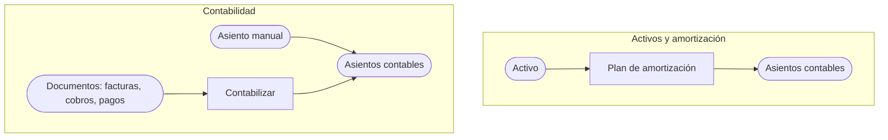

---
tags:
    - Finanzas
    - Contabilidad
    - Activos
    - Etendo
---

# ¿Qué es la sección Finanzas?

La sección **Finanzas** es donde Etendo gestiona las finanzas de tu empresa: el plan de cuentas, los centros de costos, el calendario contable, los asientos manuales, los documentos pendientes de contabilizar, y el registro contable de tus activos fijos y su amortización.

Cada documento que confirmas en Etendo —una factura, un cobro, un pago— genera sus asientos contables al contabilizarlo, en las cuentas de tu plan de cuentas. Para los gastos o ajustes que no vienen de un documento, como las comisiones del banco, registras un asiento manual. En paralelo, tus activos fijos (vehículos, equipos, maquinaria) se amortizan por su cuenta, generando los asientos contables correspondientes cuando confirmas cada período.

!!! info "¿Buscas tus cuentas, cobros o pagos?"
    Las cuentas de banco, tarjeta y caja, los cobros, los pagos, la conciliación bancaria y las condiciones de pago están en la sección [Tesorería](../../tesoreria/que-es-tesoreria/que-es-tesoreria.md).

## Qué incluye esta sección

- **Contabilidad** — el plan de cuentas donde Etendo anota cada operación, los centros de costos, el calendario contable con sus períodos abiertos o cerrados, los asientos manuales y la lista de documentos que todavía no están contabilizados.
- **Activos y Amortización** — el registro de tus bienes fijos y la distribución de su valor a lo largo de su vida útil, con los asientos contables que se generan al confirmar cada período.

## Recursos y próximos pasos

Para empezar, revisa las cuentas donde Etendo anota cada operación en [Gestionar tu plan de cuentas](../gestionar-tu-plan-de-cuentas/gestionar-tu-plan-de-cuentas.md). Si además necesitas llevar el control contable de tus bienes fijos, consulta [Apuntar un activo](../como-apuntar-un-activo/como-apuntar-un-activo.md).

---

## Artículos Relacionados

- [Gestionar tu plan de cuentas](../gestionar-tu-plan-de-cuentas/gestionar-tu-plan-de-cuentas.md)
- [Cómo registrar un asiento manual](../como-registrar-un-asiento-manual/como-registrar-un-asiento-manual.md)
- [Apuntar un activo](../como-apuntar-un-activo/como-apuntar-un-activo.md)

---
Esta obra está bajo la licencia :material-creative-commons: :fontawesome-brands-creative-commons-by: :fontawesome-brands-creative-commons-sa: [CC BY-SA 2.5 ES](https://creativecommons.org/licenses/by-sa/2.5/es/){target="_blank"} de [Futit Services S.L](https://etendo.software){target="_blank"}.
