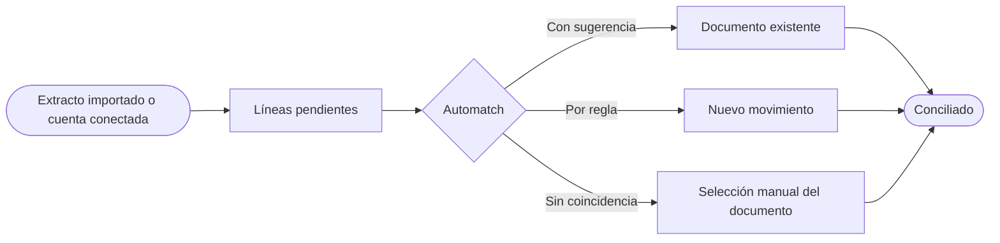
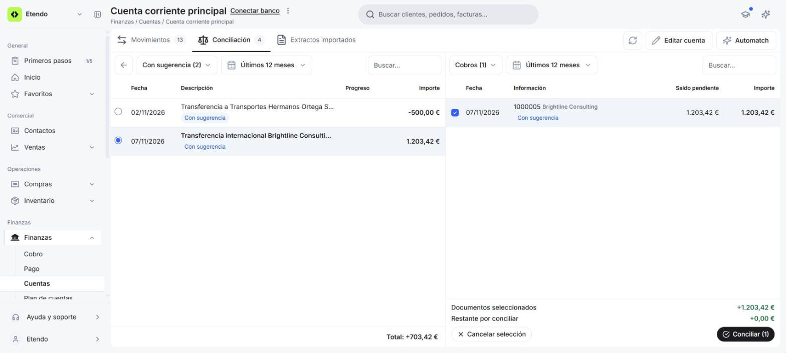

---
tags:
    - Cuentas
    - Finanzas
    - Conciliación Bancaria
    - Etendo
---

# ¿Qué es la conciliación bancaria en Etendo?

Conciliar es vincular cada línea de tu extracto bancario con la operación de Etendo que le corresponde, para que el saldo de tu cuenta coincida siempre con el saldo real de tu banco. Normalmente esa operación es un documento que ya existe (una factura, un cobro o un pago); en los movimientos recurrentes sin factura, como una comisión bancaria, Etendo puede crear el movimiento por ti a partir de una regla.

## Cómo funciona el proceso de conciliación

Las líneas del extracto llegan a la pestaña **Conciliación** de la cuenta como pendientes. A partir de ahí tienes tres caminos:

- **Con sugerencia**: **Automatch** encontró una factura, un cobro o un pago que coincide con la línea y te lo propone para que lo vincules.
- **Por regla**: la línea coincide con una regla de matcheo. En lugar de vincular un documento, Etendo crea un movimiento nuevo con los datos de la regla.
- **Selección manual**: eliges el tipo de documento (**Facturas de venta**, **Facturas de compra**, **Cobros** o **Pagos**), lo buscas por fecha o con el buscador, marcas los que corresponden a la línea hasta que el **Restante por conciliar** llega a 0 y haces clic en **Conciliar**.

Si te equivocas, puedes **desconciliar** la línea más tarde: el vínculo se rompe y su importe vuelve a quedar pendiente de conciliar.

## Qué incluye esta sección

- **Conciliación por cuenta**: dentro de cada cuenta, la pestaña **Conciliación** muestra las líneas del extracto y te deja filtrarlas por estado (**Todos**, **Pendientes**, **Con sugerencia**, **Por regla**, **Con diferencia** y **Conciliadas**), con un contador en cada filtro.
- **Automatch**: la ventana **Conciliación automática sugerida** agrupa cada línea pendiente con su operación y te deja conciliar varios grupos a la vez. Si hay sugerencias, se abre sola al entrar en la pestaña **Conciliación**.
- **Reglas de matcheo**: reglas configurables para los movimientos que se repiten sin factura asociada (por ejemplo, comisiones bancarias). Se aplican a las líneas que Automatch no pudo conciliar.
- **Tolerancia de conciliación**: el margen de fecha (en días) y de importe (en %) que Automatch acepta para sugerir una coincidencia. Se configura en cada cuenta, desde **Editar cuenta**.

Así se ve la pestaña **Conciliación** filtrada por **Con sugerencia**, con una línea de extracto seleccionada y, a la derecha, el documento que sugiere Automatch ya marcado:

## Recursos y próximos pasos

Antes de conciliar necesitas líneas de extracto en la cuenta. Puedes [conectar la cuenta con tu banco](../como-conectar-desconectar-desactivar-o-eliminar-una-cuenta-bancaria/como-conectar-desconectar-desactivar-o-eliminar-una-cuenta-bancaria.md) para que se sincronicen solas, o [importar el extracto bancario](../como-importar-o-descargar-el-extracto-bancario/como-importar-o-descargar-el-extracto-bancario.md) como archivo. Después, concilia cada línea desde [Conciliar o desconciliar movimientos contra documentos](../como-conciliar-o-desconciliar-movimientos-contra-documentos/como-conciliar-o-desconciliar-movimientos-contra-documentos.md).

---

## Artículos Relacionados

- [Conciliar o desconciliar movimientos contra documentos](../como-conciliar-o-desconciliar-movimientos-contra-documentos/como-conciliar-o-desconciliar-movimientos-contra-documentos.md)
- [Configurar reglas para automatizar la conciliación](../como-configurar-reglas-para-automatizar-la-conciliacion-bancaria/como-configurar-reglas-para-automatizar-la-conciliacion-bancaria.md)
- [Importar o descargar el extracto bancario](../como-importar-o-descargar-el-extracto-bancario/como-importar-o-descargar-el-extracto-bancario.md)
- [Borrar un extracto o un movimiento](../como-borrar-transacciones-del-extracto-bancario/como-borrar-transacciones-del-extracto-bancario.md)
- [Conectar, desconectar, archivar, desarchivar o eliminar una cuenta](../como-conectar-desconectar-desactivar-o-eliminar-una-cuenta-bancaria/como-conectar-desconectar-desactivar-o-eliminar-una-cuenta-bancaria.md)
- [Cómo editar una cuenta](../como-editar-una-cuenta/como-editar-una-cuenta.md)
- [Registrar un cobro](../como-registrar-un-cobro/como-registrar-un-cobro.md)
- [Registrar un pago](../como-registrar-un-pago/como-registrar-un-pago.md)
- [Gestionar pagos y cobros](../como-gestionar-pagos-y-cobros/como-gestionar-pagos-y-cobros.md)

---
Esta obra está bajo la licencia :material-creative-commons: :fontawesome-brands-creative-commons-by: :fontawesome-brands-creative-commons-sa: [CC BY-SA 2.5 ES](https://creativecommons.org/licenses/by-sa/2.5/es/){target="_blank"} de [Futit Services S.L](https://etendo.software){target="_blank"}.
