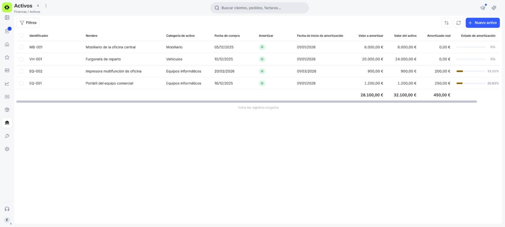
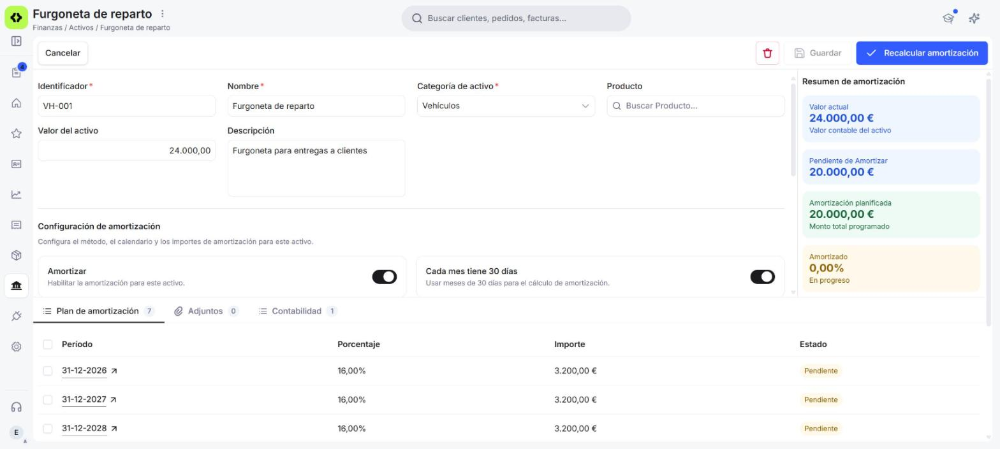
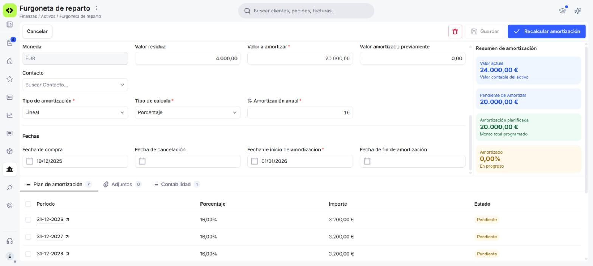
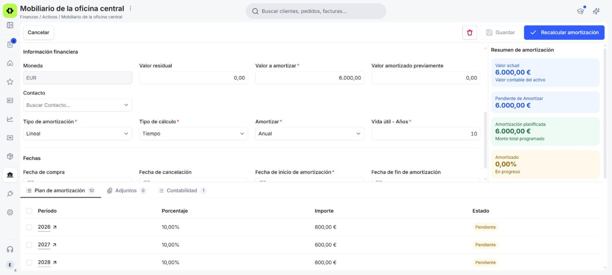
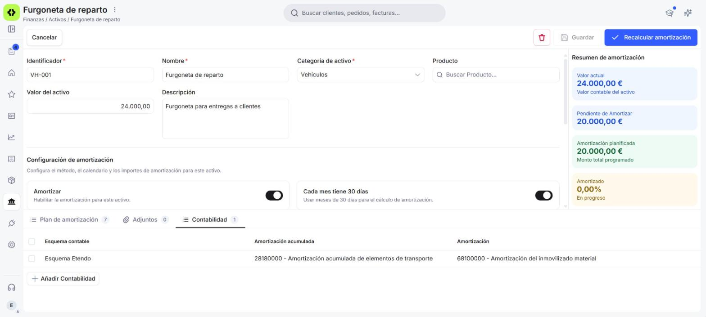

# Activos: referencia de campos

Aquí tienes el detalle de la lista de activos, de cada campo del formulario y de lo que muestra un activo una vez que generas su plan de amortización. Los ejemplos usan un portátil que se amortiza por meses, un vehículo que se amortiza por porcentaje y el mobiliario de una oficina que se amortiza por años. Para los pasos de alta, consulta [Apuntar un activo](../como-apuntar-un-activo/como-apuntar-un-activo.md).

## Lista de activos

<figure markdown="span">
  
  <figcaption>Lista de Activos con bienes de varias categorías y su estado de amortización.</figcaption>
</figure>

En **[Finanzas > Activos](https://app.etendo.ai/assets){target="_blank"}** ves todos los bienes que tienes registrados. Para cada uno, la lista muestra:

- **Identificador** y **Nombre** — para reconocer el bien.
- **Categoría de activo** — el tipo de bien.
- **Fecha de compra** y **Fecha de inicio de amortización**.
- **Amortizar** — *Sí* si el bien se amortiza.
- **Valor a amortizar** y **Valor del activo**.
- **Amortizado real** — el importe ya amortizado, contando solo las cuotas confirmadas.
- **Estado de amortización** — el mismo avance, como barra con el porcentaje.

Al pie de la lista verás la suma de **Valor a amortizar**, **Valor del activo** y **Amortizado real**. Usa **Filtros** para añadir condiciones, por ejemplo ver solo los activos de una categoría. Para registrar uno nuevo, haz clic en **+ Nuevo activo**.

## Datos del activo y configuración de amortización

<figure markdown="span">
  
  <figcaption>Vehículo VH-001: sus datos, la amortización activada y el resumen a la derecha.</figcaption>
</figure>

La parte de arriba del formulario sirve para identificar el bien y saber cuánto pagaste por él:

- **Identificador** *(obligatorio)* — código único del bien dentro de tu empresa, por ejemplo tu número de inventario: `VH-001`. Lo eliges tú; Etendo no lo genera.
- **Nombre** *(obligatorio)* — qué es el bien: *Furgoneta de reparto*.
- **Categoría de activo** *(obligatorio)* — el tipo de bien: *Vehículos*, *Equipos informáticos*, *Mobiliario*… Al elegirla, Etendo propone la forma de amortizar que tiene configurada esa categoría. La categoría también decide en qué cuentas de tu contabilidad se anota la amortización.
- **Producto** — producto de tu catálogo con el que se relaciona el bien, si lo hay.
- **Valor del activo** — lo que pagaste por el bien: `24.000`.
- **Descripción** — número de serie, ubicación, quién lo usa o cualquier otro dato útil.

Debajo, la sección **Configuración de amortización** (*"Configura el método, el calendario y los importes de amortización para este activo."*) tiene el interruptor **Amortizar**; al activarlo aparece también **Cada mes tiene 30 días**:

- **Amortizar** — *"Habilitar la amortización para este activo."* Actívalo para que Etendo calcule las cuotas. Mientras está desactivado, el formulario muestra *"La amortización está desactivada. Actívala para configurar el método, el cálculo y la vida útil."*
- **Cada mes tiene 30 días** — *"Usar meses de 30 días para el cálculo de amortización."* Viene activado y hace que todas las cuotas mensuales sean iguales, aunque el mes tenga 28 o 31 días.

## Información financiera

Esta sección aparece al activar **Amortizar**. Aquí defines cuánto se amortiza y a qué ritmo.

- **Moneda** — la moneda de tu empresa. No se puede cambiar.
- **Valor residual** — lo que calculas que valdrá el bien cuando dejes de usarlo: `4.000`.
- **Valor a amortizar** *(obligatorio)* — el importe que se reparte entre los años de uso. Se completa solo con el valor del activo menos el valor residual (24.000 − 4.000 = `20.000`). Puedes cambiarlo si tu asesor te indica otro importe.
- **Valor amortizado previamente** — lo que ya se había amortizado antes de registrar el bien en Etendo, por ejemplo si lo traes de otro programa. Viene en `0`.
- **Contacto** — contacto con el que quieras relacionar el bien.
- **Tipo de amortización** *(obligatorio)* — *Lineal*: el valor a amortizar se reparte en cuotas iguales.
- **Tipo de cálculo** *(obligatorio)* — cómo indicas el ritmo de amortización: *Porcentaje* o *Tiempo*.

Según el **Tipo de cálculo**, el formulario muestra campos distintos:

=== "Porcentaje"

    <figure markdown="span">
      
      <figcaption>Vehículo VH-001: 16 % anual sobre 20.000 € a amortizar, con una línea por año fechada el 31 de diciembre.</figcaption>
    </figure>

    - **% Amortización anual** *(obligatorio)* — qué parte del valor a amortizar se anota cada año.

    El plan tiene **una línea por año**, fechada el 31 de diciembre. Con el vehículo: 16 % de 20.000 € = 3.200 € al año durante seis años, y una última línea de 800 € para completar el total.

=== "Tiempo"

    <figure markdown="span">
      
      <figcaption>Mobiliario MB-001: 6.000 € repartidos en 10 cuotas anuales de 600 €.</figcaption>
    </figure>

    - **Amortizar** *(obligatorio)* — cada cuánto se anota la amortización: *Mensual* o *Anual*. No lo confundas con el interruptor del mismo nombre de la sección anterior.
    - **Vida útil - Meses** o **Vida útil - Años** *(obligatorio)* — durante cuánto tiempo vas a usar el bien. El nombre cambia según la periodicidad elegida.

    Ejemplos:

    - Portátil `EQ-001`: 1.200 €, mensual, 48 meses → 25 € al mes.
    - Mobiliario `MB-001`: 6.000 €, anual, 10 años → 600 € al año.

## Fechas

- **Fecha de compra** — la fecha de la factura de compra.
- **Fecha de cancelación** — la fecha en que el bien deja de ser tuyo, por ejemplo porque lo vendes. Déjala vacía mientras lo sigas usando.
- **Fecha de inicio de amortización** *(obligatorio)* — desde cuándo usas el bien. Es el punto de partida de la primera cuota.
- **Fecha de fin de amortización** — cuándo termina de amortizarse el bien. Se completa sola si amortizas por *Tiempo* con periodicidad *Mensual*; en los demás casos queda vacía.

## Resumen de amortización

El panel de la derecha del activo (lo ves en la captura de [Datos del activo y configuración de amortización](#datos-del-activo-y-configuracion-de-amortizacion)) resume la situación del activo:

- **Valor actual** — *"Valor contable del activo"*.
- **Pendiente de Amortizar** — lo que queda por amortizar. En el portátil, con 10 cuotas de 25 € ya confirmadas: 1.200 − 250 = 950 €.
- **Amortización planificada** — *"Monto total programado"*: el importe total que reparte el plan.
- **Amortizado** — porcentaje ya amortizado. Solo cuenta las cuotas en estado **Confirmado**, aunque la fecha de otras ya haya pasado. Debajo aparece *En progreso* mientras quedan cuotas por amortizar.

Después de generar el plan, el botón **Crear amortización** pasa a ser **Recalcular amortización**. Úsalo si cambias el valor, el ritmo o las fechas del bien.

## Pestañas del activo

El activo tiene tres pestañas: **Plan de amortización**, **Adjuntos** y **Contabilidad**.

### Plan de amortización

Muestra las cuotas que genera **Crear amortización**, una por período, con las columnas **Período**, **Porcentaje**, **Importe** y **Estado**:

- **Pendiente** — la cuota todavía no se ha confirmado.
- **Confirmado** — la cuota ya se ha procesado y cuenta para el **Amortizado**.

Haz clic en un período para abrir el registro de **Amortización** que lo agrupa. Para confirmar y llevar cada cuota a tu contabilidad, consulta [Crear y ejecutar un plan de amortización](../como-crear-y-ejecutar-un-plan-de-amortizacion/como-crear-y-ejecutar-un-plan-de-amortizacion.md).

### Adjuntos

Aquí guardas los documentos del bien: la factura de compra, la garantía, el contrato de mantenimiento… Puedes arrastrar el archivo o seleccionarlo; se admiten PDF, Word, Excel, PowerPoint, imágenes, XML, ZIP y RTF. La pestaña se activa después de guardar el activo.

### Contabilidad

<figure markdown="span">
  
  <figcaption>Pestaña Contabilidad del vehículo VH-001, con las cuentas que vienen de la categoría Vehículos.</figcaption>
</figure>

Muestra en qué cuentas de tu contabilidad se anota la amortización de este bien.

!!! info "Para tu asesor"
    - Cada fila corresponde a un **Esquema contable** e indica la cuenta de **Amortización acumulada** y la de **Amortización**. Estas cuentas salen de la **Categoría de activo**, que se configura en **[Finanzas > Categoría de activo](https://app.etendo.ai/asset-group){target="_blank"}**.
    - Al crear una categoría, Etendo le asigna unas cuentas por defecto que conviene revisar.
    - Con **+ Añadir Contabilidad** puedes añadir las cuentas de otro esquema contable.

---

## Artículos Relacionados

- [Apuntar un activo](../como-apuntar-un-activo/como-apuntar-un-activo.md)
- [Crear y ejecutar un plan de amortización](../como-crear-y-ejecutar-un-plan-de-amortizacion/como-crear-y-ejecutar-un-plan-de-amortizacion.md)
- [Glosario de Finanzas](../glosario-de-finanzas/glosario-de-finanzas.md)

---
Esta obra está bajo la licencia :material-creative-commons: :fontawesome-brands-creative-commons-by: :fontawesome-brands-creative-commons-sa: [CC BY-SA 2.5 ES](https://creativecommons.org/licenses/by-sa/2.5/es/){target="_blank"} de [Futit Services S.L](https://etendo.software){target="_blank"}.
