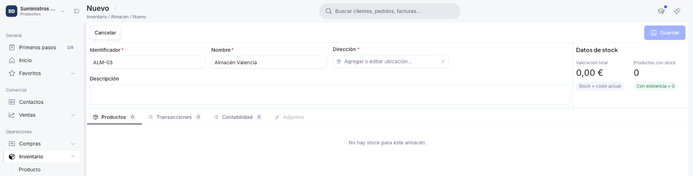
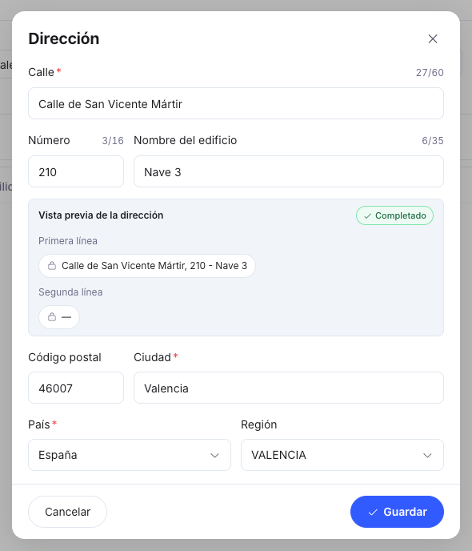

---
tags:
    - Almacén
    - Inventario
    - Etendo
---

# Crear un almacén

Este artículo cubre cómo dar de alta un almacén nuevo en Etendo.

## Ve a la ventana Almacén

Ve a **[Inventario > Almacén](https://app.etendo.ai/warehouse){target="_blank"}** y haz clic en **+ Nuevo almacén**.

## Completa el formulario

- **Nombre** *(obligatorio)* — Nombre descriptivo del almacén.
- **Identificador** *(obligatorio)* — Código único. Ej. `ALM-01`.
- **Dirección** *(obligatorio)* — Al hacer clic se abre la ventana **Dirección**. Consulta [Completa la dirección del almacén](#completa-la-direccion-del-almacen).
- **Descripción** *(opcional)* — Observaciones internas.

<figure markdown="span">
  
  <figcaption>Formulario de un almacén nuevo, todavía sin datos de stock.</figcaption>
</figure>

## Completa la dirección del almacén

<figure markdown="span">
  
  <figcaption>Ventana Dirección del almacén, con la Vista previa de la dirección completada.</figcaption>
</figure>

1. Escribe la **Calle** sin el número (ej. *Calle de San Vicente Mártir*) y el **Número** en su propio campo. Si la dirección no tiene número, deja **Número** vacío: se guarda como *s/n*.
2. Si el almacén está en un edificio o una nave con nombre, escríbelo en **Nombre del edificio** (ej. *Nave 3*).
3. Revisa la **Vista previa de la dirección**: Etendo compone la **Primera línea** y la **Segunda línea** a partir de esos tres campos, y no se editan a mano.
4. Completa **Código postal**, **Ciudad**, **País** y **Región**, y haz clic en **Guardar** para volver al formulario del almacén.

Para el detalle de cada campo, consulta [Añadir una dirección](../../../../comercial/contactos/como-crear-un-contacto/como-crear-un-contacto.md#anadir-una-direccion).

## Guarda el almacén

Cuando termines de completar el formulario, haz clic en **Guardar**.

!!! info "Los datos de stock aparecen después de guardar"
    Hasta que el almacén no esté guardado, el panel de datos de stock muestra $0,00 y 0 productos, la pestaña Productos muestra "No hay stock para este almacén" y la pestaña Transacciones muestra "No se encontraron transacciones para este almacén". Una vez guardado y con movimientos, vas a poder ver ahí el stock y la valoración de cada producto en este almacén.

<figure markdown="span">
  
  <figcaption>Ficha de un almacén recién guardado, todavía sin movimientos de stock.</figcaption>
</figure>

Al guardar, el almacén queda disponible para registrar su stock. Puedes hacerlo de dos formas: con un recuento desde la ventana **Inventario físico**, o registrando compras a proveedores — el stock se suma al completar el albarán de compra correspondiente.

---

## Artículos Relacionados

- [¿Qué es la sección Almacén?](../index.md)
- [¿Qué es la sección de Productos?](../../productos/index.md)
- [¿Qué es la sección Inventario?](../../que-es-inventario/que-es-inventario.md)

---
Esta obra está bajo la licencia :material-creative-commons: :fontawesome-brands-creative-commons-by: :fontawesome-brands-creative-commons-sa: [CC BY-SA 2.5 ES](https://creativecommons.org/licenses/by-sa/2.5/es/){target="_blank"} de [Futit Services S.L](https://etendo.software){target="_blank"}.
