# Cómo crear tu cuenta

Crear tu cuenta es gratis y no necesitas tarjeta de crédito. El recorrido tiene cinco fases: creas tu cuenta, pruebas Etendo en un entorno de demo, creas tu entorno productivo, completas las tareas del panel **Primeros pasos** y emites tu primera factura. La demo es gratuita y te sirve para probar; el entorno productivo es un plan de pago y lo necesitas para facturar con validez ante la administración tributaria.

## 1. Crea tu cuenta

### Regístrate

1. Accede a la página de registro de Etendo. Verás el formulario **Crea tu cuenta gratis**.

    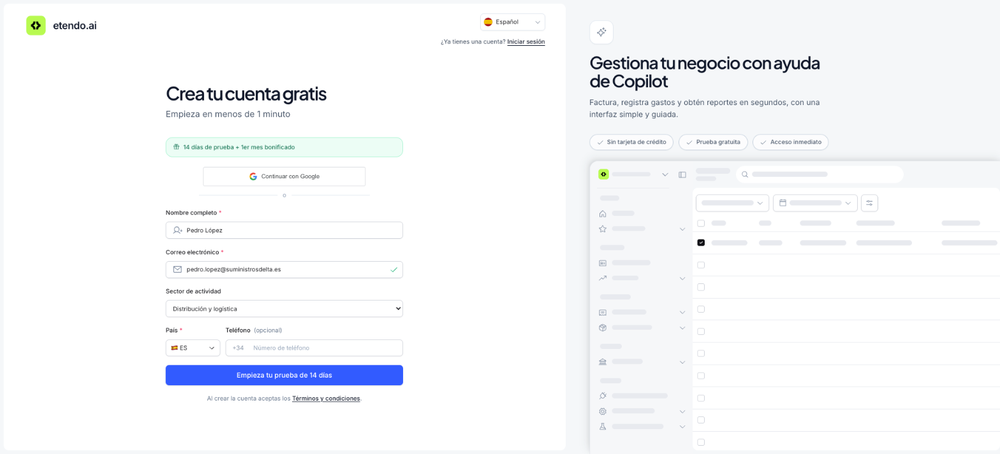

    !!! tip "Idioma"
        Antes de empezar, puedes cambiar el idioma de la interfaz desde el selector de idioma, en la esquina superior derecha del formulario.

    !!! tip "Registrarte con Google"
        En lugar de completar el formulario, puedes registrarte con tu cuenta de Google desde el botón **Continuar con Google**.

2. Completa los campos:
    - **Nombre completo** — tu nombre como administrador de la cuenta. Obligatorio.
    - **Correo electrónico** — la dirección con la que entrarás en Etendo. Obligatorio.
    - **Sector de actividad** — actividad principal de tu empresa (ej. *Distribución y logística*). Opcional.
    - **País** — el país de tu número de teléfono; define el prefijo (ej. *+34*). Obligatorio.
    - **Teléfono** — tu número, sin el prefijo. Opcional.

3. Haz clic en **Empieza tu prueba de 14 días**. Al crear la cuenta aceptas los **Términos y condiciones**.

### Confirma tu correo

Antes de continuar, Etendo te pide que confirmes tu dirección de correo.

1. Abre la bandeja de entrada del correo con el que te registraste.

    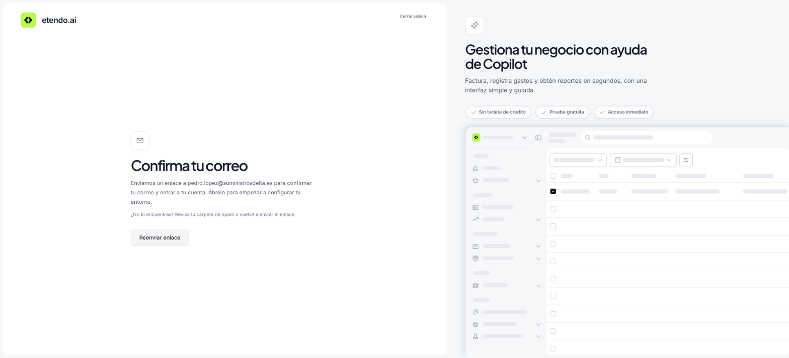

2. Haz clic en el enlace que Etendo te envía. Se abre la pantalla **Tu entorno está listo**.

    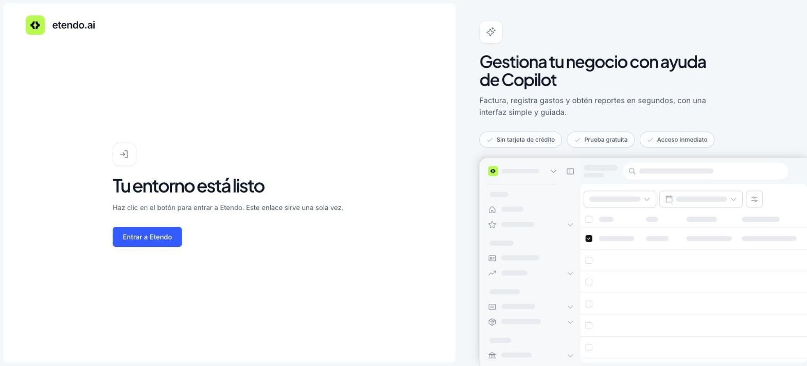

3. Haz clic en **Entrar a Etendo**. El enlace sirve una sola vez.

!!! tip "¿No te ha llegado el correo?"
    Revisa tu carpeta de spam o haz clic en **Reenviar enlace** desde la pantalla **Confirma tu correo**.

### Completa tu perfil

1. Revisa el **Nombre completo**. Ya viene completado con el nombre que escribiste al registrarte.

    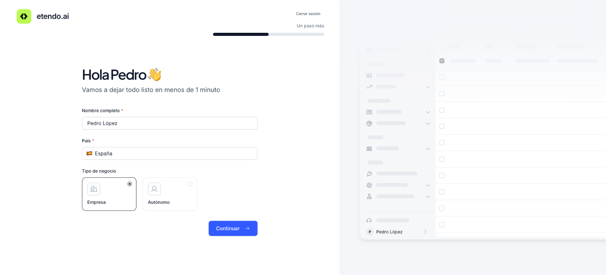

2. Revisa el **País**. Ya viene completado con el que elegiste al registrarte; cámbialo si tu empresa está en otro país.
3. Elige el **Tipo de negocio**:
    - **Empresa** — sociedades como S.L. o S.A., o cooperativas.
    - **Autónomo** — trabajador por cuenta propia.
4. Haz clic en **Continuar**.

### Completa los datos para empezar a facturar

En el paso **Datos para empezar a facturar**, Etendo te pide los datos que aparecen en tus facturas y documentos comerciales.

1. Completa los campos:

    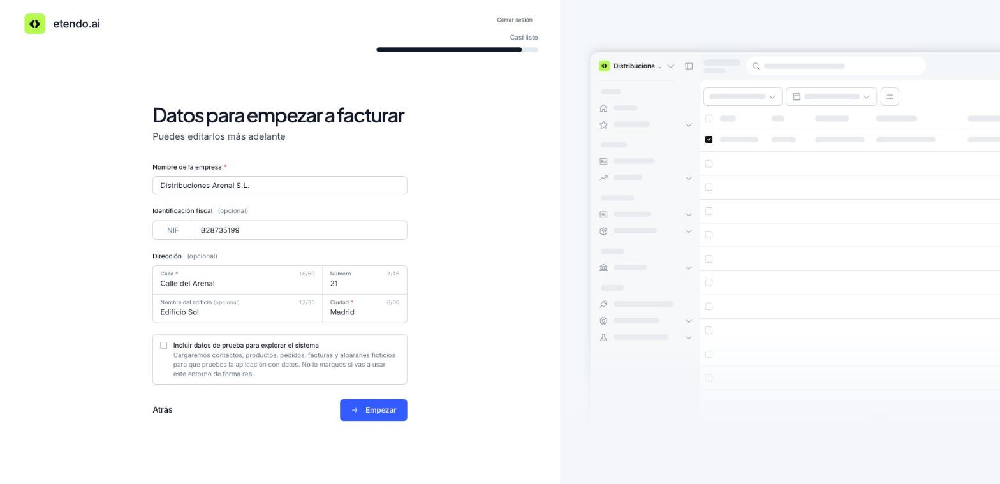

    - **Nombre de la empresa** — razón social completa (ej. *Distribuciones Arenal S.L.*). Obligatorio.
    - **Identificación fiscal (NIF)** — la identificación fiscal de una empresa empieza por letra (ej. *B12345678*); si en **Tipo de negocio** elegiste **Autónomo**, escribe tu DNI o NIE. Es opcional en este paso, pero lo necesitas antes de emitir facturas y conectar con la administración tributaria.
    - **Dirección** — dirección fiscal, opcional en este paso. Se divide en **Calle** (sin el número), **Número**, **Nombre del edificio** y **Ciudad**. Si empiezas a completarla, **Calle** y **Ciudad** son obligatorios. Para el detalle de cada campo, consulta [Añadir una dirección](../../comercial/contactos/como-crear-un-contacto/como-crear-un-contacto.md#anadir-una-direccion).
    - **Incluir datos de prueba para explorar el sistema** — márcala si quieres que la demo traiga contactos, productos, pedidos, facturas y albaranes ficticios para probar con datos. Déjala sin marcar si prefieres empezar la demo de cero y probar con tus propios datos.

    !!! info "Edición posterior"
        Puedes modificar todos estos datos cuando quieras desde [**Configuración > Organización**](https://app.etendo.ai/organization){target="_blank"}. Ahí completas también el **Código postal**, el **País** y la **Región** de la dirección fiscal, que no se piden en este paso. Consulta [Editar la dirección fiscal](../../sistema/configuracion/como-gestionar-tu-organizacion/como-gestionar-tu-organizacion.md#editar-la-direccion-fiscal).

2. Haz clic en **Empezar**.

Etendo prepara el espacio de trabajo de tu empresa. El proceso tarda unos segundos.

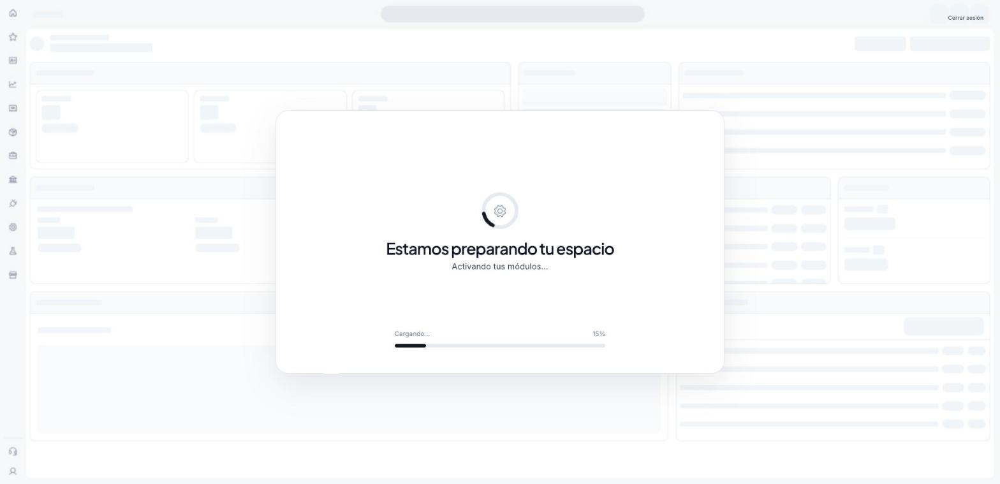

## 2. Conoce tu entorno de pruebas (demo)

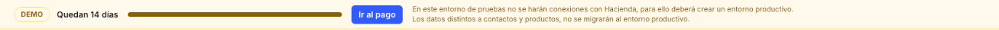

!!! tip "Para qué sirve la demo"
    La demo es un entorno funcional para hacer todo tipo de pruebas en el sistema. No se conecta con la administración tributaria ni emite facturas con validez legal. Cuando termines de probar, creas tu entorno productivo con toda tu información real, y desde ahí envías facturas legales. Al pasar a productivo, puedes transferir los **contactos** y **productos** que añadiste en la demo.

En cuanto tu espacio está listo, tu cuenta funciona como un **entorno de pruebas (demo)** durante 14 días. Etendo te lo recuerda en dos lugares:

- La etiqueta **Demo**, junto al nombre de tu empresa, en la esquina superior izquierda.
- Una barra en la parte superior de la pantalla, con los días restantes, el botón [**Ir al pago**](https://app.etendo.ai/upgrade){target="_blank"} y un aviso: en la demo no hay conexión con la administración tributaria, y solo los contactos y productos pasan al entorno productivo.

## 3. Crea tu entorno productivo

El entorno productivo es tu cuenta real, la que se conecta con la administración tributaria. Es independiente de la demo: la demo se mantiene tal como está, no se elimina.

Haz clic en [**Ir al pago**](https://app.etendo.ai/upgrade){target="_blank"} para abrir el asistente **Crear un entorno productivo**, de 3 pasos: **Plan**, **Complementos** y **Pago**.

### Elige el plan

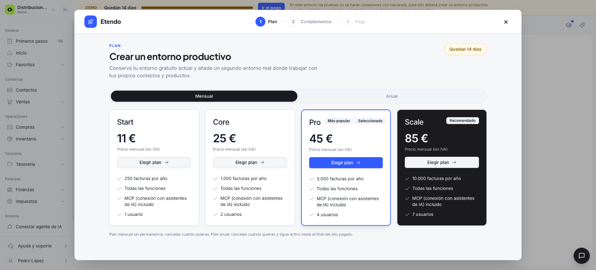

1. Elige el pago **Mensual** o **Anual**. El plan mensual no tiene permanencia; el anual sigue activo hasta el final del año pagado aunque lo canceles.
2. Compara los planes **Start**, **Core**, **Pro** y **Scale**. Todos incluyen todas las funciones y la conexión con agentes de IA (MCP); cambian el precio, el número de facturas por año y el número de usuarios.
3. Haz clic en **Elegir plan** en el plan que quieras.

### Transfiere tus datos de la demo

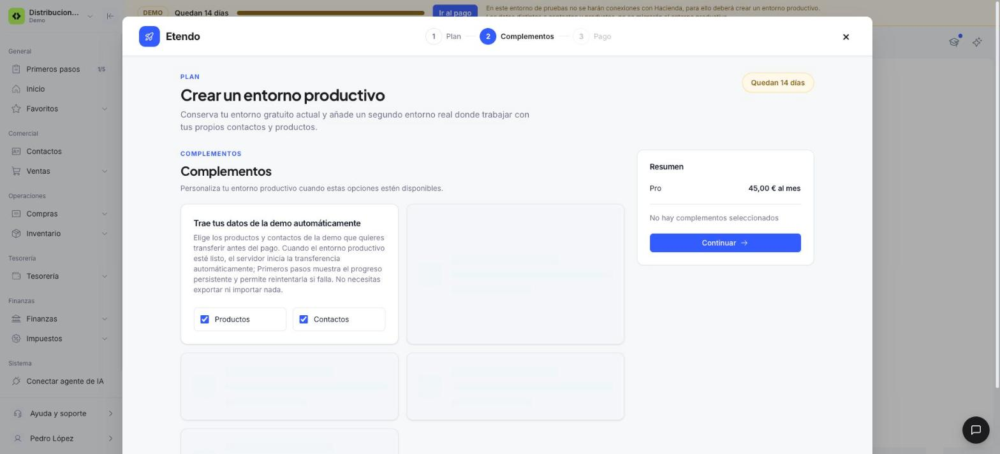

1. En **Trae tus datos de la demo automáticamente**, decide si quieres traer los **Productos** y **Contactos** que añadiste en la demo. Ambas casillas vienen marcadas por defecto. Son los únicos datos que puedes transferir: el resto de la información de la demo no pasa al entorno productivo.
2. Revisa el **Resumen** con el plan elegido y haz clic en **Continuar**.

Etendo hace la transferencia automáticamente en cuanto el entorno productivo está listo, sin que tengas que exportar ni importar nada.

### Completa el pago

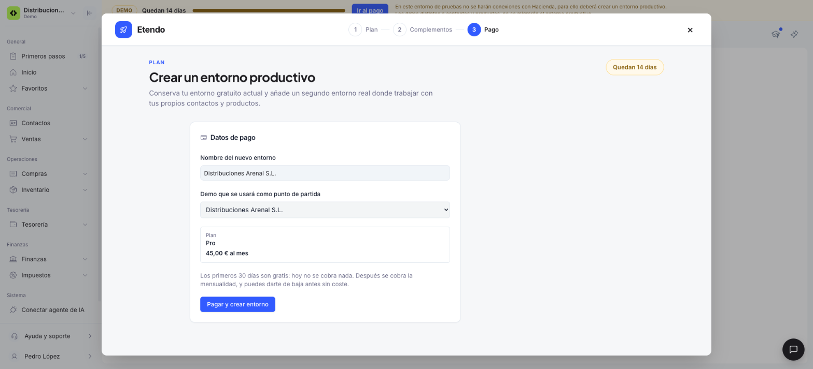

1. En **Datos de pago**, revisa el **Nombre del nuevo entorno**, la **Demo que se usará como punto de partida** y el plan elegido.
2. Haz clic en **Pagar y crear entorno**. Etendo te lleva a la página de pago segura de Stripe.

    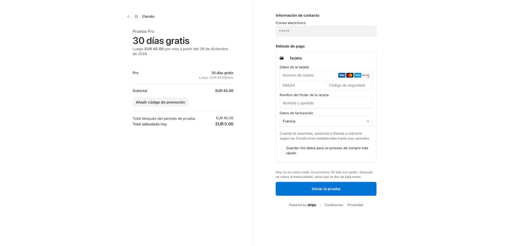

3. Revisa el resumen de la izquierda, escribe los datos de tu tarjeta y los **Datos de facturación**, y haz clic en **Iniciar la prueba**.

!!! info "Los primeros 30 días son gratis"
    Al crear el entorno productivo no se cobra nada: los primeros 30 días son gratis y el plan se cobra después, salvo que te des de baja antes. Estos 30 días son aparte de los 14 días de la demo.

Al activarlo, Etendo te lleva al panel **Primeros pasos** de tu entorno productivo. Lo reconoces por la etiqueta **Productivo**, junto al nombre de tu empresa, en la esquina superior izquierda.

La demo sigue disponible: puedes cambiar entre la demo y el entorno productivo desde el [Selector de empresa](../navegar-en-etendo/navegar-en-etendo.md#selector-de-empresa) (menú **Cambiar empresa**, junto al logo).

## 4. Completa las tareas del panel Primeros pasos

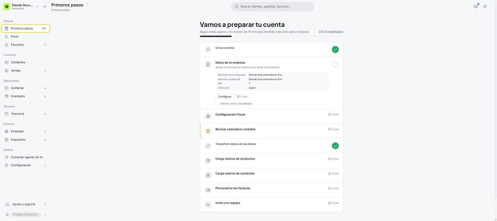

El panel **Primeros pasos** te guía por la configuración básica de tu cuenta. Se abre con el título *"Vamos a preparar tu cuenta"* y un contador de progreso (ej. *2/9 Completados*). Cada tarea se despliega al pulsarla; las que no se completan solas tienen la casilla **Marcar como completado**.

- **Crear cuenta** — se completa sola al terminar el registro.
- **Datos de tu empresa** — muestra un resumen de los datos que introdujiste al registrarte (nombre de la empresa, nombre comercial, NIF y dirección). Revísalos y, si alguno es incorrecto o falta, corrígelo: **Configurar** te lleva a [**Configuración > Organización**](https://app.etendo.ai/organization){target="_blank"}. Cuando estén bien, márcala como completada.
- **Configuración Fiscal** — pregunta *"¿Debe informar las facturas a algún Sistema de Información Fiscal (SIF) como SII, TicketBai o Verifactu?"*. Si respondes **Sí**, **Configurar** te lleva a elegir tu territorio fiscal y el sistema que te corresponde (SII, TicketBAI o VERI\*FACTU). Si no sabes cuál te corresponde, consúltalo con tu asesoría. Más información en [Configuración fiscal](../../sistema/configuracion/configuracion-fiscal/configuracion-fiscal.md).
- **Revisar calendario contable** — muestra el ejercicio que Etendo te propone, por ejemplo de enero a diciembre, con todos los períodos sin abrir: hasta que abras alguno no puedes completar ni contabilizar documentos. Haz clic en **Confirmar** si es tu ejercicio, o en **Modificar** para elegir otro inicio. Después, abre los períodos en los que vas a trabajar. Para el detalle, consulta [Revisar el calendario en una cuenta nueva](../../finanzas/como-gestionar-el-calendario-contable/como-gestionar-el-calendario-contable.md#revisar-el-calendario-en-una-cuenta-nueva).
- **Transferir datos de su demo** — muestra el estado de la transferencia de productos y contactos que elegiste al crear el entorno productivo. Se completa sola.
- **Carga masiva de productos** — importa tu catálogo desde una hoja de cálculo. **Importar** abre una ventana para arrastrar o seleccionar un archivo CSV, TXT o XLSX, con plantillas descargables listas para completar. Para el detalle, consulta [Importar productos](../../operaciones/inventario/productos/importar-productos/importar-productos.md).

    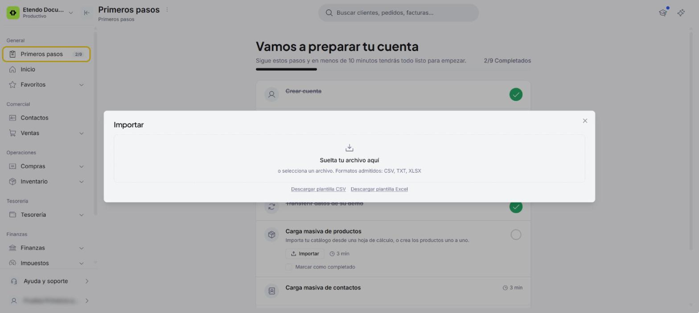

- **Carga masiva de contactos** — importa tus clientes y proveedores para empezar a facturar cuanto antes. **Importar** abre la misma ventana de importación. Para el detalle, consulta [Importar contactos](../../comercial/contactos/importar-contactos/importar-contactos.md).
- **Personaliza tus facturas** — define el prefijo y el número inicial de tus facturas; conviene hacerlo antes de emitir la primera. **Configurar** te lleva a [**Configuración > Secuencias de documentos**](https://app.etendo.ai/document-sequence){target="_blank"}. Más información en [Secuencias de documentos](../../sistema/configuracion/secuencias-de-documentos/secuencias-de-documentos.md).
- **Invita a tu equipo** — invita a las personas que trabajarán contigo y decide qué puede hacer cada una. **Configurar** te lleva a [**Configuración > Usuarios**](https://app.etendo.ai/user){target="_blank"}:
    1. Haz clic en [**Nuevo usuario**](https://app.etendo.ai/user/new){target="_blank"}.

        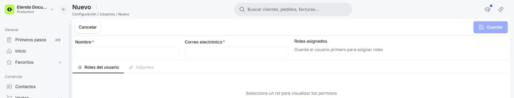

    2. Completa **Nombre** y **Correo electrónico** (obligatorios) y guarda el usuario.
    3. Añade los **Roles asignados** después de guardar.

    Para el detalle, consulta [Cómo invitar a un usuario](../../sistema/configuracion/como-invitar-a-un-usuario/como-invitar-a-un-usuario.md).

## 5. Crea tu primera factura

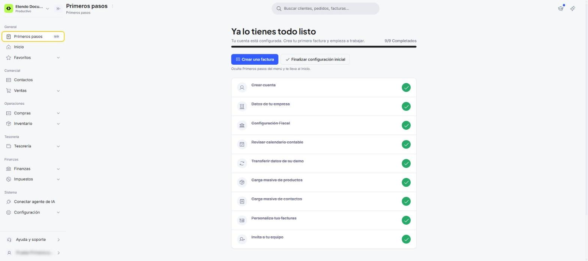

Cuando completas las 9 tareas, el panel muestra *"Ya lo tienes todo listo"*, el texto *"Tu cuenta está configurada. Crea tu primera factura y empieza a trabajar."* y el contador *9/9 Completados*. Aparecen dos botones:

- **Crear una factura** — abre directamente una nueva factura de venta. Para completarla, sigue [Crear una factura de venta](../../comercial/ventas/crear-una-factura-de-venta/crear-una-factura-de-venta.md).
- **Finalizar configuración inicial** — oculta **Primeros pasos** del menú y te lleva al **Inicio**. A partir de ahí, cualquier ajuste lo haces desde la ventana correspondiente en **Configuración**.

## Artículos Relacionados

- [Crear una factura de venta](../../comercial/ventas/crear-una-factura-de-venta/crear-una-factura-de-venta.md)
- [Cómo gestionar tu organización](../../sistema/configuracion/como-gestionar-tu-organizacion/como-gestionar-tu-organizacion.md)
- [¿Qué es Etendo?](../que-es-etendo/que-es-etendo.md)

---
Esta obra está bajo la licencia :material-creative-commons: :fontawesome-brands-creative-commons-by: :fontawesome-brands-creative-commons-sa: [CC BY-SA 2.5 ES](https://creativecommons.org/licenses/by-sa/2.5/es/){target="_blank"} de [Futit Services S.L](https://etendo.software){target="_blank"}.
