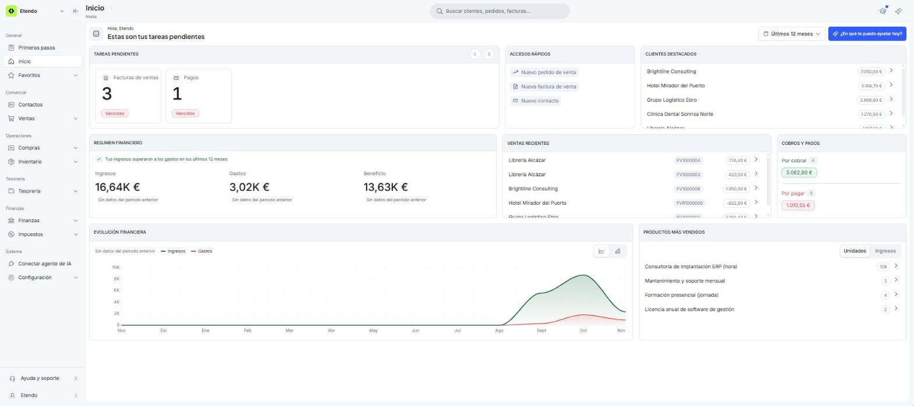

# ¿Qué es Etendo?

Etendo es un ERP (software de gestión empresarial) en la nube, pensado para empresas, autónomos y asesorías que necesitan gestionar su negocio sin complicaciones técnicas. Accedes desde el navegador, sin instalar nada ni mantener infraestructura propia, y siempre trabajas con la versión más actualizada.

Con Etendo gestionas Contactos, Ventas, Compras, Inventario, Tesorería, Finanzas e Impuestos desde un mismo lugar, y cuentas con **Copilot**, el agente de IA integrado en la interfaz de Etendo, que te ayuda a consultar información y a ejecutar acciones sin salir del sistema.

## Un ERP para personas y para agentes de IA

Todo lo que haces en Etendo puede ejecutarse también mediante un agente de inteligencia artificial a través de MCP (Model Context Protocol), el estándar que conecta agentes de IA con aplicaciones, con las mismas capacidades que tiene la interfaz visual. Este modelo dual te permite elegir, para cada tarea, el camino que más te convenga:

- **Desde la interfaz**: navega por los módulos, completa formularios y confirma documentos como en cualquier ERP.
- **Desde un agente**: automatiza flujos de negocio completos (crear un cliente, registrar una venta) conectando tu agente de IA a Etendo mediante MCP, sin intervención manual. Lo configuras desde **Sistema** > **Conectar agente de IA**.
- **Con Copilot**: pídele en lenguaje natural, desde el botón **¿En qué te puedo ayudar hoy?** del Inicio, que consulte datos o ejecute una acción por ti, como dar de alta un cliente o registrar una venta.

## Todo tu negocio, en un solo lugar

Etendo organiza la operación de tu empresa en módulos conectados entre sí, para que la información que cargas una vez esté disponible en todos los procesos relacionados. Los encuentras agrupados en el menú lateral:

- **Comercial**:
    - **Contactos**: un único maestro para clientes y proveedores, con tarifas y condiciones de pago que se heredan en cada documento.
    - **Ventas**: presupuestos, pedidos, albaranes, facturas y albaranes de devolución.
- **Operaciones**:
    - **Compras**: pedidos, albaranes, facturas y albaranes de devolución de compra, y la relación albarán-factura.
    - **Inventario**: productos, categorías de producto, tarifas, almacenes, inventario físico, movimientos entre almacenes, consumo interno e informes de stock.
- **Tesorería**: cobros, pagos, cuentas (bancos, tarjetas y caja) con su conciliación bancaria, informes y condiciones de pago.
- **Finanzas**:
    - **Finanzas**: plan de cuentas, esquema contable, calendario contable, asientos manuales, centros de costos y proyectos, activos y su amortización, documentos no contabilizados e informes contables.
    - **Impuestos**: tipos y categorías de impuesto, configuración fiscal, el **Monitor Fiscal** para el envío de tus facturas a SII, TicketBAI o VERI\*FACTU, y los modelos fiscales `303` y `349`.
- **Sistema**: en **Configuración** defines tu organización, las secuencias de documentos, las categorías de contacto, la conversión de divisas y los **usuarios y roles**. Etendo trae 5 roles predefinidos (**Administrador**, **Finanzas**, **Ventas**, **Compras** e **Inventario**); por ejemplo, solo **Administrador** y **Finanzas** pueden ejecutar las acciones contables de Activos y Amortización.

## Tu punto de partida: el Inicio

<figure markdown>
  
  <figcaption>Inicio de Etendo: tareas pendientes, resumen financiero, ventas recientes y evolución financiera.</figcaption>
</figure>

Al iniciar sesión llegas al **Inicio**, que te da una fotografía rápida del negocio mediante los siguientes widgets:

- **Tareas pendientes**: los documentos que requieren tu atención, como facturas de venta o pagos vencidos.
- **Accesos rápidos**: atajos para crear un **Nuevo pedido de venta**, una **Nueva factura de venta** o un **Nuevo contacto**.
- **Clientes destacados**: los clientes con mayor facturación en el período seleccionado.
- **Resumen financiero**: los **Ingresos**, **Gastos** y **Beneficio** del período, comparados con el período anterior.
- **Ventas recientes**: los últimos documentos de venta registrados en el sistema.
- **Cobros y pagos**: cuántos documentos tienes **Por cobrar** y **Por pagar**, y por qué importe.
- **Evolución financiera**: un gráfico mensual de ingresos y gastos, en líneas o en barras.
- **Productos más vendidos**: el ranking de productos del período, por **Unidades** o por **Ingresos**.

Con el filtro de período, arriba a la derecha, eliges el rango de fechas que muestran los widgets: **Últimos 12 meses**, **Últimos 90 días**, **Últimos 30 días**, **Mes en curso** o **Año en curso**.

Si acabas de crear tu cuenta, empieza por **Primeros pasos**, el primer elemento del menú: es una lista guiada de tareas para dejar Etendo listo antes de emitir tu primera factura.

!!! tip "Empieza con Copilot"
    Desde el Inicio, pulsa **¿En qué te puedo ayudar hoy?** y escríbele a Copilot lo que necesitas, por ejemplo, *"Crea un cliente nuevo"*, y deja que el agente lo resuelva por ti.

Con la cuenta lista, puedes empezar a facturar, registrar gastos y consultar reportes en cuestión de minutos. Prueba Etendo, sin necesidad de tarjeta de crédito ni configuración adicional.

## Artículos Relacionados

- [Cómo crear tu cuenta](../como-crear-tu-cuenta/como-crear-tu-cuenta.md) — regístrate, prueba la demo, crea tu entorno productivo y completa las tareas del panel Primeros pasos hasta emitir tu primera factura.
- [Navegar en Etendo](../navegar-en-etendo/navegar-en-etendo.md) — conoce el menú lateral y los elementos que se repiten en todas las pantallas.
- [Contactos](../../comercial/contactos/que-es-la-seccion-contactos/que-es-la-seccion-contactos.md) — carga tus primeros contactos antes de emitir tu primer documento de venta o compra.

---
Esta obra está bajo la licencia :material-creative-commons: :fontawesome-brands-creative-commons-by: :fontawesome-brands-creative-commons-sa: [CC BY-SA 2.5 ES](https://creativecommons.org/licenses/by-sa/2.5/es/){target="_blank"} de [Futit Services S.L](https://etendo.software){target="_blank"}.
