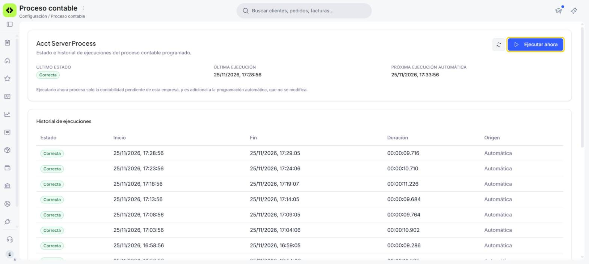

# Cómo revisar el proceso contable

Etendo contabiliza tus documentos de forma automática cada 5 minutos: facturas, albaranes, asientos manuales y otros documentos que ya están completados pasan a tu contabilidad sin que tengas que hacer nada. La ventana **Proceso contable** te muestra cómo van esas ejecuciones y te permite lanzar una al momento.

## Consultar el estado del proceso

<figure markdown="span">
  
  <figcaption>Estado del proceso contable y su historial de ejecuciones.</figcaption>
</figure>

1. En el menú lateral, dentro de **Configuración**, haz clic en **[Proceso contable](https://app.etendo.ai/acct-process-monitor){target="_blank"}**.
2. Revisa la parte superior:
    - **Último estado** — el resultado de la última ejecución, por ejemplo **Correcta**.
    - **Última ejecución** — la fecha y hora en que se ejecutó por última vez.
    - **Próxima ejecución automática** — cuándo volverá a ejecutarse.
3. Debajo, en **Historial de ejecuciones**, tienes cada ejecución con su **Estado**, **Inicio**, **Fin**, **Duración** y **Origen** (**Automática** si la lanzó Etendo).

Para actualizar los datos de la ventana, haz clic en el botón de recarga, a la izquierda de **Ejecutar ahora**.

## Contabilizar al momento

Si acabas de completar un documento y no quieres esperar a la próxima ejecución, haz clic en **Ejecutar ahora**. Etendo contabiliza en ese momento lo que esté pendiente de tu empresa. La programación automática no cambia: sigue ejecutándose cada 5 minutos.

Si un documento sigue sin aparecer en la contabilidad, búscalo en **Documentos no contabilizados** para ver por qué está pendiente.

## Artículos Relacionados

- [Cómo revisar los documentos no contabilizados](../../../finanzas/como-revisar-los-documentos-no-contabilizados/como-revisar-los-documentos-no-contabilizados.md)
- [Cómo registrar un asiento manual](../../../finanzas/como-registrar-un-asiento-manual/como-registrar-un-asiento-manual.md)
- [Glosario de Finanzas](../../../finanzas/glosario-de-finanzas/glosario-de-finanzas.md)

---
Esta obra está bajo la licencia :material-creative-commons: :fontawesome-brands-creative-commons-by: :fontawesome-brands-creative-commons-sa: [CC BY-SA 2.5 ES](https://creativecommons.org/licenses/by-sa/2.5/es/){target="_blank"} de [Futit Services S.L](https://etendo.software){target="_blank"}.
