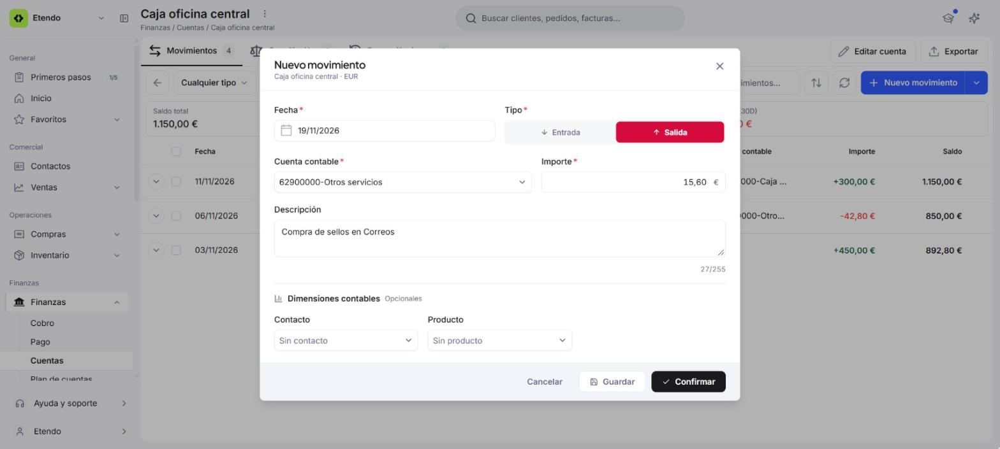
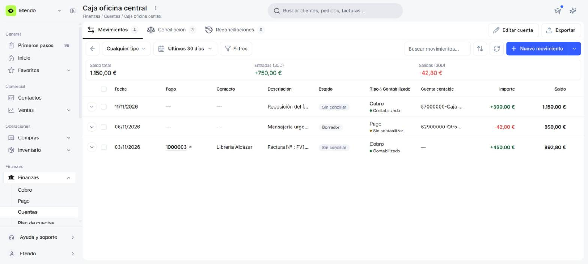
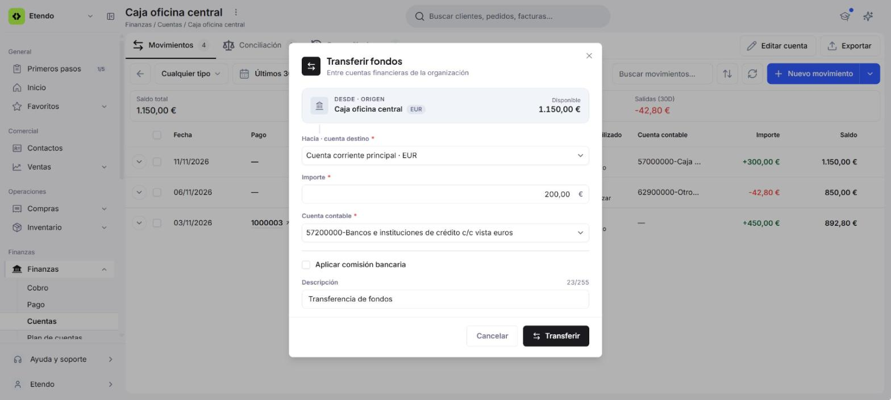
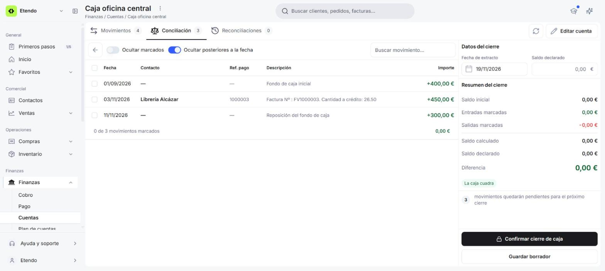

---
tags:
    - Cuentas
    - Tesorería
    - Caja
    - Efectivo
    - Etendo
---

# Gestionar caja y movimientos en efectivo

Una caja es un tipo de cuenta para el efectivo que manejas fuera del banco: la caja chica de la oficina, la caja de un punto de venta, etc. En este artículo verás cómo registrar sus entradas y salidas, pasar dinero entre la caja y otra cuenta, hacer el cierre de caja y corregir un movimiento.

Si todavía no tienes la caja creada, consulta [Añadir y configurar un banco, tarjeta o caja](../como-anadir-y-configurar-un-banco-tarjeta-o-caja/como-anadir-y-configurar-un-banco-tarjeta-o-caja.md).

## ¿Qué es una caja?

Dentro de **Cuentas**, **Caja** es uno de los tres tipos de cuenta, junto a **Banco** y **Tarjeta**. A diferencia de un banco, una caja no se conecta con ninguna entidad ni importa extractos: todos sus movimientos se registran en Etendo.

Al abrir una caja verás tres pestañas:

- **Movimientos**: las entradas y salidas de efectivo, con el saldo.
- **Conciliación**: el cierre de caja, donde compruebas que el efectivo que tienes coincide con lo registrado.
- **Reconciliaciones**: el historial de cierres de caja confirmados.

## Registrar un movimiento en efectivo

1. Abre la caja desde **[Tesorería > Cuentas](https://app.etendo.ai/financial-account){target="_blank"}** y, en la pestaña **Movimientos**, haz clic en **Nuevo movimiento**. También puedes elegir **Nuevo movimiento** en el menú **⋮** de la caja, en el listado de cuentas.
2. Elige el **Tipo**: **Entrada** (dinero que ingresa en la caja) o **Salida** (dinero que sale). Por defecto está marcado **Salida**.
3. Completa los campos obligatorios:
    - **Fecha**: por defecto, la de hoy.
    - **Cuenta contable**: la cuenta en la que se registra el movimiento (por ejemplo, otros servicios o material de oficina). Al elegirla, Etendo rellena la **Descripción** con su nombre.
    - **Importe**: siempre positivo; el **Tipo** ya indica si entra o sale.
4. Si lo necesitas, cambia la **Descripción** y, en **Dimensiones contables**, indica un **Contacto** o un **Producto**.
5. Elige cómo guardarlo:
    - **Guardar**: el movimiento queda en **Borrador** para terminarlo más tarde.
    - **Confirmar**: el movimiento queda registrado.

    

## Consultar los movimientos y el saldo

En la pestaña **Movimientos** de la caja tienes:

- Arriba, el **Saldo total** y las **Entradas** y **Salidas** del período seleccionado (por defecto, **Últimos 30 días**).
- El listado de movimientos, con estas columnas clave:
    - **Estado**: **Borrador**, **Sin conciliar** o **Conciliado**.
    - **Tipo & Contabilizado**: una entrada aparece como **Cobro** y una salida como **Pago**. Debajo se indica si está **Contabilizado** o **Sin contabilizar**.
    - **Cuenta contable**: la cuenta en la que se registró el movimiento.

Desde el listado general de **Cuentas**, el panel **Saldo** suma todas tus cuentas (bancos, tarjetas y cajas) y lo desglosa en **Detalle de saldos por moneda**.

## Transferir fondos entre la caja y otra cuenta

Usa esta opción para reponer la caja con dinero del banco o para ingresar en el banco el efectivo de la caja.

1. En la pestaña **Movimientos** de la cuenta de la que sale el dinero, abre la flecha junto a **Nuevo movimiento** y elige **Transferir fondos**. También está en el menú **⋮** de la cuenta, en el listado de cuentas.
2. La cuenta de origen aparece arriba (**Desde · origen**), con su saldo disponible. Elige la cuenta en **Hacia · cuenta destino**.
3. Indica el **Importe** y la **Cuenta contable**.
4. Si el banco cobra comisión, marca **Aplicar comisión bancaria** e indica la comisión de origen y de destino.
5. Revisa la **Descripción** (por defecto, "Transferencia de fondos") y haz clic en **Transferir**.

    

La transferencia se registra con la fecha de hoy y genera un movimiento en cada cuenta.

## Hacer el cierre de caja

En la pestaña **Conciliación** de la caja puedes hacer el arqueo: comparar el efectivo que tienes con lo registrado en Etendo.

1. Marca los movimientos que entran en este cierre. Con **Ocultar posteriores a la fecha** solo ves los anteriores a la fecha del cierre.
2. En **Datos del cierre**, indica la **Fecha de extracto** y el **Saldo declarado**, es decir, el efectivo que has contado.
3. Revisa el **Resumen del cierre**: Etendo calcula el saldo a partir del **Saldo inicial** y de las entradas y salidas marcadas, y muestra la **Diferencia** con el saldo declarado. Si coinciden, verás **La caja cuadra**.
4. Haz clic en **Confirmar cierre de caja**, o en **Guardar borrador** para terminarlo más tarde. Los movimientos que no marques quedan pendientes para el próximo cierre.

Los cierres confirmados aparecen en la pestaña **Reconciliaciones**.

## Corregir o borrar un movimiento

Pasa el cursor sobre la fila del movimiento y abre su menú **⋮**:

- En un movimiento en **Borrador**: **Editar**, **Confirmar** o **Eliminar**.
- En un movimiento confirmado: **Descontabilizar**, **Reactivar** (lo devuelve a borrador para poder corregirlo) o **Eliminar**.

Para el detalle de cómo borrar uno o varios movimientos, consulta [Borrar un extracto o un movimiento](../como-borrar-transacciones-del-extracto-bancario/como-borrar-transacciones-del-extracto-bancario.md).

!!! info "Movimientos de cobros y pagos de facturas"
    Si cobras o pagas una factura en efectivo eligiendo la caja como cuenta, el movimiento aparece en la caja con el número del cobro o del pago en la columna **Pago**. Ese movimiento se gestiona desde el cobro o el pago (consulta [Gestionar pagos y cobros](../como-gestionar-pagos-y-cobros/como-gestionar-pagos-y-cobros.md)).

---

## Artículos Relacionados

- [Añadir y configurar un banco, tarjeta o caja](../como-anadir-y-configurar-un-banco-tarjeta-o-caja/como-anadir-y-configurar-un-banco-tarjeta-o-caja.md)
- [Conectar, desconectar, archivar, desarchivar o eliminar una cuenta](../como-conectar-desconectar-desactivar-o-eliminar-una-cuenta-bancaria/como-conectar-desconectar-desactivar-o-eliminar-una-cuenta-bancaria.md)
- [Borrar un extracto o un movimiento](../como-borrar-transacciones-del-extracto-bancario/como-borrar-transacciones-del-extracto-bancario.md)
- [Gestionar pagos y cobros](../como-gestionar-pagos-y-cobros/como-gestionar-pagos-y-cobros.md)
- [Glosario de Tesorería](../glosario-de-tesoreria/glosario-de-tesoreria.md)

---
Esta obra está bajo la licencia :material-creative-commons: :fontawesome-brands-creative-commons-by: :fontawesome-brands-creative-commons-sa: [CC BY-SA 2.5 ES](https://creativecommons.org/licenses/by-sa/2.5/es/){target="_blank"} de [Futit Services S.L](https://etendo.software){target="_blank"}.
