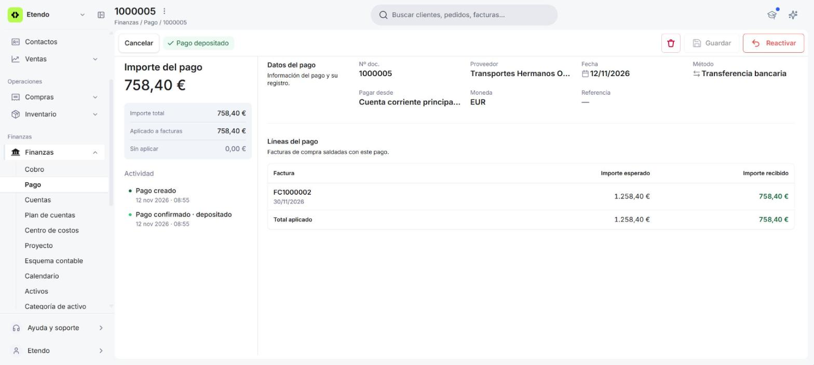

---
tags:
    - Tesorería
    - Pagos
    - Etendo
---

# Registrar un pago

Un pago registra el dinero que entregas a un proveedor por una o más facturas de compra. En Etendo, el pago siempre se crea desde la factura — Etendo lo asocia automáticamente al documento de origen — y queda visible tanto en el detalle de esa factura como en la vista global **[Tesorería > Pago](https://app.etendo.ai/payment-out){target="_blank"}**.

## Crear el pago desde una factura de compra

1. Abre la factura de compra a la que quieres registrar el pago.
2. Haz clic en **Añadir pago**.
3. Se abre el modal **Nuevo pago**. Completa los campos:

    | Campo | Qué introducir |
    |---|---|
    | **Importe** | Se autocompleta con el importe pendiente de la factura. Puedes ajustarlo si realizas un pago parcial. |
    | **Fecha** | Fecha del pago. |
    | **Método de pago** | Efectivo, Recibo, Tarjeta o Transferencia bancaria. |
    | **Cuenta** | Cuenta bancaria o caja desde la que se realiza el pago. Las opciones dependen del método elegido. |

4. Si el proveedor tiene saldo a favor o crédito disponible, aparece la sección **Saldo a favor y crédito disponible**: marca la casilla de cada uno que quieras aplicar, total o parcialmente.
5. Haz clic en **Igualar** (si aparece) para ajustar el importe y que la diferencia quede en 0,00 €. Revisa el bloque **Total factura / Dinero / Aplicado / Diferencia** para verificarlo.
6. Haz clic en:
    - **Guardar** — el pago queda en estado **Borrador** (sin impacto en caja ni en el saldo de la factura).
    - **Confirmar** — el pago pasa a estado **Pago depositado** y reduce el saldo pendiente de la factura.

## Confirmar un pago desde la vista global

Si guardaste un pago en borrador y quieres confirmarlo más tarde:

1. Ve a **Tesorería > Pago**.
2. Busca el pago por número de documento, fecha o proveedor. Puedes filtrar por **Borrador** en el desplegable de estados.
3. Haz clic sobre la fila para abrir el detalle.
4. Revisa los campos del pago:

    | Campo | Descripción |
    |---|---|
    | **Nº doc.** | Número del pago asignado por Etendo |
    | **Proveedor** | Proveedor al que se realiza el pago |
    | **Fecha** | Fecha del pago |
    | **Método** | Método de pago seleccionado |
    | **Pagar desde** | Cuenta bancaria o caja desde la que se paga |
    | **Moneda** | Moneda de la transacción |
    | **Referencia** | Referencia externa opcional |

5. Haz clic en **Confirmar**. El estado pasa a **Pago depositado**.

## Reactivar un pago

Si necesitas corregir un pago ya confirmado, puedes revertirlo siempre que no esté conciliado:

1. Abre el pago desde **Tesorería > Pago**.
2. Haz clic en **Reactivar**. El pago vuelve a estado **Borrador**.
3. Realiza los cambios necesarios y vuelve a confirmar.

!!! warning "Pagos conciliados"
    Un pago en estado **Conciliado** no se puede reactivar directamente. Primero debes desconciliarlo desde la conciliación bancaria.

## Pagos en moneda extranjera

Si la factura está en una moneda distinta a la de tu organización (por ejemplo, USD), el pago se registra en esa misma moneda. En el detalle del pago, el panel izquierdo muestra el importe en esa moneda:

- El importe en la moneda original (p. ej. `$460,00`).

---

## Artículos Relacionados

- [¿Qué son las vistas Cobro y Pago?](../que-es-cobros-y-pagos/que-es-cobros-y-pagos.md)
- [Registrar un cobro](../como-registrar-un-cobro/como-registrar-un-cobro.md)
- [Gestionar pagos y cobros](../como-gestionar-pagos-y-cobros/como-gestionar-pagos-y-cobros.md)
- [Conciliar o desconciliar movimientos contra documentos](../como-conciliar-o-desconciliar-movimientos-contra-documentos/como-conciliar-o-desconciliar-movimientos-contra-documentos.md)

---
Esta obra está bajo la licencia :material-creative-commons: :fontawesome-brands-creative-commons-by: :fontawesome-brands-creative-commons-sa: [CC BY-SA 2.5 ES](https://creativecommons.org/licenses/by-sa/2.5/es/){target="_blank"} de [Futit Services S.L](https://etendo.software){target="_blank"}.
