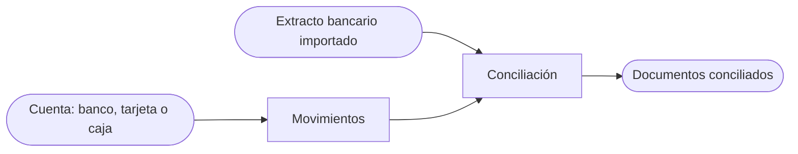

---
tags:
    - Tesorería
    - Cuentas
    - Cobros y pagos
    - Etendo
---

# ¿Qué es la sección Tesorería?

La sección **Tesorería** es donde Etendo centraliza el dinero de tu empresa: tus cuentas de banco, tarjeta y caja, todo lo que entra y sale de ellas, la conciliación contra tu banco, el seguimiento global de cobros y pagos, y las condiciones de pago con las que se calcula el vencimiento de cada factura.

Cada cuenta mantiene su propio saldo y su propio historial. Cuando conectas un banco o importas su extracto, Etendo compara esas líneas contra tus movimientos, pagos y cobros, y te permite conciliarlos —a mano o de forma automática— para que el saldo de la cuenta siempre coincida con el del banco.

## Qué incluye esta sección

- **Cobro** y **Pago** — el listado global de cobros a clientes y pagos a proveedores de todas tus cuentas, más allá de una cuenta en particular.
- **Cuentas** — el listado de todas tus cuentas (bancos, tarjetas y cajas), con su saldo, su moneda y sus pendientes de conciliar. Desde aquí das de alta cuentas nuevas y accedes al detalle de cada una.
- **Extracto bancario** — los archivos de extracto que importas para una cuenta, línea por línea, o que descargas para tu propio registro.
- **Conciliación bancaria** — el cruce entre las líneas del extracto y tus movimientos, pagos y cobros, con sugerencias automáticas (**Automatch**), reglas de matcheo para casos recurrentes, y conciliación manual.
- **Condiciones de pago** — los plazos que das a tus clientes o que te dan tus proveedores, con los que Etendo calcula cuándo vence cada factura.

## Recursos y próximos pasos

Para empezar a operar, da de alta tu primera cuenta desde [Añadir y configurar un banco, tarjeta o caja](../como-anadir-y-configurar-un-banco-tarjeta-o-caja/como-anadir-y-configurar-un-banco-tarjeta-o-caja.md). Si tu banco lo permite, puedes conectarla directamente en lugar de introducir los movimientos a mano.

---

## Artículos Relacionados

- [Añadir y configurar un banco, tarjeta o caja](../como-anadir-y-configurar-un-banco-tarjeta-o-caja/como-anadir-y-configurar-un-banco-tarjeta-o-caja.md)
- [Gestionar pagos y cobros](../como-gestionar-pagos-y-cobros/como-gestionar-pagos-y-cobros.md)
- [¿Qué es la conciliación bancaria en Etendo?](../que-es-la-conciliacion-bancaria-en-etendo/que-es-la-conciliacion-bancaria-en-etendo.md)
- [Glosario de Tesorería](../glosario-de-tesoreria/glosario-de-tesoreria.md)

---
Esta obra está bajo la licencia :material-creative-commons: :fontawesome-brands-creative-commons-by: :fontawesome-brands-creative-commons-sa: [CC BY-SA 2.5 ES](https://creativecommons.org/licenses/by-sa/2.5/es/){target="_blank"} de [Futit Services S.L](https://etendo.software){target="_blank"}.
